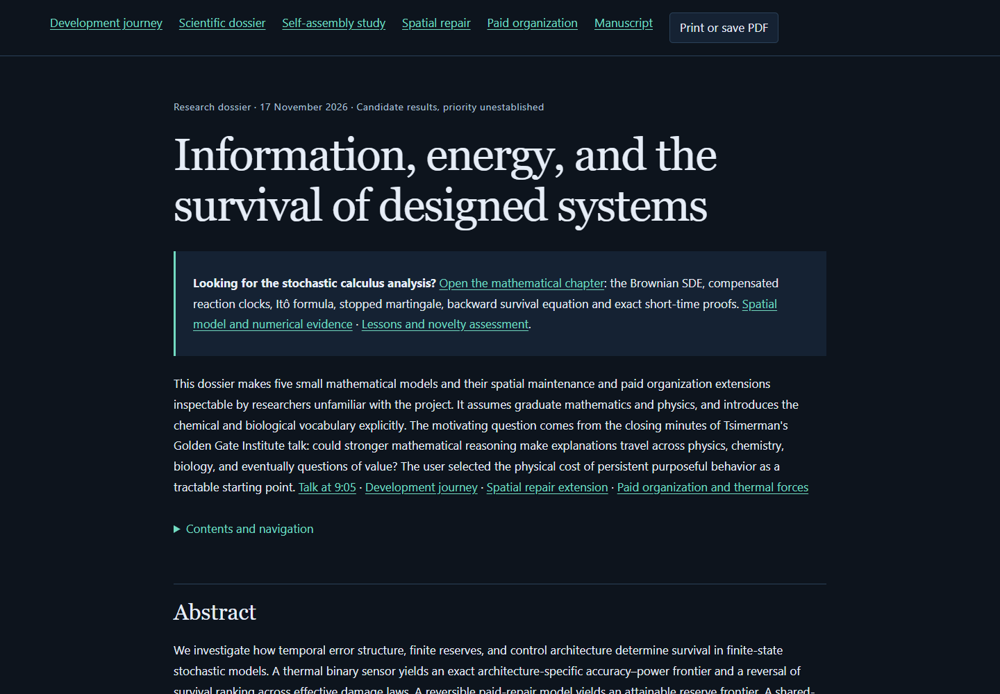
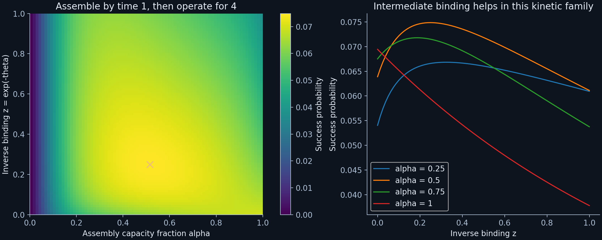
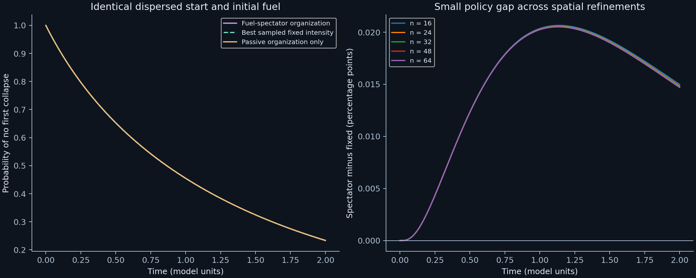
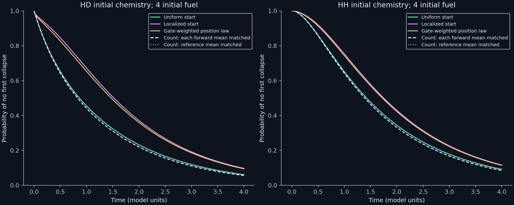

# Finite Reserve Survival

[**Open the live scientific dossier**](https://az9713.github.io/finite-reserve-survival/) · [Spatial repair: proofs and evidence](https://az9713.github.io/finite-reserve-survival/docs/SPATIAL-REPAIR.html) · [Development journey](https://az9713.github.io/finite-reserve-survival/docs/DEVELOPMENT-JOURNEY.html) · [Studies 01–05 paper draft](https://az9713.github.io/finite-reserve-survival/results/research-manuscript.pdf)

**[Stochastic calculus analysis: SDEs, Itô formula, martingales and survival proofs](https://az9713.github.io/finite-reserve-survival/docs/STOCHASTIC-CALCULUS.html)**

**[Paid autonomous spatial organization: shared fuel, best constant intensity and certificates](https://az9713.github.io/finite-reserve-survival/docs/PAID-ORGANIZATION.html)**

[](https://az9713.github.io/finite-reserve-survival/)

Five stochastic models track how sensing, action, and repair affect the chance that a physical device keeps functioning. The strongest results are exact survival bounds with attaining policies and a certified example in which the value of sensing changes with the time horizon.

| Study | Finding | Significance |
|---|---|---|
| Thermal sensing | Two sensors with 80% stationary accuracy reverse their survival ranking when the damage mechanism changes. | Accuracy misses the timing of errors. Clustering can matter as much as frequency. |
| Paid repair | For a fixed energy quantum, the stress-count distribution gives a sharp survival frontier. With a known stress count and a fixed total reserve, equal repair quanta attain the optimal bound. | The model gives an exact energy requirement for a target survival probability within its protocol. |
| Shared reserve | Adaptive sensing achieves **87.5%** survival after two rounds versus **75%** for the best fixed sensing schedule. The advantage begins above **two-thirds** readout accuracy in this example. | A measurement can be worth paying for in a full battery state and wasteful in a depleted one. |
| Autonomous reactions | At time four, reserve-dependent sensing attains **53.38%** survival. Every constant sensing intensity in the specified comparator class is bounded above by **50.63%**. The best binary circuit for the asymptotic decay rate leaves sensing off. | Optimizing survival at a deadline can select a different architecture from optimizing the long-run decay rate. |
| Self-assembled repair | A closed six-species network constructs active complexes from monomers and uses them to repair damaged complexes. Its globally optimized formation-and-maintenance probability lies between **7.486803% and 7.496801%**, with every boundary design below **7.296462%**. | An intermediate binding strength and a split between assembly and repair capacity are provably optimal within this static kinetic family. |

## Candidate contributions

- A sharp net-resource bound **N ≥ k + r** for forming k complexes and performing r net fuel-consuming repairs, with an attaining path for k ≥ 2.
- An analytic sharp allocation optimum for one complex, and a **globally certified interior optimum** for two complexes over a continuous two-parameter design square. A rational construction comes within **0.01 percentage points** of the optimum.

- An exact long-run comparison against **every precommitted sensing schedule** in the two-unit checkpoint model, including an explicit switch in the best fixed strategy at repair success probability **2 − √2**.
- The exact **two-thirds** sensing accuracy threshold for a strict two-round feedback advantage in the symmetric instance.
- A rationally certified continuous-time benchmark that separates reserve-dependent sensing from a full continuum of constant sensing intensities, alongside a separate asymptotic comparison over binary circuits.

The [targeted literature review](https://az9713.github.io/finite-reserve-survival/research/priority-search-2026-11-17.md) found related work in costly sensing, energy harvesting, and autonomous information thermodynamics. It identified no exact match for the stated results. Literature priority and independent review remain open.

Tsimerman’s Golden Gate Institute talk motivated the project. The models connect microscopic energetics and temporal information to operational survival. The autonomous example uses a maintained fuel reservoir and designed reaction gates. Study 05 adds an abstract chemical self-assembly and maintenance model. A molecular realization, replication, and heredity remain open.

## Self-assembly study and evidence

[Read the complete study](https://az9713.github.io/finite-reserve-survival/docs/SELF-ASSEMBLY.html) · [Global certificate](results/assembly.json) · [Certificate replay](results/assembly-certificate-check.json) · [Independent simulation](results/assembly-evidence.json) · [Literature comparison](research/assembly-literature.md)

The assembly-and-maintenance result uses two copies of each complementary monomer, four fuel molecules, formation by time one, and four time units of operation after formation. The bounds cover every static design in the specified square. The independent simulation uses 30,000 attempts. Every molecule remains inside the compartment, with a heat bath providing thermal fluctuations.

[](https://az9713.github.io/finite-reserve-survival/docs/SELF-ASSEMBLY.html)

Intermediate binding optima and fuel-driven chemical persistence have earlier theoretical and experimental precedents. The candidate contribution is the particular finite-inventory reliability model, its constructive resource bound, and the replayable continuum certificate. Priority remains open.

## Paid autonomous organization: small finite-grid advantage

The new model starts uniformly dispersed and can activate an attractive interaction mode through reversible passive and fuel-paid reactions. Organization and repair share the same four-molecule fuel/waste inventory. The candidate uses spectator-fuel catalysis; the comparator covers **every constant paid-channel intensity alpha in [0,1]**, with the same other parameters, initial preparation and kinetic ceilings. This is not a comparison against every fixed material or architecture.

At the preregistered time two, an independent interval calculation on the **48³ lattice** encloses the candidate's gap to the best constant arm between **0.01460412 and 0.01471414 percentage points**. The 64³ numerical survival estimates are **23.36998%** for the candidate and **23.35528%** for the fixed attaining sample. The best constant supremum is enclosed, rather than assumed from a grid search. The effect is small and has no rigorous Brownian-continuum error enclosure.

[](https://az9713.github.io/finite-reserve-survival/docs/PAID-ORGANIZATION.html)

Verification includes **57 passing tests**, six certified finite grids, 60,000 independent exact lattice paths, 180,000 separate finite-step continuum SDE paths, stopped fuel/energy ledgers and optimizer controls. The path precision cannot resolve the tiny gap; its sign is certified for the stated finite models. The coarsest lattice reverses the comparison. Removing the attractive well makes the candidate lose on the tested grid; a specified open-bath limit exactly matches a fixed-family member. These controls and all limitations are retained.

[Originality audit](research/organization-originality-audit.md) · [Preregistration](research/organization-preregistration.md) · [Global finite-grid certificate](results/organization-verification.json) · [Continuum check](results/organization-continuum-check.json) · [Independent review](results/organization-review.json) · [Proofs and visuals](https://az9713.github.io/finite-reserve-survival/docs/PAID-ORGANIZATION.html)

The audit records 29 queries and 26 sources. No new general concept or established publication priority is claimed. The model does not establish an elementary molecular implementation or account for unverified real fabrication costs. It is a constrained benchmark of when paid organization can improve survival.

## Implemented spatial repair benchmark

[What we learned, what is not novel, and the next research claim](https://az9713.github.io/finite-reserve-survival/docs/SPATIAL-LESSONS.html)

[](https://az9713.github.io/finite-reserve-survival/docs/SPATIAL-REPAIR.html)

[Read the live model, proofs and illustrated results](https://az9713.github.io/finite-reserve-survival/docs/SPATIAL-REPAIR.html) · [Numerical data](results/spatial-repair.json) · [Independent verification](results/spatial-repair-verification.json) · [Originality audit](research/spatial-repair-originality-audit.md)

Two preassembled complexes now diffuse in a periodic cube, change between healthy and damaged states, and exchange a finite inventory of fuel and waste through reversible repair. Each reversible edge of the well-mixed comparator is calibrated to the uniform-start forward encounter mean, preserving its equilibrium ratio without fitting survival.

For the exploratory four-fuel case starting with one healthy and one damaged complex, the largest sampled survival difference from this calibrated count model is **1.340 percentage points** for a uniform start, **23.208 points** for a localized start, and **21.354 points** for a gate-weighted start. At time four, localized spatial survival is **9.718%**, compared with **5.606%** for the count model. Localization preserves information that these calibrated rates discard.

Evidence includes four spatial refinements (32, 48, 64 and 96 points per axis), independent continuous-space Brownian paths, detailed-balance and energy-ledger checks, and independently assembled dense and spherical references. The report separates exact mathematical statements, numerical truncation bounds, observed spatial convergence and sampling confidence. It does not claim a rigorous continuum error enclosure.

The spatial-study receipt records **51 passing tests**; the later organization release has 57. The formal 200,000-path verification gives a **99% simultaneous lower bound of 22.24 percentage points** on the localized HD survival gap from the fixed finest-grid-calibrated count comparator. Another 200,000 fresh-seed paths are retained in a [separate review receipt](results/spatial-repair-review-check.json). [Browser validation](results/spatial-repair-ui-validation.json), [delivery manifest](results/spatial-repair-delivery-manifest.json) and [integrity replay](results/spatial-repair-integrity.json) preserve the evidence. The existing manuscript/PDF covers Studies 01–05; the spatial reports are separate extensions.

**Novelty status:** the audit identifies direct precedents for spatial detailed balance, diffusion-calibrated rates and rebinding effects. This finite-inventory first-collapse benchmark is a targeted numerical extension; no new general concept is established. Self-assembly, a molecular realization and an adaptive spatial controller remain outside this maintenance-only model.

## Stochastic calculus: implementation plan and feasibility check

[Read the live illustrated implementation plan](https://az9713.github.io/finite-reserve-survival/docs/STOCHASTIC-CALCULUS-PLAN.html) · [Plan source](docs/stochastic-calculus-plan.md) · [Prior-art comparison](research/stochastic-calculus-prior-art.md) · [Calculation receipt](results/encounter-feasibility.json) · [Full-suite verification](results/encounter-verification.json)

The plan motivated the implemented spatial maintenance benchmark above. Its separate classical calculation gives a **2.037 s** mean encounter time for an illustrative 5 nm target in a 1 μm³ compartment, using a measured GFP diffusion coefficient as a tracer-scale anchor. With an assumed independent 1 s⁻¹ closure rate, exact capture probability is **32.9294%**, versus **32.9276%** for a matched-mean exponential model. Starting 1 nm outside the capture surface instead gives **88.6561%**. These dimensional tracer values are not a calibration of the new chemical model.

These are classical diffusion calculations, not a new discovery or a calibrated biological repair model. The planning package includes derivations, two figures, an independent boundary-value check, and desktop/mobile HTML validation. Spatial maintenance is now implemented; spatial self-assembly and a new general survival theorem remain open.

## Reproduce

Python 3.10+ with numpy, scipy, and matplotlib. PDF export additionally uses reportlab.

```bash
python -m pip install -e .
python -m pip install reportlab
PYTHONPATH=src python -m unittest discover -s tests -v
python scripts/run_study.py --samples 30000
python scripts/build_artifacts.py
python -B scripts/run_assembly.py
python -B scripts/assembly_evidence.py
python -B scripts/check_assembly_certificate.py
```

`run_study.py` writes exact results, seeded event-driven simulations, 144 transfer cases, 1,875 sampled sensor designs at three horizons, figures, and environment/source provenance. `build_artifacts.py` builds the offline HTML and PDF. No external data or credentials are needed to reproduce calculations. Cached literature PDFs are excluded from git; source URLs and hashes remain available.

## What the theory does and does not establish

Study 01 tracks sensor work and heat under local detailed balance, with a power frontier restricted to its architecture and kinetic ceiling. Its effective damage/reset layer omits repair work. Later studies supply explicit repair and resource models. Study 05 has a closed finite-inventory species model with an exact equilibrium weight, a pathwise ledger, and a declared first-passage failure rule. Molecular realization and biological validation remain open.

The studies connect physical kinetics and energetic constraints to **temporal error structure** and task-dependent survival. Studies 02–04 add paid repair, a shared reserve, and autonomous reversible channels. A finite battery in the latter studies limits storage while an explicitly supplied external source replenishes it. Study 05 adds self-assembly with finite chemical inventories and exact detailed balance. Molecular realization and biological validation remain open. The dossier distinguishes each study's boundary and comparator class.

To rebuild the original dossier, install `markdown` and run `python -B scripts/build_research_docs.py`. This reruns the current scientific test suite and records source hashes. The earlier chemical-study receipt contains 38 tests; the spatial verification now contains 51. The HTML equations use the bundled, licensed KaTeX files and work offline. `scripts/build_manuscript.py` additionally uses `pypandoc_binary` and Tectonic to build the LaTeX/PDF and submission-source archive. See `results/dossier-ui-validation.json` for the original dossier's browser and link checks. Reproduce the spatial study with `run_spatial_repair.py`, `verify_spatial_repair.py`, and `build_spatial_repair_docs.py` in `scripts/`.
