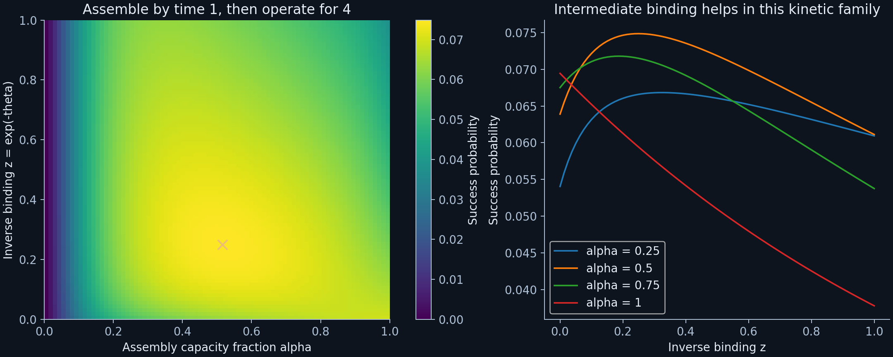

## 10. Making the organization itself emerge

The next request asked for a system that assembles and maintains its own organization, with proof and evidence through publication. Study 05 begins with free complementary monomers and a finite inventory of fuel. The functional complex must form through a chemical association reaction. An existing functional complex can then catalyse fuel-consuming repair of a damaged complex. Every enabled channel keeps its reverse, and waste stays in the compartment.

The first checks established conserved inventories and exact detailed balance, including the factorial entropy of molecule counts. A pathwise identity then gave the resource bound \(N\ge k+r\) for \(k\) assembled complexes and \(r\) net repairs. An explicit sequence of assembly followed by damage–repair cycles attains that count for \(k\ge2\). A one-complex reduction supplied a closed-form success probability and the exact maximizing static assembly rate.

An early objective counted devices that had assembled and remained functional at a common final time. Numerical exploration showed that this could reward delaying formation. The retained benchmark requires formation by a deadline followed by a full specified operating lifetime. The two event probabilities are defined and derived separately in the scientific study.

The first exploratory optimizer also exposed an implementation issue: converting arbitrary floating-point parameter proposals into exact fractions produced integer denominators too large for the certificate representation. Floating exploration now evaluates the full generator directly, while certification uses explicitly rational points. The corresponding implementation paths are cross-checked in the tests.

The two-complex example has four fuel molecules. Numerical exploration located an intermediate-binding candidate. Rational probability enclosures and derivative bounds then covered the full real parameter square, giving an optimum between 0.07486803 and 0.07496801. Every boundary design is bounded above by 0.07296462. This proves an interior optimum in this kinetic family. A separate single-complex theorem shows that stronger binding is always beneficial there, which identifies the importance of the additional cooperative organization.

An independent six-channel Gillespie implementation ran 30,000 seeded attempts. Its success estimate of 0.0743 agrees with the exact value for its chosen rational design. It retained successful paths with fuel-consuming repair and verified the molecule and energy ledgers at every jump. A separate replay checks every saved rational point, rectangle partition, and interpolation inequality against the source equations and independent matrix exponentials.

The literature search found extensive earlier work on intermediate binding strength, finite-particle assembly times, fuel-driven persistence, and chemical self-replication. The study therefore presents a candidate model-specific benchmark with exact accounting and a certified continuum optimum. Its relevance to the chemistry-to-biology question is the formation of functional components that enable subsequent maintenance. Molecular implementation, replication, and hereditary variation remain open.

The current publication package includes this development history, the complete Study 05 proofs, five new figure sets, an expanded manuscript, the reaction-network code, a certificate tree, its replay receipt, and the stochastic evidence. [Read Study 05](SELF-ASSEMBLY.html) · [Literature comparison](../research/assembly-literature.md) · [Certificate replay](../results/assembly-certificate-check.json)
