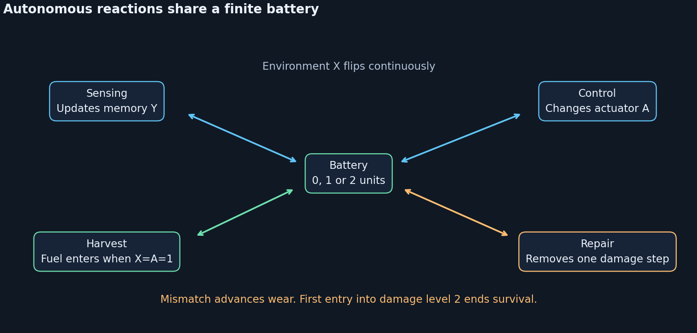
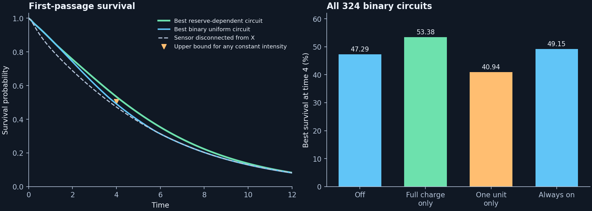
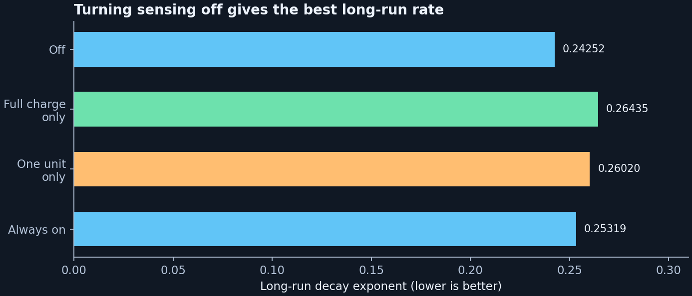

# Study 04 — Clock-free survival with a shared reserve

**Reserve-dependent sensing improves finite-time survival in this autonomous
model. Its advantage does not extend to the best asymptotic decay rate of
the same benchmark.** The model is a continuous-time Markov jump process
with fixed reaction barriers. Sensing, control, and repair each consume a
unit of the same battery when they run forward. Correct control opens an
external fuel channel. All enabled reactions have finite, positive reverse
rates.

## 1. Autonomous reaction network



A state is \(s=(b,x,y,a,d)\). The battery \(b\) runs from 0 to capacity \(C\).
The environment \(x\), sensor memory \(y\), and actuator \(a\) are binary.
Damage \(d\) takes values 0, 1, and 2. Define failure as the **first entry
into \(d=2\)**. A device at \(b=0\) can still operate if the available
reactions allow it.

In units of \(k_BT\), let \(\epsilon\) be the energy of a battery unit,
\(\delta\) the energy released by one step of damage, and \(\mu\) the
chemical work available from one unit of fuel. Use \(0\le\delta<\epsilon<\mu\)
and internal energy \(E(s)=b\epsilon-d\delta\). All other states have
degenerate energies. Each enabled edge has a forward rate \(k_+\).
The reverse rate is fixed by local detailed balance,

\[
 \log(k_+/k_-)=W-\Delta E,\qquad
 \Delta E=E(s')-E(s),
\]

where \(W\) is the chemical work supplied to the device on the forward
jump. The right-hand side is the heat released to the bath in units of
\(k_BT\). Signs reverse on a backward jump.

| Forward channel | Condition and state change | Bath heat on forward jump |
|---|---|---:|
| Environment | \(x=0\to1\), independent of the other bits | \(0\) |
| Sense | \(b\ge1,\ y\ne x\). Set \(y=x\) and spend one unit | \(\epsilon\) |
| Control | \(b\ge1\). Move \(a\) toward the circuit's selected target and spend one unit | \(\epsilon\) |
| Harvest | \(x=a=1,\ b<C\). A fuel conversion increases \(b\) by one | \(\mu-\epsilon\) |
| Wear or terminal damage | \(x\ne a\). Increase \(d\) by one | \(\delta\) |
| Repair | \(d=1,\ b\ge1\). Return to \(d=0\) and spend one unit | \(\epsilon-\delta\) |

The state can change by any enabled reaction at any time. There is no phase
variable, externally prescribed pulse, or checkpoint in the physical
dynamics. \(x\) is a thermal switch with equal flip rates. The only supplied
work during operation is the explicitly priced harvest reaction, powered by
a fuel reservoir at fixed chemical potential. Its reverse returns chemical
work and removes a battery unit. The static gates represent a choice of
barriers at fabrication. They multiply both directions of a channel at
once. For example, the reverse of a paid correction restores a battery unit
and turns a correct sensor into an incorrect one. A reverse repair can
create damage while replenishing the reserve. Reactions remain microscopically
reversible even at \(d=2\), but trajectories are stopped there for the
first-passage question.

This is an autonomous **open** system. The fuel reservoir is maintained
outside the device, and the initial battery and actuator position are
prepared. Fabrication and maintaining the ambient fuel concentration are
outside the initial operating-reserve bound.

### Which circuits can compete?

The binary circuit class chooses for each funded level \(b=1,\ldots,C\)
whether to enable sensing at its full reference rate. The actuator circuit
chooses one of three settings at each funded pair \((b,y)\): disable
forward movement, target 0, or target 1. It never receives \(x\) directly.
Each setting indexes the **higher battery endpoint** of the reversible edge,
so the corresponding return path is always retained. A circuit's rates
depend on its actual current state, with no access to elapsed time.

The fixed-sensing comparator has the same actuator truth tables. Its
sensing activity is identical at every funded level. We compare with both
binary choices and every constant intensity \(\alpha\in[0,1]\), where
\(\alpha\) multiplies both sensing rates. The latter is a larger comparator
class than the binary family. The sharp adaptive optimum below is for
binary sensing gates and the stated actuator tables.

## 2. Sharp survival bound

For each circuit \(c\), retain states with \(d<2\). The row subgenerator
\(Q_c\) has all live transition rates, and its diagonal retains the outgoing
rate into \(d=2\). Let \(\pi_b\) initialize the battery at \(b\), draw \(x\)
uniformly, and set \(y=a=d=0\). Then

\[
 S_c(T,b)=\pi_b e^{TQ_c}\mathbf1,\qquad
 S^*(T,b)=\max_{c\in\mathcal C}S_c(T,b).
\]

The first identity follows from the killed forward equation. The finite
class \(\mathcal C\) has \(2^C3^{2C}\) circuits. Enumerating that class gives
an exact bound and its matching construction: install a circuit that
attains the maximum. The construction fixes all its rate barriers before
launch. Evaluating a different horizon can select a different circuit.
There is no switching between circuits during operation. Random selection
of a circuit before launch cannot beat the largest value.

A separate maximization over the outgoing rates from each live state would
allow the reverse of an edge to be set independently of its forward rate.
That relaxation could violate local detailed balance. The exact enumeration
keeps every forward–reverse pair linked.

### Certification with integer arithmetic

The benchmark uses rational rates. Choose a common uniformization rate
\(\Lambda\) at least as large as the largest exit rate, and put
\(P_c=I+Q_c/\Lambda\). Each \(P_c\) is nonnegative and substochastic. Expanding
the matrix exponential gives

\[
 S_c(T,b)=e^{-z}\sum_{k=0}^\infty\frac{z^k}{k!}\,\pi_bP_c^k\mathbf1,
 \qquad z=\Lambda T .
\]

The Poisson series is a mathematical way to evaluate a continuous-time
chain. \(\Lambda\) is not a physical device clock.

For rational \(T\), write \(w_k=z^k/k!\) and \(Z_L=\sum_{k=0}^Lw_k\).
If \(L+2>z\), the omitted unnormalized tail is at most
\(R_L=w_{L+1}/(1-z/(L+2))\), by a geometric comparison. Hence each retained
normalized weight lies between \(w_k/(Z_L+R_L)\) and \(w_k/Z_L\), and
the normalized tail is at most \(R_L/Z_L\). The code rounds those rational
bounds outward to an integer grid. It also propagates lower and upper
vectors for \(P_c^k\mathbf1\) with floor and ceiling division. Nonnegative
matrix entries preserve componentwise bounds at every power. Every
uncomputed survival factor is at most one. Summing the rounded products
and adding the tail to the upper bound certifies the survival
probabilities. The benchmark compares integer numerators on a common
denominator. It isolates the winning circuit even after every competitor
receives its upper bound.

## 3. Finite-time adaptive advantage survives



Use capacity two, \((e^\epsilon,e^\delta,e^\mu)=(8,2,128)\), and forward
rates

| Environment | Sense | Control | Harvest | Wear | Terminal damage | Repair |
|---:|---:|---:|---:|---:|---:|---:|
| \(1/2\) | \(11\) | \(21/2\) | \(17/4\) | \(5/2\) | \(5/2\) | \(21/4\) |

The rates are an example selected by exploratory numerical search. The
certificate applies to these exact rational parameters. Start full and
observe at \(T=4\). Each row below optimizes all 81 actuator truth tables.

| Sense at \(b=1\) | Sense at \(b=2\) | Best survival at \(T=4\), approximately |
|---|---|---:|
| Off | Off | 47.2884% |
| Off | On | **53.3766%** |
| On | Off | 40.9363% |
| On | On | 49.1504% |

The unique best binary circuit senses at full charge only. At one unit the
actuator targets the sensor reading. At full charge it targets 1 when
\(y=1\), while disabling forward actuation when \(y=0\). The winner's lower
bound exceeds the highest upper bound of the other 323 circuits. This is
an energy-reserve feedback rule implemented by static state-dependent
reaction pathways. For example, a correct update from \(b=2\) can leave
one unit for the commanded move, after which matching engagement opens
the fuel channel.

Optimizing all binary circuits at each starting reserve gives about
29.7976%, 36.9134%, and 53.3766% survival for zero, one, and two units,
respectively. Thus **two units, or \(2k_BT\log 8\), are necessary and
sufficient to reach 52% survival at \(T=4\)** within this class. The
certificate compares both smaller reserves directly, without assuming
that more initial charge always helps a given circuit.

### Against every constant sensing intensity

For one actuator table write \(Q_\alpha=Q_0+\alpha A\), where \(A\) is the
sensing generator with activity one. Duhamel's identity, differentiated
twice, expresses \(S''(\alpha)\) as two insertions of \(A\) between
substochastic semigroups, integrated over an ordered time simplex with
a factor of two. Their induced infinity norms are at most one, so

\[
 |S''(\alpha)|\le T^2\|A\|_\infty^2 .
\]

The linear interpolation error on an interval of width \(h\) is at most
\(T^2\|A\|_\infty^2 h^2/8\). Therefore, evaluate all 81 actuator tables on
the 257 nodes with \(h=1/256\), take the largest certified node upper
bound, and add the error allowance. The result bounds the whole continuum
by 50.6275%, below the adaptive winner's certified lower bound. Both classes use
the same actuator choices and bath accounting. The bounds also certify
strict separation for \(T\in[3.99,4.01]\). In any circuit,
\(-k_{\rm failure}\le\partial_T S\le0\), since the probability loss rate
is the current mass in the failure-enabled live states times their
terminal jump rate. Thus the certified gap at \(T=4\) can shrink by at
most \(0.025\) over this interval.

### Does the direct information channel matter?

In a separate comparison, remove the direct coupling \(x\to y\). An enabled
sensor now flips the memory independent of \(x\) at the same forward
reference rate, spends the same battery unit, and has the same reverse
heat. It can still use reserve-dependent gates, and the controller can
still use both reserve and \(y\). Endogenous correlations can remain.
Reoptimizing all 324 circuits of this comparison leaves the best
survival below the informative winner. Thus paying for an
environment-independent memory flip cannot explain the observed advantage.

## 4. The long-run separation does not transfer in this example



For any circuit, restrict \(Q_c\) to live states reachable from the launch
distribution. The live graph is connected on that set because every
internal edge has its reverse and the two launch states communicate by
the environment flip. Perron–Frobenius applied after a positive diagonal
shift of this irreducible Metzler matrix gives the real spectral
abscissa \(\lambda_c\), and
\(\lim_{T\to\infty}\log S_c(T,b)/T=\lambda_c\).

The numerical eigensolver only proposes a positive integer vector \(v\).
The certificate checks the following componentwise ratios in exact
rational arithmetic,

\[
 \min_i (Q_cv)_i/v_i\ \le\ \lambda_c\ \le\
 \max_i (Q_cv)_i/v_i .
\]

Indeed, if \(l v\le Q_cv\le u v\), positivity of the killed semigroup
sandwiches \(e^{tQ_c}v\) between \(e^{lt}v\) and \(e^{ut}v\).
Comparison of \(\mathbf1\) with constant multiples of \(v\) yields the same
exponential bounds on survival. The reachability restriction prevents
unreachable sensor states from supplying an artificial leading eigenvalue.

Among the 324 binary circuits, the optimized large-time exponent
\(-\lambda_c\) is about **0.24252027** and is attained with sensing off.
The best exponents with sensing enabled only at full charge, only at one
unit, or at both funded levels are about 0.26435182, 0.26019620, and
0.25318551, respectively. The exact intervals for all circuits with
some sensing lie strictly above the best off exponent. The unrestricted
binary optimum and the uniform binary optimum thus share the same
long-run decay rate. The continuum of constant sensing activities was
bounded for the finite-time comparison. The spectral comparison here is
for binary circuits.

## 5. Reproduce and read the evidence

```powershell
python scripts/run_autonomous.py
$env:PYTHONPATH = 'src'
python -B -m unittest discover -s tests -v
```

[Results and exact enclosure values](../results/autonomous.json) include the
winning gates, the best uniform-intensity enclosure, and the reachable
spectral intervals. Tests check every physical reverse edge and energy
ratio, compare the certified intervals with an independent matrix
exponential, and check spectral and interpolation enclosures. Continuous
autonomous information thermodynamics, uniformization, and spectral
comparison are established tools. The specific finite-time separation,
its information-channel comparison, and its loss at large time are
candidate contributions in this architecture. Literature priority is
unestablished. [Autonomous energy and information flows](https://arxiv.org/abs/2209.10644)
· [Rigorous Poisson truncation](https://web.stanford.edu/~glynn/papers/1988/FG88.html)
