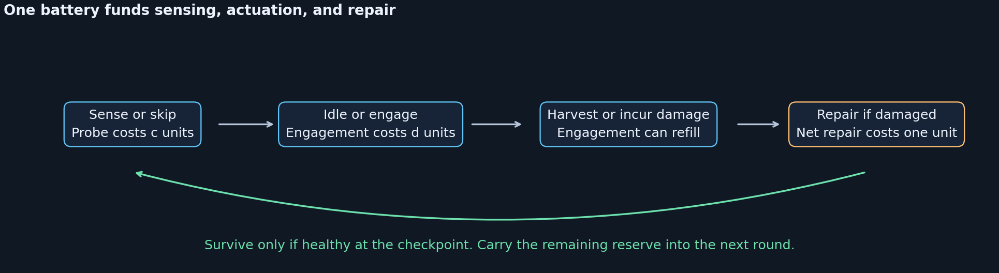
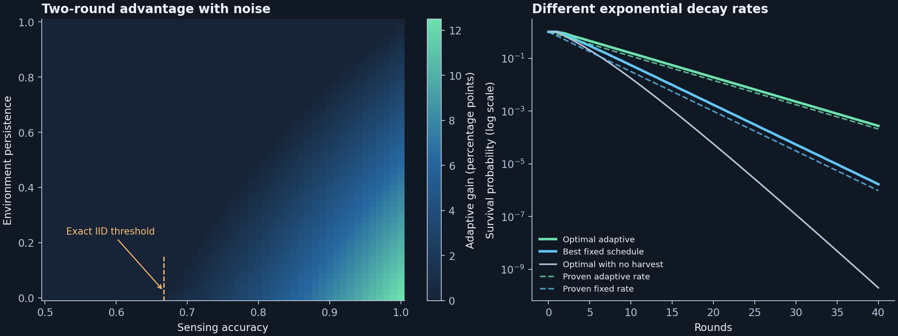
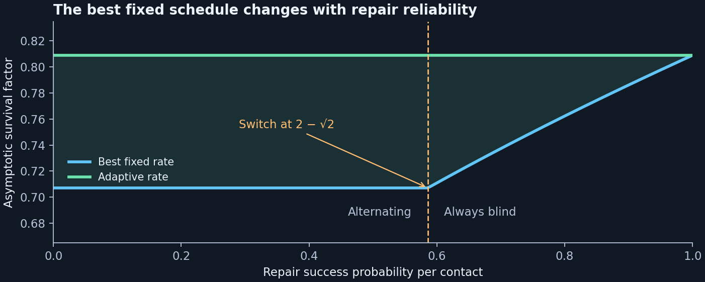

# Study 03 — Survival with shared energy and adaptive sensing

A finite battery funds sensing, actuation, and reversible repair. Correct
actuation can move work from a finite environmental packet back into the
battery. For the specified checkpoint architecture, we derive the **exact
survival probability attainable from each initial reserve**. We then give a
two-round family with a strict feedback advantage, an exact noise threshold,
and a case where feedback improves the exponential rate of survival over
**every** precommitted sensing schedule.

## 1. One reserve, with feedback through the environment



A healthy device starts a round with \(b\in\{0,\ldots,C\}\) units in its battery.
A unit has energy \(\epsilon k_BT\). The hidden binary environment \(X\) has
stationary probability \(q\) of state \(1\). That state makes a work packet
accessible to an engaged actuator. From one round to the next the transition
law is

\[
P(X=1\mid X_{\rm prev}=j)=q(1-\rho)+\rho j,\qquad j=0,1 .
\]

The launch prior is \(q\) when the previous state is unknown. The parameter
\(\rho\in[0,1]\) measures persistence. For \(0<q<1\) and \(0<\rho<1\), a thermal
two-state switch realizes this law by relaxing for time \(\Delta\) with total
rate \(-\log(\rho)/\Delta\) and energy gap \(k_BT\log((1-q)/q)\). The IID case
uses fresh equilibrium flags. The flag is held fixed from sensing through
repair. Endpoints with degenerate probabilities can be read as preparations
or limits of these switches.

1. **Sense or skip.** A probe pays \(c\ge1\) units into an isolated work
   receiver and reveals a bit \(Y\) with \(P(Y=X\mid X)=f\in[1/2,1]\).
2. **Idle or engage.** Idle is action \(A=0\), which has no work bill. Engagement
   is \(A=1\) and pays \(d\ge1\) units, regardless of the environment. This bill
   is due before any harvesting. If \(X=A=1\), transfer up to \(H\) units from
   the external packet into the battery, stopping at capacity. A match with
   \(X=A=0\) transfers nothing.
3. **Repair a mismatch.** The load permutes the degenerate damage bit by
   \(D\mapsto D\mathbin{\mathrm{XOR}}[X\ne A]\). During mismatch, the contact
   opens the reversible pair
   \((D=1,b,R=0)\leftrightarrow(D=0,b-1,R=1)\) for \(b\ge1\), with \(R\) a
   repair receipt. Forward repair releases \(\epsilon k_BT\) as heat. Its
   reverse absorbs the same heat, restores the battery unit, and clears the
   receipt. With a sum-of-rates ceiling \(\Gamma\) and contact duration \(\tau\),
   the maximum probability of ending this contact healthy is
   \(\kappa=(1-e^{-\Gamma\tau})/(1+e^{-\epsilon})\), as in Study 02.
4. **Check the damage bit.** The first damaged checkpoint ends operation.
   The experiment tolerates a healthy checkpoint at zero reserve. On a
   surviving path the work receipts reveal the previous \(X\) by \(X=A
   \mathbin{\mathrm{XOR}} R\). This reveals past conditions through the
   consequences of action, with current conditions hidden until the next
   probe or checkpoint.

### Microscopic accounting and admissible control

A powered gate can be an ideal energy-conserving swap on the device plus its
work registers. For example, with an initially empty sensing receiver \(w_s\),
an energy-degenerate readout bit \(y=0\), and a noise bit \(e\) with
\(P(e=1)=1-f\), swap the two states

\[
(b,w_s=0,y=0,X,e)\leftrightarrow
(b-c,w_s=c,y=X\mathbin{\mathrm{XOR}}e,X,e).
\]

Each allowed pair preserves total energy and the non-overlapping receiver
levels make the transformation reversible. The engagement bill can be
transferred by the corresponding swap with the actuation receiver. Its
nonzero level is the action receipt. The harvest swap retains the residual
packet energy, so the reverse is well defined even when capacity clips the
transfer. The two-state noise bit can have a thermal bias with gap
\(k_BT\log(f/(1-f))\), and serves only as an unchanged control. After the
action, the same XOR uncomputes \(Y\) from the preserved \(X,e\) and the probe
receipt. The ideal perfect probe uses \(e=0\). Repair rates have ratio
\(k_+/k_-=e^\epsilon\), consistent with the energy difference of the full
repair pair. Work receivers retain their records. No step erases an unknown
readout or automatically recharges a spent battery.

On each surviving round the pathwise ledger, in units of \(\epsilon k_BT\), is

\[
b'=b-c\,\mathbf1_{\rm probe}-d\,\mathbf1_{\rm engage}
  +h_{\rm admitted}-\mathbf1_{\rm repaired}.
\]

Repeated forward and reverse repair jumps cancel except for the final net
transition. Lost reserve moves into the work receivers or the bath. Admitted
work comes from the explicit packet, and rejected work remains there.
The two powered gates have prescribed positive work bills. These are
properties of the stipulated task hardware.
Externally supplied components are the phase clock, prepared receivers and
receipt registers, thermal flags, and packets. The bound below is on the
initial **operating battery** given those resources. It imposes no price on
building the apparatus or on maintaining the clock and receipts. The
controller has access to reserve and receipts, and has no current \(X\)
input except the paid readout. The environment still couples physically to
the actuator and damage gate. The IID proofs need no previous-state receipt
in the control policy.

## 2. Sharp survival frontier and attaining control

Let \(V_n(j,b)\) be the best survival probability with \(n\) rounds left, prior
index \(j\), and reserve \(b\). Index \(j=\ast\) denotes a stationary launch.
The base is \(V_0=1\). For any nonnegative continuation \(v(j,b)\), define
\(G_v(x,a,r)\) for the paid or unpaid battery \(r\) immediately before
actuation. Action \(a\) is admissible when \(r\ge da\). Let \(z=r-da\).
The four live-outcome rules collapse to

\[
G_v(x,a,r)=
\begin{cases}
v(x,\min(C,z+aH)) & x=a,\\
\kappa\,v(x,z-1) & x\ne a,\ z\ge1,\\
0 & x\ne a,\ z=0.
\end{cases}
\]

Write \(p_j(x)\) for the current prior and \(L_f(y\mid x)\) for the symmetric
readout likelihood. Maxima range only over affordable actions. The exact
Bellman update is

\[
\begin{aligned}
B_v(j,b)&=\max_a\sum_x p_j(x)G_v(x,a,b),\\
P_v(j,b)&=\sum_y\max_a\sum_x p_j(x)L_f(y\mid x)G_v(x,a,b-c),\quad b\ge c,\\
V_{n+1}(j,b)&=\max\{B_{V_n}(j,b),P_{V_n}(j,b)\}.
\end{aligned}
\]

Omit the probe option when \(b<c\). The max in the blind branch comes
before knowing \(X\). In the probe branch, the max occurs separately for each
observation. These are joint probabilities of \((x,y)\), so no division by
a possibly zero observation probability is needed.

**Proof of both directions.** Given a mismatch, every permitted contact
schedule ends healthy with probability at most \(\kappa\). Its only live
outcome has the same battery and inferred \(x\), irrespective of the contact
schedule. The maximum-rate contact thus dominates for every nonnegative
continuation. Once a round survives, the next prior depends only on its
inferred \(x\) and the remaining battery. Conditioning on the available
information bounds each possible decision by the corresponding maximum.
Induction from \(V_0=1\) bounds arbitrary history-dependent or randomized
controllers. Conversely, store the maximizing mode and action for each
entry of the table and use the maximum-rate repair contact. Every step of
the induction attains equality. The adaptive frontier uses \(O(NC)\) time
and space. Monotonicity in \(b\) follows by induction since the live branch
maps are nondecreasing in remaining reserve and additional reserve only
adds affordable actions. For target \(\eta\), invert \(V_N\) over
\(b=0,\ldots,C\) to obtain an exact minimum initial battery or infeasibility.

### A strong fixed-schedule comparator

A fixed sensing schedule is any length-\(N\) binary word chosen before the
first round. It still gets optimal feedback for actuation, including the
current readout on scheduled probe rounds. If the scheduled probe is
unaffordable it falls back to blind action, which gives the comparator a
more favorable rule than failing on the spot. Allowing it to electively
cancel an *affordable* scheduled probe on depleted paths would make its
sensing decision a feedback rule.

Each word composes monotone maps \(B,P\) with the fallback. We compute the
maximum over all words, including nonperiodic schedules. The implementation
prunes a suffix only if another suffix dominates its entire vector of
continuation values. Applying any common prefix preserves that dominance.
The comparison is exact. In the worst case the number of undominated
vectors is exponential. Randomizing over fixed schedules cannot exceed
their maximum.

## 3. Exact separation after two rounds


Set \(c=d=1\), \(H\ge2\), \(C\ge2\), and start with \(b=2\). Take IID flags
with \(q\in(0,1)\), perfect sensing, and \(\kappa\in(0,1)\). The optimal
last-round survival with 0, 1, or at least 2 units is \(1-q,m,1\), where
\(m=\max(1-q+q\kappa,q)\). At one unit skipping the probe is strictly best
because spending it leaves only the possibility of a correct idle. At two
or more units a probe is strictly best because blind action has positive
mismatch probability and \(\kappa<1\).

Probing first and acting on the readout gives
\(A=(1-q)m+q\). The two possible blind alternatives give
\(S_0=1-q+q\kappa m\) and \(S_1=q+(1-q)^2\kappa\).
We have \(A>S_1\) because \(m>\kappa(1-q)\).
If \(m=1-q+q\kappa\), then \(A-S_0=q^2(1-\kappa^2)>0\).
If \(m=q\), then \(A-S_0=3q-1-(1+\kappa)q^2\).
The latter is concave on \([1/(2-\kappa),1]\), where at the left endpoint it
agrees with the positive first expression and at the right endpoint it equals
\(1-\kappa>0\). Thus probing first is strictly required. The unique optimal
action after the probe matches the flag. Each flag has positive probability,
and the resulting reserves require opposite probe decisions on the next
round. A fixed schedule cannot attain \(A\), even if it optimizes every
actuation decision. The strict separation holds over the whole open
\((q,\kappa)\) parameter family.

For the symmetric instance \(q=\kappa=1/2\), \(C=H=2\), choose
\(\epsilon=\ln3\) and \(\Gamma\tau=\ln3\) to realize the repair probability.
The four fixed schedules \(00,01,10,11\), with 1 denoting probe, attain
\(9/16,5/8,3/4,3/4\). The adaptive optimum is \(7/8\). With capacity two,
the adaptive controller reaches 80% using \(2\ln3\,k_BT\) of initial
battery and every fixed schedule falls short even at full charge.

## 4. Noise and persistence



The zero-information limit \(f=1/2\) makes the probe dominated by skipping.
The readout supplies only an independent coin and spending its work cannot
increase the optimal nondecreasing continuation. Increasing \(f\) cannot
lower the optimal survival of either policy class. A better symmetric
channel can be degraded to a worse one using an independent random flip
after paying the same sensor bill, and the optimized controller dominates
that simulated strategy. The same reasoning applies to the fixed comparator
word by word.

For the symmetric two-round instance with IID flags, **the adaptive
advantage is strictly positive exactly when \(f>2/3\)**. In the last round,
one unit always favors skipping. At two units, after probing, the posterior
\(\theta=P(X=1\mid Y)\) gives live probabilities \(1-\theta/2\) for idle and
\(\theta\) for engagement. The two equally likely posteriors are \(f\) and
\(1-f\). The optimized last-round survival at two units is therefore \(3/4\)
for \(f\le2/3\) and \((1+3f)/4\) above it. Below or at the threshold, a fixed
second-round skip can realize the adaptive result for any first-round choice.

Above the threshold, an optimal first-round skip uses idle strictly and
reaches both one and two units on live paths. If the first round probes,
idle after \(Y=0\) and engagement after \(Y=1\) are the unique maximizing
actions. The branch with \(X=Y=0\) reaches one unit, and \(X=Y=1\) reaches
two. In either case the final probe decisions conflict. For
\(f>2/3\), subtracting the first-round blind value from its probe value gives
\(3f^2/8-3/16\). Consequently the first-round probe is strictly favored
only above \(1/\sqrt2\), with a tie there. For \(f\le2/3\), the first-round
probe value is no greater than its value at \(2/3\), which is below the
blind value.

Persistence changes the posterior before any costly probe. The same
Bellman proof applies because live work receipts distinguish the preceding
flag. At \(f=0.9,\rho=0.5\) the symmetric example still gains 2.8125
percentage points in two rounds. The heatmap is a numerical illustration
of the exact finite-state recurrence. The IID threshold above is proved
analytically.

## 5. Exact long-horizon rate separation

Keep the symmetric IID instance with perfect sensing, \(C=H=2\), and
start at full charge, but allow any repair success probability
\(0<\kappa<1\). Let \(a_N\) be optimal adaptive survival and \(s_N\) the
largest survival of any length-\(N\) precommitted schedule. Then

\[
\lim_{N\to\infty} a_N^{1/N}=\frac{1+\sqrt5}{4},\qquad
\lim_{N\to\infty} s_N^{1/N}
 =\frac12\max\!\left(\sqrt2,\frac{1+\sqrt{1+4\kappa}}2\right).
\]

These are survival factors per round on an exponential scale. Adaptive
sensing wins strictly for every \(0<\kappa<1\).
Alternating fixed probe and blind rounds attains the fixed rate below
\(\kappa=2-\sqrt2\). Always acting blind attains it above that threshold.
Both attain it at equality. The survival ratio grows exponentially while
both absolute survival probabilities tend to zero.



**Adaptive upper bound and construction.** Let \(v=(x,y,z)\) list
continuation values at reserves 0, 1, 2. When \(0\le x\le y\le z\), the
blind and scheduled sensing maps are

\[
 B(v)=(x/2,\max(y/2+\kappa x/2,z/2),z/2+\kappa y/2),\quad
 P(v)=(x/2,x/2,(y+z)/2).
\]

Each preserves the ordered nonnegative cone. With
\(r=(1+\sqrt5)/4\), take \(u_0=\min(1,(2r-1)/\kappa)>0\) and
\(w=(u_0,1,2r)\). Then \(\max(B(w),P(w))\le r w\) componentwise because
\(\kappa u_0\le2r-1\) and \(2r^2=r+1/2\). The inequality
\(\mathbf1\le w/u_0\), order preservation, and homogeneity give
\(a_N\le(2r/u_0)r^N\).
For the lower bound use a stationary policy. With two units, probe and
match the environment. With one unit, engage blind to try to replenish.
On reserve states 1 and 2 its live matrix is
\(\bigl(\begin{smallmatrix}0&1/2\\1/2&1/2\end{smallmatrix}\bigr)\)
with eigenvalue \(r\) and positive right eigenvector \((1,2r)\).
Since \((1,2r)/(2r)\le\mathbf1\), starting at two units attains at least
\(r^N\).
The attaining stationary policy uses no repair on surviving paths. It
spends the probe when two units can cover it and the possible action.
At one unit it takes the risk of blind engagement to get back to two.
That is why the adaptive exponential factor is independent of \(\kappa\),
even though repair can improve finite-horizon survival.

**Fixed upper bound and construction.** Work with doubled maps \(2B,2P\),
so \(x=1\) throughout a backwards evaluation from \((1,1,1)\).
For \(u=(y,z)^T\), the blind map is between \(Lu\) and
\(Lu+(\kappa,0)^T\), and the probe map equals \(Ju+(1,0)^T\), with

\[
 L=\begin{pmatrix}0&1\\\kappa&1\end{pmatrix},\qquad
 J=\begin{pmatrix}0&0\\1&1\end{pmatrix}.
\]

Write \(e=(0,1)^T\) and \(g_k=(1,1)L^k e\). Then \(JL^kJ=g_kJ\),
\(g_0=1\), \(g_1=2\), and \(g_{k+2}=g_{k+1}+\kappa g_k\)
since \(L^2=L+\kappa I\).
Put \(\ell=(1+\sqrt{1+4\kappa})/2\) and \(m_*=\max(\sqrt2,\ell)\).
Induction gives \(g_k\le m_*^{k+1}\) because \(m_*^2\ge m_*+\kappa\).
Any word in \(L,J\) can be split at occurrences
of \(J\). The interior \(L\)-runs contract to factors \(g_k\), and the
initial and final \(L\)-runs have norm bounded by a constant times \(m_*^k\)
because \(L\) has two distinct eigenvalues of absolute value at most
\(m_*\). Hence every word of length \(n\) has norm at most \(K m_*^n\)
for one finite constant \(K\), independent of the word.
Summing the bounded additive inputs along any word retains a constant
times \(m_*^N\) upper bound. Dividing by \(2^N\) gives the fixed rate
upper bound. Conversely, the doubled maps dominate their homogeneous
parts. Since \(JL e=2e\), an alternating schedule achieves at least
\(2^{\lfloor N/2\rfloor}/2^N\). The all-blind schedule dominates
\((L/2)^N(1,1)^T\), which gives rate at least \(\ell/2\) by the positive
eigenvector of \(L\). The matching constructions and the word bound
establish the fixed rate, including for nonperiodic and horizon-dependent
schedules.

**Robust rate gap.** Return to repair success \(\kappa=1/2\). At stationary
probability \(1/2\) and persistence \(\rho<1\), the probability of any full
flag path relative to the IID path
is between \((1-\rho)^{N-1}\) and \((1+\rho)^{N-1}\).
For the adaptive construction, restrict to the event that all \(N\) noise
bits are correct, with probability \(f^N\). For the fixed upper bound,
give the fixed controller perfect accuracy, which can only help.
This proves the inequalities

\[
\liminf a_N(f,\rho)^{1/N}\ \ge f(1-\rho)r,\qquad
\limsup s_N(f,\rho)^{1/N}\ \le(1+\rho)/\sqrt2 .
\]

In particular \(f=0.97,\rho=0.03\) preserves strict exponential separation.
These inequalities certify an open region and allow the full feedback
policy to exploit reserve and prior conditions.

### Removing harvest removes the exponential advantage

Set \(H=0\), keeping the paid operations, sensing accuracy, and repair.
On each live path at most \(C\) checkpoints can spend a net battery unit.
Every other checkpoint must be an idle match in environment \(0\).
For any set of \(j\) exceptional rounds, at least \(N-1-2j\) adjacent
pairs have both indices outside the set. In a Markov flag path all such
pairs must be \(0\to0\), each with probability \(p_{00}=1-q(1-\rho)\)
conditional on the forced preceding zero. Other constraints only remove
probability. A union bound over exceptional sets gives

\[
S_N\le\sum_{j=0}^{\min(C,N)}{N\choose j}
p_{00}^{\max(0,N-1-2j)}.
\]

The policy that always skips and idles survives whenever all flags are zero,
with probability \((1-q)p_{00}^{N-1}\) for a stationary launch and \(N\ge1\).
Thus for \(0<q<1\) and \(\rho<1\), both optimal adaptive and best fixed
survival have exact per-round root rate \(p_{00}\) regardless of the
initial reserve. The bound allows finite-horizon advantages. The
exponential separation in the symmetric example depends on replenishment.

### A limitation for every finite device in this class

For \(0<q<1,\rho<1\), let \(p_{\min}>0\) be the least probability of either
flag among all launch and preceding-flag priors. Put
\(L_0=\lfloor C/c\rfloor+1\).
Under any policy there is probability at least \(p_{\min}^{L_0}\) of
reaching a first mismatch within the next \(L_0\) rounds from a healthy state.
To see it, until a mismatch occurs, at each probed round ask for \(X=0\).
That branch either mismatches immediately or uses at least \(c\) battery
units with no harvest. At the first blind round ask for the flag opposite
its chosen action. Each requested outcome has conditional probability at
least \(p_{\min}\) and there can be at most \(\lfloor C/c\rfloor\) consecutive
probed rounds on this branch. At the forced mismatch the survival
probability is at most \(\kappa\). Consequently every controller satisfies

\[
S_N \le \bigl[1-(1-\kappa)p_{\min}^{L_0}\bigr]^{\lfloor N/L_0\rfloor}.
\]

The bound explains why continued harvesting and feedback cannot eliminate
all risk under this protocol. It is a uniform, generally loose bound.
The Bellman frontier is the sharp finite-horizon result.

## 6. Verification and research status

Run from the project root.

```powershell
python scripts/run_closed_loop.py
$env:PYTHONPATH = 'src'
python -B -m unittest discover -s tests -v
```

The tests enumerate short decision trees independently of the vectorized
Bellman solver, evaluate the attaining policy, compare the best fixed
envelope against every fixed word in those trees, and obtain repair
probabilities from a two-state matrix exponential. They check the pathwise
energy ledger, the analytical noise threshold, and the exponential
construction. The figures and the numerical arrays are generated by the
same reproduction script. The results record is
[closed-loop.json](../results/closed-loop.json).

Finite-horizon survival recursions are instances of established stochastic
reachability. Prior work on energy-harvesting transmitters already optimizes
costly sensing with feedback over correlated channels. Prior work on
energy-harvesting estimation also derives energy-dependent optimal
scheduling. Energy-harvesting reliability has also been studied as an
outage problem with exogenous arrivals. Switching-system analysis supplies established tools for
growth rates of matrix products.
[Stochastic reachability](https://arxiv.org/abs/1407.5449) ·
[Costly channel sensing](https://arxiv.org/abs/1703.10519) ·
[Energy-harvesting estimation](https://arxiv.org/abs/1908.06070) ·
[Energy-outage analysis](https://arxiv.org/abs/1702.01648) ·
[Blondel and Nesterov on nonnegative matrix products](https://perso.uclouvain.be/vincent.blondel/publications/09BN.pdf)

The candidate contributions are the reversible shared-reserve construction,
the two-round strict separation over an open parameter family, the
two-thirds threshold, the exact exponential separation from all fixed
sensing words, and the threshold at which the best fixed regime changes.
This targeted comparison leaves priority unestablished. The proofs apply to
an externally timed, checkpointed device with supplied packets and ideal gates. A
continuous-time controller paid from the same battery, with physically
priced clock and memory operations and failure between checkpoints, is a
separate extension.
