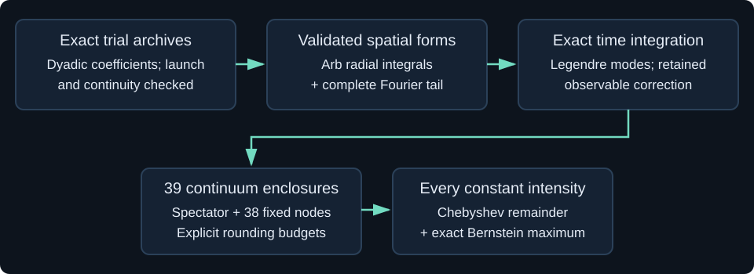

# The Brownian time-two comparison: validated residual certificate

The time-two question is resolved for the declared comparison. The physical parameters, uniform dispersed start, four-molecule fuel inventory, and first-collapse criterion are the same as in the previously released spatial-organization model. The comparator consists of every **constant paid-channel intensity** \(\alpha\in[0,1]\), with the remaining rates and potential fixed.

## Certified result

\[
0.233707424740\ \le S_\star(2)\le\ 0.233724358748,\qquad
\sup_{0\le\alpha\le1} S_\alpha(2)\le 0.233597373569.
\]

The displayed bounds are rounded outwards from the exact rational endpoints in the receipt. The certified difference is at least **0.000110051 absolute probability**, or **0.0110051 percentage points**. The independent replay recomputes the complete constant-intensity cover. It does not assume that intensity one maximizes survival.

[Complete exact receipt](../results/continuum-validated-comparison.json) · [Independent parameter replay](../results/continuum-validated-independent-replay.json) · [Figure PDF](../results/figures/continuum-validated-certificate.pdf)

## 1. Fix the physical process and failure event

The relative position follows the periodic diffusion \(dX=-D\nabla U_q(X)dt+\sqrt{2D}dW\). Thermal health changes, reversible fuel-paid repairs and reversible conformation switches occur as chemical jumps. At the first state with no healthy complex, the process is killed. The launch is uniform in position with one healthy complex, four fuel molecules and inactive attraction. The same launch and resource ledger are used for every arm. This is a designed mathematical reaction model; no molecular calibration is inferred.

For precision, the live chemical state is \((h,b,q)\), with \(h\in\{1,2\}\), \(b\in\{0,\ldots,4\}\), waste count \(4-b\), and attraction mode \(q\in\{0,1\}\). Relative position lies in the unit three-torus; \(r\) is its nearest-image radius. Define

\[
a=\frac8{25},\quad D=\frac1{40},\quad c(r)=(1-r^2/a^2)_+,\quad
g=c^4,\quad U_0=0,\quad U_1=2-6c^2,\quad m(u)=\min(1,e^{-u}).
\]

Thermal damage \(h\to h-1\) has rate \(h\), and restoration \(h\to h+1\) has rate \((2-h)/2\). Repair \((1,b,q)\to(2,b-1,q)\) has rate \(16bg\); its reverse from \((2,b-1,q)\) has rate \(8(5-b)g\). Passive mode switching \((h,b,0)\rightleftarrows(h,b,1)\) has rates \(g m(U_1)\) and \(g m(-U_1)\). Paid switching \((h,b,0)\rightleftarrows(h,b-1,1)\) has rates

\[
4b\,s(b)g m(U_1),\qquad \frac{5-b}2\,s(b)g m(-U_1),\qquad 1\le b\le4.
\]

The spectator uses \(s(b)=(b-1)/3\), and the fixed family uses \(s(b)=\alpha\). Both directions of each edge carry the same conductance factor.

The term **spectator** means that a second fuel molecule participates catalytically and survives the forward event. Schematically its paid channel is \(X_0+2F\rightleftarrows X_1+F+W\), whereas the constant arm uses \(X_0+F\rightleftarrows X_1+W\). Both consume one net fuel molecule per forward event. The extra reactant makes availability enter the rate without an external measurement or controller; division by three matches the stated rate ceiling at full inventory. These are effective reaction laws, rather than an asserted synthesized molecular mechanism. The common chemical mass is

\[
c_{h,b}=\frac{\binom2h2^{2-h}}{9}\,
\frac{\binom4b8^{4-b}}{9^4}.
\]

Each paid forward switch and forward repair consumes one fuel molecule; the explicitly retained reverse reactions regenerate one. There is no external fuel supply. Brownian thermal motion is supplied by the heat bath. The scalar survival event stops at the first \(h=0\) visit even though the underlying full thermal chemistry permits reversal; it measures first collapse, rather than equilibrium occupation.

At the labelled-state level a dimensionless energy is \(\beta E=b\log8-(2-h)\log2+U_q\); the binomial factors above count chemical multiplicities. If \(J_D,J_R,J_P\) are net forward damage, repair and paid-switch counts, respectively, then \(\Delta h=-J_D+J_R\), \(\Delta b=-J_R-J_P\), and

\[
\Delta(\beta E)=-J_D\log2-J_R\log4-J_P\log8+\Delta U.
\]

Thus switching and repair compete for the same finite fuel inventory. The resource ledger counts **net** reactions because every reverse is retained.

The common reversible density \(\rho_{h,b,q}=c_{h,b}e^{-U_q}\) makes the killed generator \(A=-\mathcal L\) positive and self-adjoint. Its thermal block gives \(A\ge\lambda_0 I+D\nabla^*\nabla\), with \(\lambda_0=(7-\sqrt{17})/4\). The full model and thermodynamic accounting remain in the [earlier report](CONTINUUM-ORGANIZATION.html).

## 2. Store exact candidate functions

A numerical Galerkin solver proposes primal and dual curves. Its output is converted to **exact dyadic, continuous time-piecewise polynomials**, in a cosine basis whose Fourier coefficients are rational. Integer checks verify exact initial values and every panel junction. The computation uses coordinate frequency cutoff 12: 455 symmetric spatial modes in each of 20 live chemical states. Eleven time panels with degree 12 give 143 orthogonal temporal residual terms per curve. [Trial generator](../scripts/validate_continuum_nodes.py) · [Time proof](../research/validated-time.md)

## 3. Correct the approximate observable

Let \(f=1\) on live states, and let \(\ell=(59049/4)\mathbf1_{(h,b,q)=(1,4,0)}\) be the launch density relative to \(\rho\). Then \(S(2)=(f,e^{-2A}\ell)_\rho\). The exact trial initial values are \(U(0)=f\), \(V(0)=\ell\).

For \(r_U=U'+AU\), \(r_V=V'+AV\), the reported center includes

\[
C=(f,V(2))_\rho-\int_0^2(U(2-t),r_V(t))_\rho\,dt.
\]

The exact residual theorem gives

\[
|S(2)-C|\le\sqrt{E_UE_V},\qquad E_Z=\int_0^2\|A^{-1/2}r_Z(t)\|_\rho^2dt.
\]

The correction is retained because approximate Galerkin curves need not have exact residual orthogonality. [Proof and implemented residual decomposition](../research/validated-residual-implementation.md) · [Original dual-residual theorem](../research/continuum-residual.md)

## 4. Enclose spatial integrals and every omitted frequency

The coefficients are piecewise radial polynomial/exponential functions. Arb integrates their Fourier transforms and Cartesian moments, splitting at the contact boundary and where the Metropolis acceptance changes branch. The returned balls, including conversion error, enclose each coefficient. A complete Fourier cube through coordinate frequency 24 bounds the resolved inverse-Laplacian flux; Parseval and \(|k|\ge25\) bound everything outside that cube. Resolved **lower** bounds are subtracted from total norm **upper** bounds in the required direction. [Spatial proof](../research/validated-spatial.md) · [Arb tables and source hashes](../results/continuum-validated-spatial-tables.json)

The finite matrix contractions use explicit midpoint/radius arithmetic, with conservative dot-product rounding budgets under IEEE 754 round-to-nearest and gradual underflow. Nonfinite values, stale cache sources, checksum mismatches, and impossible negative tail enclosures abort. This is a computer-assisted enclosure under a stated arithmetic contract, rather than a proof-assistant formalization. [Arithmetic implementation](../src/purposeful/validated_linear.py)

## 5. Integrate the entire time interval

On each time panel, an exact rational transformation to shifted Legendre polynomials removes temporal cross terms. Each residual mode has the positive weight \(h/(2n+1)\). Summing its certified spatial energy therefore bounds the complete time integral, including times never sampled by the approximate solver. The reversed primal curve and dual curve are common-refined exactly before computing the correction. [Validation runner](../scripts/run_validated_continuum.py)

## 6. Cover every constant intensity

The paid generator is a bounded nonnegative perturbation \(A_\alpha=A_0+\alpha B\), with \(\|B\|\le33/2\). The ordered Duhamel series yields \(|S^{(n)}(\alpha)|\le700\,33^n\). Interpolation at 38 Chebyshev roots consequently has remainder

\[
\|S-I_{37}S\|_\infty\le \frac{1400(33/4)^{38}}{38!}<1.8\times10^{-7}.
\]

The exact transcendental roots are related to the stored dyadic model parameters by an independently enclosed Lipschitz correction. An independent calculation proves the node-uncertainty amplification bound \(\Lambda_{38}\le3.279\), covering all 39 intervals between and outside the roots. The center interpolant is maximized by exact rational Bernstein subdivision. [Independent checker](../scripts/check_validated_continuum.py) · [Independent review](../research/validated-continuum-review.md)

## Scientific significance and limits

This calculation closes the discretization and constant-comparator gaps for **this one finite-reserve Brownian model at time two**. The earlier rigorous short-time loss and eventual long-time loss remain valid. Thus a finite-horizon organization advantage can coexist with an asymptotically inferior survival exponent. The calculation does not identify the transition times or prove uniqueness of an advantageous time window. In fact, if \(\delta\) is the exact certified gap lower bound, the advantage holds throughout \(|t-2|<\delta\). The only killing jump is \(h=1\to0\), at rate one. Hence each survival derivative lies in \([-1,0]\); every difference \(S_\star-S_\alpha\) is 1-Lipschitz, uniformly in \(\alpha\). Taking their infimum gives \(S_\star(t)-\sup_\alpha S_\alpha(t)\ge\delta-|t-2|\). This supplies a rigorous nonempty time window, with no additional simulation. In particular, the advantage is proved for every \(1.99989<t<2.00011\). These conservative endpoints do not locate the actual crossovers.

There is no conflict with the nonnegative paid Dirichlet form. Although \(A_\alpha=A_0+\alpha B\), \(B\ge0\), orders the smallest eigenvalues, the finite-time parameter derivative is

\[
\frac{dS_\alpha(T)}{d\alpha}=-\int_0^T
\left(e^{-(T-s)A_\alpha}f,\,B e^{-sA_\alpha}\ell\right)_\rho ds.
\]

The two functions in this cross pairing differ, so positivity of \(B\) does not fix its sign. Ground-state decay and transient survival from a specified preparation are different observables. This also explains why the verifier covers the entire intensity interval instead of assuming monotonicity or an endpoint optimizer.

It compares an autonomous spectator-fuel mechanism with a prescribed constant-intensity family. It does not optimize all fixed materials, all physical rate parameters, or all adaptive policies. There is no experimental validation, elementary molecular implementation, or confirmed novelty claim. Residual certification, reaction–diffusion models, paid organization and horizon-dependent optimality have substantial prior art; the contribution assessed here is the narrowly stated, replayable example and its certified comparison.

The [retained originality audit](../research/organization-originality-audit.md) and the [earlier residual discussion](../research/continuum-residual.md) identify the relevant physical and goal-oriented error-estimation precedents. Closing this numerical proof gap does not establish publication priority.

## Reproduce and assess

Install the validation extra with `python -m pip install -e ".[validation]"`. Generate the spectator archive and root-node archives with `validate_continuum_nodes.py --policy spectator` and `--node-index 0` through `37`. Run `complete_validated_continuum.py`, then independently replay `check_validated_continuum.py --receipt results/continuum-validated-comparison.json --lebesgue --output results/continuum-validated-independent-replay.json`. Matrix caches are rebuildable local intermediates. The retained trial archives, node receipts, exact endpoint fractions, per-mode budgets and source hashes expose every computational step.

[All node receipts](../results/continuum-validated-comparison.json) · [Source, tests and artifact manifest](../results/continuum-validated-verification.json) · [Earlier limitations and retained historical evidence](CONTINUUM-ORGANIZATION.html)
