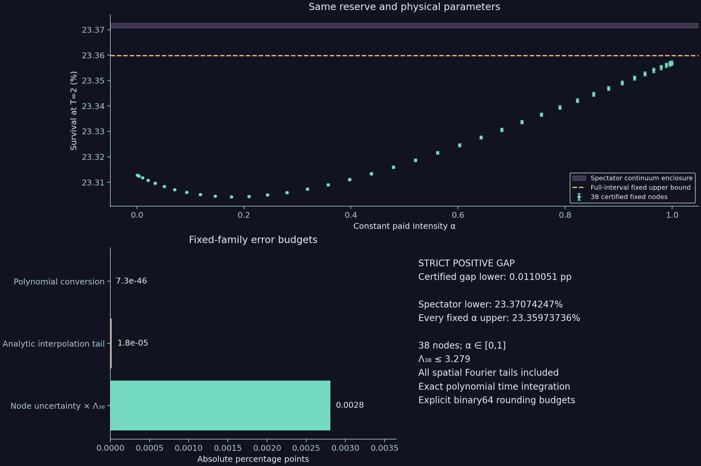
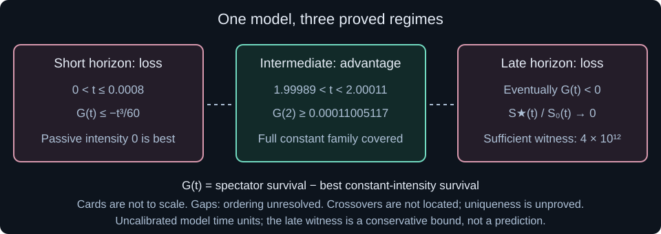

# The Brownian time-two comparison: validated residual certificate

The time-two question is resolved for the declared comparison. The physical parameters, uniform dispersed start, four-molecule fuel inventory, and first-collapse criterion are the same as in the previously released spatial-organization model. The comparator consists of every **constant paid-channel intensity** \(\alpha\in[0,1]\), with the remaining rates and potential fixed.

## Certified result

\[
0.233707424740\ \le S_\star(2)\le\ 0.233724358748,\qquad
\sup_{0\le\alpha\le1} S_\alpha(2)\le 0.233597373569.
\]

The displayed bounds are rounded outwards from the exact rational endpoints in the receipt. The certified difference is at least **0.000110051 absolute probability**, or **0.0110051 percentage points**. The independent replay recomputes the complete constant-intensity cover. It does not assume that intensity one maximizes survival.

[Complete exact receipt](../results/continuum-validated-comparison.json) · [Independent parameter replay](../results/continuum-validated-independent-replay.json) · [Figure PDF](../results/figures/continuum-validated-certificate.pdf)

[Read what this establishes, its novelty limits, and the strongest next research target](#what-do-we-learn-from-the-certified-continuum-result).

[Future work: research gaps and 24 ambitious directions](FUTURE-WORK.html).

## 1. Fix the physical process and failure event

The relative position follows the periodic diffusion \(dX=-D\nabla U_q(X)dt+\sqrt{2D}dW\). Thermal health changes, reversible fuel-paid repairs and reversible conformation switches occur as chemical jumps. At the first state with no healthy complex, the process is killed. The launch is uniform in position with one healthy complex, four fuel molecules and inactive attraction. The same launch and resource ledger are used for every arm. This is a designed mathematical reaction model; no molecular calibration is inferred.

For precision, the live chemical state is \((h,b,q)\), with \(h\in\{1,2\}\), \(b\in\{0,\ldots,4\}\), waste count \(4-b\), and attraction mode \(q\in\{0,1\}\). Relative position lies in the unit three-torus; \(r\) is its nearest-image radius. Define

\[
a=\frac8{25},\quad D=\frac1{40},\quad c(r)=(1-r^2/a^2)_+,\quad
g=c^4,\quad U_0=0,\quad U_1=2-6c^2,\quad m(u)=\min(1,e^{-u}).
\]

Thermal damage \(h\to h-1\) has rate \(h\), and restoration \(h\to h+1\) has rate \((2-h)/2\). Repair \((1,b,q)\to(2,b-1,q)\) has rate \(16bg\); its reverse from \((2,b-1,q)\) has rate \(8(5-b)g\). Passive mode switching \((h,b,0)\rightleftarrows(h,b,1)\) has rates \(g m(U_1)\) and \(g m(-U_1)\). Paid switching \((h,b,0)\rightleftarrows(h,b-1,1)\) has rates

\[
4b\,s(b)g m(U_1),\qquad \frac{5-b}2\,s(b)g m(-U_1),\qquad 1\le b\le4.
\]

The spectator uses \(s(b)=(b-1)/3\), and the fixed family uses \(s(b)=\alpha\). Both directions of each edge carry the same conductance factor.

The term **spectator** means that a second fuel molecule participates catalytically and survives the forward event. Schematically its paid channel is \(X_0+2F\rightleftarrows X_1+F+W\), whereas the constant arm uses \(X_0+F\rightleftarrows X_1+W\). Both consume one net fuel molecule per forward event. The extra reactant makes availability enter the rate without an external measurement or controller; division by three matches the stated rate ceiling at full inventory. These are effective reaction laws, rather than an asserted synthesized molecular mechanism. The common chemical mass is

\[
c_{h,b}=\frac{\binom2h2^{2-h}}{9}\,
\frac{\binom4b8^{4-b}}{9^4}.
\]

Each paid forward switch and forward repair consumes one fuel molecule; the explicitly retained reverse reactions regenerate one. There is no external fuel supply. Brownian thermal motion is supplied by the heat bath. The scalar survival event stops at the first \(h=0\) visit even though the underlying full thermal chemistry permits reversal; it measures first collapse, rather than equilibrium occupation.

At the labelled-state level a dimensionless energy is \(\beta E=b\log8-(2-h)\log2+U_q\); the binomial factors above count chemical multiplicities. If \(J_D,J_R,J_P\) are net forward damage, repair and paid-switch counts, respectively, then \(\Delta h=-J_D+J_R\), \(\Delta b=-J_R-J_P\), and

\[
\Delta(\beta E)=-J_D\log2-J_R\log4-J_P\log8+\Delta U.
\]

Thus switching and repair compete for the same finite fuel inventory. The resource ledger counts **net** reactions because every reverse is retained.

The common reversible density \(\rho_{h,b,q}=c_{h,b}e^{-U_q}\) makes the killed generator \(A=-\mathcal L\) positive and self-adjoint. Its thermal block gives \(A\ge\lambda_0 I+D\nabla^*\nabla\), with \(\lambda_0=(7-\sqrt{17})/4\). The full model and thermodynamic accounting remain in the [earlier report](CONTINUUM-ORGANIZATION.html).

## 2. Store exact candidate functions

A numerical Galerkin solver proposes primal and dual curves. Its output is converted to **exact dyadic, continuous time-piecewise polynomials**, in a cosine basis whose Fourier coefficients are rational. Integer checks verify exact initial values and every panel junction. The computation uses coordinate frequency cutoff 12: 455 symmetric spatial modes in each of 20 live chemical states. Eleven time panels with degree 12 give 143 orthogonal temporal residual terms per curve. [Trial generator](../scripts/validate_continuum_nodes.py) · [Time proof](../research/validated-time.md)

## 3. Correct the approximate observable

Let \(f=1\) on live states, and let \(\ell=(59049/4)\mathbf1_{(h,b,q)=(1,4,0)}\) be the launch density relative to \(\rho\). Then \(S(2)=(f,e^{-2A}\ell)_\rho\). The exact trial initial values are \(U(0)=f\), \(V(0)=\ell\).

For \(r_U=U'+AU\), \(r_V=V'+AV\), the reported center includes

\[
C=(f,V(2))_\rho-\int_0^2(U(2-t),r_V(t))_\rho\,dt.
\]

The exact residual theorem gives

\[
|S(2)-C|\le\sqrt{E_UE_V},\qquad E_Z=\int_0^2\|A^{-1/2}r_Z(t)\|_\rho^2dt.
\]

The correction is retained because approximate Galerkin curves need not have exact residual orthogonality. [Proof and implemented residual decomposition](../research/validated-residual-implementation.md) · [Original dual-residual theorem](../research/continuum-residual.md)

## 4. Enclose spatial integrals and every omitted frequency

The coefficients are piecewise radial polynomial/exponential functions. Arb integrates their Fourier transforms and Cartesian moments, splitting at the contact boundary and where the Metropolis acceptance changes branch. The returned balls, including conversion error, enclose each coefficient. A complete Fourier cube through coordinate frequency 24 bounds the resolved inverse-Laplacian flux; Parseval and \(|k|\ge25\) bound everything outside that cube. Resolved **lower** bounds are subtracted from total norm **upper** bounds in the required direction. [Spatial proof](../research/validated-spatial.md) · [Arb tables and source hashes](../results/continuum-validated-spatial-tables.json)

The finite matrix contractions use explicit midpoint/radius arithmetic, with conservative dot-product rounding budgets under IEEE 754 round-to-nearest and gradual underflow. Nonfinite values, stale cache sources, checksum mismatches, and impossible negative tail enclosures abort. This is a computer-assisted enclosure under a stated arithmetic contract, rather than a proof-assistant formalization. [Arithmetic implementation](../src/purposeful/validated_linear.py)

## 5. Integrate the entire time interval

On each time panel, an exact rational transformation to shifted Legendre polynomials removes temporal cross terms. Each residual mode has the positive weight \(h/(2n+1)\). Summing its certified spatial energy therefore bounds the complete time integral, including times never sampled by the approximate solver. The reversed primal curve and dual curve are common-refined exactly before computing the correction. [Validation runner](../scripts/run_validated_continuum.py)

## 6. Cover every constant intensity

The paid generator is a bounded nonnegative perturbation \(A_\alpha=A_0+\alpha B\), with \(\|B\|\le33/2\). The ordered Duhamel series yields \(|S^{(n)}(\alpha)|\le700\,33^n\). Interpolation at 38 Chebyshev roots consequently has remainder

\[
\|S-I_{37}S\|_\infty\le \frac{1400(33/4)^{38}}{38!}<1.8\times10^{-7}.
\]

The exact transcendental roots are related to the stored dyadic model parameters by an independently enclosed Lipschitz correction. An independent calculation proves the node-uncertainty amplification bound \(\Lambda_{38}\le3.279\), covering all 39 intervals between and outside the roots. The center interpolant is maximized by exact rational Bernstein subdivision. [Independent checker](../scripts/check_validated_continuum.py) · [Independent review](../research/validated-continuum-review.md)

## Scientific significance and limits

This calculation closes the discretization and constant-comparator gaps for **this one finite-reserve Brownian model at time two**. The earlier rigorous short-time loss and eventual long-time loss remain valid. Thus a finite-horizon organization advantage can coexist with an asymptotically inferior survival exponent. The calculation does not identify the transition times or prove uniqueness of an advantageous time window. In fact, if \(\delta\) is the exact certified gap lower bound, the advantage holds throughout \(|t-2|<\delta\). The only killing jump is \(h=1\to0\), at rate one. Hence each survival derivative lies in \([-1,0]\); every difference \(S_\star-S_\alpha\) is 1-Lipschitz, uniformly in \(\alpha\). Taking their infimum gives \(S_\star(t)-\sup_\alpha S_\alpha(t)\ge\delta-|t-2|\). This supplies a rigorous nonempty time window, with no additional simulation. In particular, the advantage is proved for every \(1.99989<t<2.00011\). These conservative endpoints do not locate the actual crossovers.

There is no conflict with the nonnegative paid Dirichlet form. Although \(A_\alpha=A_0+\alpha B\), \(B\ge0\), orders the smallest eigenvalues, the finite-time parameter derivative is

\[
\frac{dS_\alpha(T)}{d\alpha}=-\int_0^T
\left(e^{-(T-s)A_\alpha}f,\,B e^{-sA_\alpha}\ell\right)_\rho ds.
\]

The two functions in this cross pairing differ, so positivity of \(B\) does not fix its sign. Ground-state decay and transient survival from a specified preparation are different observables. This also explains why the verifier covers the entire intensity interval instead of assuming monotonicity or an endpoint optimizer.

It compares an autonomous spectator-fuel mechanism with a prescribed constant-intensity family. It does not optimize all fixed materials, all physical rate parameters, or all adaptive policies. There is no experimental validation, elementary molecular implementation, or confirmed novelty claim. Residual certification, reaction–diffusion models, paid organization and horizon-dependent optimality have substantial prior art; the contribution assessed here is the narrowly stated, replayable example and its certified comparison.

The [retained originality audit](../research/organization-originality-audit.md) and the [earlier residual discussion](../research/continuum-residual.md) identify the relevant physical and goal-oriented error-estimation precedents. Closing this numerical proof gap does not establish publication priority.

## What do we learn from the certified continuum result?

**We have a rigorous existence example of a finite-horizon benefit from a fuel-dependent organization reaction, in continuous Brownian space, under a common finite reserve.** The certification removes a discretization objection to this example. It does not turn the example into a universal law of biological organization.

| Conclusion | Evidence | Boundary of the conclusion |
|---|---|---|
| The positive comparison survives the Brownian continuum. | The [exact certificate](../results/continuum-validated-comparison.json) bounds the spectator minus the supremum over all constant intensities below by more than \(11/100000\) at time two. Spatial tails, time error, roundoff and the whole parameter interval are included. | This is an absolute probability gain of at least 0.0110051 percentage points in the stated instance. The amount is small; certification establishes its sign, not a large biological effect. |
| Which design is better depends on the objective horizon. | The earlier short-time theorem gives a negative gap; the new certificate gives a positive gap around time two; the ground-state argument gives eventual loss. | The actual crossover times and the number of advantageous intervals have not been determined. The sufficient late-time witness is extremely conservative. |
| An internal chemical state can regulate allocation without an external observer or clock. | Spectator fuel enters a reversible reaction on both sides, giving the additional factor \((b-1)/3\). Organization and repair use the same \(F/W\) inventory. | This is an effective mass-action mechanism. Its elementary molecular implementation and construction costs have not been established. |
| The continuum calculation is now an assessable benchmark. | Exact trial archives, validated spatial integration, a residual proof, 39 node enclosures, independent parameter/provenance replay and 92 tests are retained. | The independent replay checks the certificate chain and parameter arithmetic; it does not independently recompute every spatial contraction. External expert review and experimental validation remain absent. |

There is a stronger qualitative conclusion than a positive value at one deadline. The previously proved killing-rate bound makes \(G\) 1-Lipschitz in time. Since its certified ordering is negative, then positive, then negative, the open positive component containing time two is bounded and has two finite boundary zeros. Thus **at least one transient interval of advantage is proved**. This continuity corollary does not locate its endpoints or establish that it is the only positive interval; it requires no new numerical calculation and carries no separate novelty claim.

There is an important terminology limit. **Both arms are fixed microscopic designs with time-homogeneous generators.** The constant-intensity arm already responds to fuel through ordinary mass-action factors such as \(b\), and to position through the contact gate. “Constant” means that its *additional paid-channel prefactor* is the same \(\alpha\) on every fuel edge. The spectator introduces one further dependence on inventory. Therefore the result compares one autonomous reaction architecture with a restricted family of other autonomous architectures. It does not show that an adaptive device beats every fixed material.

The possible mechanism is allocation: contact-promoting organization can help later repair, while its fuel consumption competes with repair now. The current comparison does **not isolate the causal contribution of spatial organization alone**. The earlier no-well ablation also changes energetics; it is not a proof that force-mediated localization is necessary for the benefit. A mechanism theorem needs controls that separate mechanical effects, fuel redistribution and kinetic changes while preserving their declared budgets.

Strictness also has a modest mathematical consequence. Under continuous, uniformly elliptic variations for which the killed semigroups depend continuously on the physical parameters \(\theta\),

\[
G(\theta,T)=S_\star(\theta,T)-\max_{0\le\alpha\le1}S_\alpha(\theta,T)
\]

is continuous: the fixed-arm maximum is over a compact parameter interval. Thus the positive point lies in some open positive neighborhood. **No explicit physical-parameter tolerance box has yet been certified.** Proving existence of an unspecified neighborhood by continuity is standard; it would not by itself establish a new concept or a substantial robustness theorem.

In relation to Tsimerman’s challenge, the advance is a precise mathematical treatment of one physics-to-effective-chemistry model. The complexes already exist at launch. The model does not produce its own repair machinery, replicate, inherit organization, evolve, or explain philosophical purpose. It therefore does not establish that the chemistry-to-biology barrier has been overcome, or test a timetable for overcoming disciplinary boundaries.

## Does this establish anything conceptually new?

**No new general concept has been established by this study.** The particular certified continuum comparison is a concrete mathematical result. Its publication priority remains unestablished. These are separate judgments: a valid theorem about one model can be useful without introducing a new scientific principle.

The strongest defensible description is **a reproducible, computer-assisted continuum example combining closed fuel accounting, reversible repair, autonomous fuel-sensitive organization and a full constant-intensity comparison**. The ingredients and broad qualitative ideas have substantial precedents:

| Nearby primary work | What already exists | What our certificate does not inherit automatically |
|---|---|---|
| [Fullerton and Jack, 2016](https://arxiv.org/html/1609.05008) | Changing attraction over an assembly protocol improves finite-time assembly outcomes. | Their comparison does not supply this closed shared-fuel first-collapse theorem. Conversely, “changing interactions can help” is not our conceptual discovery. |
| [Trubiano and Hagan, 2022 preprint](https://arxiv.org/html/2210.05749), methods and Appendix B | Finite-time assembly optimization with Markov models and forward/adjoint probability gradients. | Writing another adjoint gradient or optimizing another protocol is not sufficient evidence of originality. Their objective and externally varied controls differ from the present autonomous reserve model. |
| [Reja et al., 2024](https://pubmed.ncbi.nlm.nih.gov/39557837/) | Autonomous feedback produces transient assembly/disassembly cycles from one batch of reactants. | Closed-batch chemical feedback is established; the present survival comparison is a different observable and model. This check used the abstract and indexed result excerpts, not a full experimental-methods audit. |
| [Faran and Bisker, 2025](https://pmc.ncbi.nlm.nih.gov/articles/PMC12042269/) | State-responsive interaction changes improve self-assembly in a closed-loop control scheme. | State-responsive control is not new in itself. This check used indexed publisher/author-manuscript excerpts; direct full-page access was challenged. |
| [Zhang and Isaacson, 2022](https://arxiv.org/abs/2201.04099) | Detailed-balance conditions for reversible particle reaction–diffusion models. | Thermodynamic consistency is an essential constraint, not evidence that the organization mechanism is original. |
| [Wu et al., 2017](https://arxiv.org/abs/1706.04281) | Primal/dual error estimation for parabolic equations. | Our specialized validated implementation and observable enclosure do not make residual certification a new general method. |

This focused check supports a cautious assessment of the *kind* of contribution. It is not an exhaustive originality search and cannot certify that the exact combined result is unpublished. [Search scope, access limits and source locators](../research/continuum-assessment-literature.md) · [Retained earlier originality audit](../research/organization-originality-audit.md)

The spectral observation is also an application of established mathematics. Adding a nonnegative reversible form raises the lowest killed eigenvalue, while finite-time survival depends on a cross pairing of two different evolving functions. The coexistence of transient benefit and worse asymptotic decay is informative in this model; it should not be presented as a newly discovered general paradox.

## The strongest next step toward a novel result

**Aim for a predictive mechanism theorem: identify physically interpretable conditions under which low-order autonomous fuel regulation improves first-collapse survival, and conditions under which it cannot help.** Its value would come from explaining a class of systems before running a separate optimization for every instance. Another parameter sweep, a larger inventory, or a smaller error bar would not establish that principle on its own.

Keep a precise first target. Let \(\theta\) specify a declared class of reversible repair diffusions with the same launch convention, fixed inventory \(N\), paired forward/reverse reactions and stated kinetic ceilings. For a gate vector \(s=(s_1,\ldots,s_N)\), write

\[
A_{\theta,s}=A_{\theta,0}+\sum_{b=1}^{N}s_b B_{\theta,b},\qquad
0\le s_b\le1,\qquad B_{\theta,b}\ge0.
\]

Each \(B_{\theta,b}\) is the bounded positive operator for one reversible paid fuel edge. The fixed family is \(s_b=\alpha\); the spectator is \(\sigma_b=(b-1)/(N-1)\). A physically admitted interpolation is

\[
s_b(\varepsilon)=(1-\varepsilon)\alpha+\varepsilon\sigma_b,
\qquad 0\le\varepsilon\le1.
\]

It can be implemented *within the effective model* by splitting the attempt-rate capacity between the ordinary and spectator-catalyzed channels. Each channel retains its reverse and its one-net-fuel stoichiometry. This does not authorize arbitrary independently programmable fuel gates or assume a real synthesized catalyst for them.

The research target is an explicit condition on \(\theta,T\), and an admissible \(\varepsilon\), implying

\[
S_{\theta,s(\varepsilon)}(T)-\sup_{\alpha\in[0,1]}S_{\theta,\alpha\mathbf1}(T)
\ge c(\theta,T)>0,
\]

over a quantitatively specified parameter region, accompanied by a proved null regime or a counterexample delimiting the condition. Relevant dimensionless inputs include \(\eta a^2/D\), \(\kappa N a^2/D\), the contact-to-box ratio, potential depth and fuel affinity. They are possible organizing variables, not an already proved criterion. A strong result would bound the gain from those structural inputs rather than merely define its condition as “the numerically computed gain is positive.” Its originality must then be audited claim by claim.

### A rigorous entry point, using established mathematics

For fixed \(\theta,T\), put \(F(s)=(f,e^{-TA_s}\ell)_\rho\). Bounded-perturbation differentiation gives

\[
g_b=\frac{\partial F}{\partial s_b}
=-\int_0^T\left(e^{-(T-t)A_s}f,\,B_b e^{-tA_s}\ell\right)_\rho\,dt.
\]

This is a standard forward/adjoint sensitivity identity, related to the methods cited above. It is not a proposed new theorem. It gives the marginal value of changing a paired reaction’s activity while keeping its equilibrium ratio fixed. Positivity of \(B_b\) does not determine the sign of this cross pairing.

Suppose \(\alpha_*\) actually maximizes the complete constant family, and define

\[
v_b=\sigma_b-\alpha_*,\qquad
\gamma=\sum_b v_b g_b\big|_{s=\alpha_*\mathbf1}.
\]

If \(\gamma>0\), a sufficiently small physically admitted mixture strictly beats the best constant arm. For example, assume \(A_{s(\varepsilon)}\ge\lambda_0 I\) along the segment and let \(C_0=\|f\|_\rho\|\ell\|_\rho\). A valid, generally crude curvature bound is

\[
\left|\frac{d^2}{d\varepsilon^2}F(s(\varepsilon))\right|
\le M:=C_0T^2e^{-\lambda_0T}\left\|\sum_bv_bB_b\right\|^2.
\]

**Justification.** Two bounded perturbations insert two copies of \(\sum_bv_bB_b\) into an ordered semigroup integral. Its triangle has area \(T^2/2\), the second derivative contributes the factor two, and contraction of the three semigroup factors contributes \(e^{-\lambda_0T}\). Taylor’s theorem therefore gives

\[
F(s(\varepsilon))-F(\alpha_*\mathbf1)
\ge\varepsilon\gamma-\tfrac12M\varepsilon^2.
\]

A positive right-hand side proves improvement. For an approximate constant optimizer \(\bar\alpha\), use certified bounds instead: a lower endpoint \(L\le F(\bar\alpha\mathbf1)\), a derivative lower bound \(\underline\gamma\), and the whole-family upper endpoint \(U\). It suffices to prove

\[
L+\varepsilon\underline\gamma-\tfrac12M\varepsilon^2>U.
\]

The current certificate does not identify the exact constant optimizer, so assuming \(\alpha_*=1\) would be an additional unsupported step. Nor does the endpoint advantage at \(\varepsilon=1\) prove \(\gamma>0\) at zero: a finite-amplitude improvement could follow an initial loss. The present instance already has its finite-amplitude certificate at \(\varepsilon=1\); a structural extension across the proposed class is unproved. If the local route fails in that extension, a finite-amplitude bound or counterexample is needed. Generic operator-norm curvature bounds can be far too loose at our small effect size; the displayed inequality is a valid starting tool, not a completed usable certificate for the next theorem.

**The difficult, potentially substantive step is to derive the sign and a useful magnitude from repair, encounter and resource structure across a defined class.** The formula, Taylor argument and the statement that a positive derivative improves an optimum are standard. Relabeling them would not establish novelty.

### Milestones and conditions for accepting the next claim

1. **State and audit one candidate claim.** Fix the admissible reaction class, reserve and affinity, launch free energy, failure event and comparator before optimizing. Compare its exact conclusion and assumptions with control, reliability and chemical-feedback results; try to derive it from known theorems.
2. **Identify the mechanism in the present model.** Enclose the marginal values over the constant-optimum enclosure, or certify a finite-amplitude route. Design matched controls separating force, fuel exchange and kinetic activity. Changing a well can change the initial nonequilibrium free-energy allowance, so equal molecule counts alone do not guarantee a fair ablation.
3. **Derive predictive sufficient conditions and an obstruction.** Use physically interpretable bounds on contact, repair and inventory dynamics; produce a constructive low-order gate and an explicit gain bound. Report where the conditions fail and whether the failure is physical or only a loose estimate.
4. **Prove quantitative robustness and test a stronger baseline.** Certify explicit tolerances and a time interval. Preregister a broader constant-design family, with matched preparation, potential-energy allowances, inventory and kinetic capacity. A gain over constant \(\alpha\) alone does not settle that stronger comparison.
5. **Submit the claim to external scrutiny.** Retain proofs, full comparator bounds, counterexamples and receipts, and obtain specialist review with the user’s approval before contacting anyone. If the result reduces to existing theory, describe it as an application or benchmark.

These are proposed deliverables, not completed results. A proved obstruction or counterexample may be scientifically stronger than another favorable example. Self-production of repair machinery and heredity remain separate longer-term modeling tasks. None of these directions currently carries a guarantee of novelty.

## Reproduce and assess

Install the validation extra with `python -m pip install -e ".[validation]"`. Generate the spectator archive and root-node archives with `validate_continuum_nodes.py --policy spectator` and `--node-index 0` through `37`. Run `complete_validated_continuum.py`, then independently replay `check_validated_continuum.py --receipt results/continuum-validated-comparison.json --lebesgue --output results/continuum-validated-independent-replay.json`. Matrix caches are rebuildable local intermediates. The retained trial archives, node receipts, exact endpoint fractions, per-mode budgets and source hashes expose every computational step.

[All node receipts](../results/continuum-validated-comparison.json) · [Source, tests and artifact manifest](../results/continuum-validated-verification.json) · [Earlier limitations and retained historical evidence](CONTINUUM-ORGANIZATION.html)
