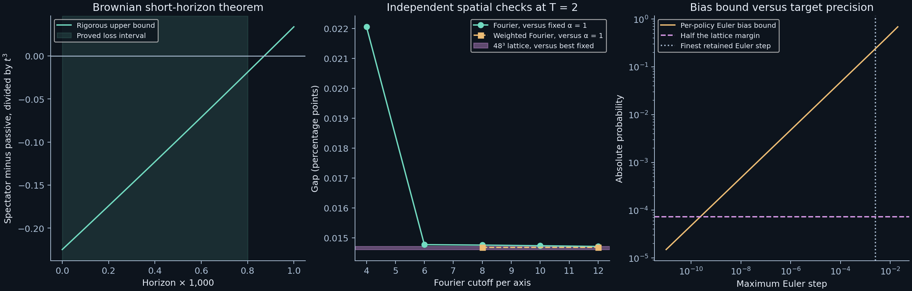

## 14. Testing the finite-grid advantage in Brownian space

The user next asked whether the small paid-organization advantage survives the Brownian continuum limit, with parallel analysis and retained proofs and evidence. The investigation kept the published physical model, common dispersed launch, constant-intensity comparator and prespecified \(T=2\) target. Parallel work examined path-law coupling, weighted residual bounds and independent Fourier projections.

A Duhamel argument proved that passive-only organization uniquely optimizes the constant family for every \(0<t\le0.0008\). The spectator loses by at least \(t^3/60\). Explicit rational bounds control the remainder without differentiating the kink in the Metropolis acceptance factor.

The long-time argument found an explicit passive ground state depending on \(h+b\), which repair preserves. A paid mode change adds a nonnegative reversible form which is strictly positive on the passive ground state. The spectator therefore has a strictly faster survival decay rate and eventually loses to the passive member. A conservative coercivity bound supplies a sufficient witness time of \(4\times10^{12}\), with no claim that this estimates the actual crossover.

At time two, two Fourier formulations reproduced a gap near 0.000147 in absolute probability against constant intensity one. A weighted residual identity bounds the observable error through the product of primal and dual residual norms. Numerical screens estimate that product at about \(2.5\times10^{-6}\) per curve at the finer sampled setting. Their spatial tails, quadrature and time reconstruction still require outward enclosures. A parameter interpolation bound reduces a future whole-family calculation to finitely many validated node values.

The existing particle simulation also received a rigorous Euler bias bound. At its finest retained maximum step, the uniform bound is 0.239 per policy, exceeding the budget needed to transfer the finite-grid sign. The independent methods thus strengthened the evidence and identified the missing precision while leaving the sign at \(T=2\) unresolved.

The completed record retains full proofs, exact rational checks, replayable numerical programs, source hashes, a PNG/PDF figure, 57 passing tests and desktop/mobile checks of all 108 equations in the continuum report. [Continuum report](CONTINUUM-ORGANIZATION.html) · [Verification receipt](../results/continuum-organization-verification.json) · [Rational replay](../scripts/check_continuum_short_time.py)
