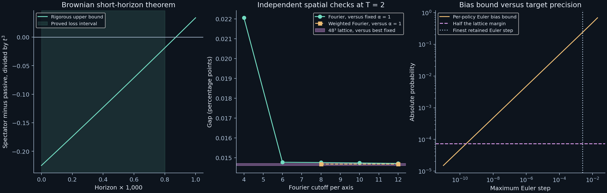

# Does the survival advantage persist in Brownian space?

For the original Brownian model, the spectator strategy **loses to passive-only organization at sufficiently short and sufficiently long horizons**. Passive-only is the unique best constant intensity for \(0<T\le 0.0008\). At long horizons the spectator survival probability decays faster than the passive one. At the prespecified \(T=2\), the finest finite-grid certificate and independent Fourier calculations favor the spectator strategy. The continuum sign at that horizon remains unresolved by the error bounds below. [Original model and parameters](PAID-ORGANIZATION.html)

## The comparison

Write \(S_\star(t)\) for spectator survival, \(S_\alpha(t)\) for constant paid intensity \(\alpha\in[0,1]\), and \(S_0\) for passive-only organization with the same repair reactions. All launches have uniform relative position on the unit three-torus, one healthy complex, four fuel molecules, and open interaction mode. Collapse is the first visit to zero healthy complexes. The physical rates, potential, and initial preparation are the same as in the original study. Only the analysis and its approximations change.

The continuum quantity is \(G(t)=S_\star(t)-\sup_{0\le\alpha\le1}S_\alpha(t)\). At \(T=2\), the \(48^3\) lattice certificate gives an absolute-probability gap in \([0.00014604124859,0.00014714135489]\). To transfer this sign using separate uniform errors, the sum of the spectator error and the fixed-family error must be less than 0.00014604124859. If both errors use one common bound, it must be less than 0.000073020624295. [Finite-grid certificate](../results/organization-verification.json)

## A continuum theorem for short horizons

**Theorem.** For every \(0<t\le 1/1250\),

\[
S_\star(t)\le S_0(t)-t^3/60,\qquad
S_\alpha(t)\le S_0(t)-\alpha t^3/60\quad(0\le\alpha\le1).
\]

In particular \(\alpha=0\) is the unique best constant intensity in this range. The upper endpoint is a sufficient bound obtained from conservative constants.

**Proof.** Use the killed semigroup \(P_p(t)\) for policy \(p\) and write its generator \(L_p=L_0+\sigma B\). For a fixed policy \(B\) is the full-intensity paid generator and \(\sigma=\alpha\). For the spectator policy \(B\) is the spectator paid generator and \(\sigma=1\). In either case the total paid rate at position \(x\) is at most \(16g(x)\), and the two choices of \(B\) agree at the common launch. Let \(f=1\) on live states and zero at the cemetery. The first generator image is \(f_1=-1\) in HD and zero in HH. Paid mode changes preserve health, so the second generator image is also common:

\[
f_2(h,b,x)=\begin{cases}
3/2+16b g(x), & h=1,\\
-2-8(4-b)g(x), & h=2.
\end{cases}
\]

These functions have the spatial smoothness needed for the generator identities. The statement uses only a bounded perturbation by the paid operator. It does not require differentiating the kink in its Metropolis factor.

Apply the semigroup integral expansion to \(f\) twice, then Duhamel to the difference on \(f_2\). For the common launch measure \(\mu\),

\[
S_p(t)-S_0(t)=\sigma\!\int_{u,v\ge0,\ u+v\le t}
(t-u-v)\,\mu P_p(u) B P_0(v)f_2\,du\,dv.
\]

At \(u=v=0\), the paid transition decreases fuel by one while preserving health, hence

\[
\mu B f_2=-256\langle g^2 m(U_1)\rangle<-C,
\qquad C=\frac{14601109619}{10825546875}>1.3487.
\]

The rational lower bound integrates only over \(r\le a/2\), where \(m(U_1)=1\), and uses \(\pi>3\). Its finite polynomial sum is in the [exact rational replay](../scripts/check_continuum_short_time.py).

We bound the difference from this integrand value. The uniform mean of \(g\) is \(512\pi a^3/3465<2/125\). Before its first accepted chemical jump, the system can be coupled to unrestricted uniform Brownian motion in the open mode. The launch rates have sum at most \(3/2+81g(x)\). The probability of a first jump by \(u\) is thus at most \(\lambda u\), where \(\lambda=14/5\), by integrating this hazard along the unrestricted Brownian path. The gate mean bound uses \(\pi<22/7\). It follows that \(\mu P_p(u)g\le 2/125+\lambda u\) when \(g\) is zero at the cemetery. In addition, \(\|Bf_2\|_\infty\le256\) from the rate cap and the largest fuel effect on \(f_2\). The same coupling yields

\[
|\mu P_p(u) Bf_2-\mu B f_2|\le512\lambda u.
\]

The estimates \(\|\nabla g\|_\infty\le 8/a\), \(\|\Delta g\|_\infty\le24/a^2\), and \(\|D\nabla U_1\|_\infty<3/4\) bound the diffusion part of \(L_0 f_2\). The base chemical exit rate is at most \(66.5\), and the range of \(f_2\), including the cemetery, has width at most \(99.5\). Together these give \(\|L_0f_2\|_\infty\le 8191.75<9000\). Contractivity gives \(\|P_0(v)f_2-f_2\|_\infty\le9000v\). The row absolute sum of \(B\) is at most \(32g(x)\), hence

\[
|\mu P_p(u)B(P_0(v)f_2-f_2)|\le 32\cdot9000\,(2/125+\lambda u)v.
\]

The simplex weight \(t-u-v\) has integral \(t^3/6\). Under its normalized measure, \(u,v\) have mean \(t/4\) and \(uv\) has mean \(t^2/20\). Substitution gives the stronger intermediate bound

\[
S_p(t)-S_0(t)\le \frac{\sigma t^3}{6}
\left(-C+\frac{7552}{5}t+40320t^2\right).
\]

At \(t=1/1250\), the parenthesis is less than \(-1/10\), and the polynomial is increasing for nonnegative \(t\). This proves the theorem. [Exact constants and source hashes](../results/continuum-short-time.json)

## The exact passive decay rate and a long-horizon failure theorem

The common unnormalized reversible weight on live states is

\[
\rho(x,h,b,q)=\binom2h2^{2-h}\binom4b8^{-b}e^{-U_q(x)}.
\]

Use the self-adjoint killed generators in \(L^2(\rho)\). Their diffusion form has domain \(H^1(\mathbb T^3)\) in each live chemical state. The weights are bounded above and away from zero over this finite set of states. The bounded jump and killing terms preserve the form domain. Its compact embedding in \(L^2(\rho)\) gives compact resolvent.

Let

\[
\lambda_0=(7-\sqrt{17})/4,\qquad r=(\sqrt{17}-1)/2,\qquad
\phi(x,h,b,q)=r^{h+b}.
\]

The two-state killed thermal block is

\[
K=\begin{pmatrix}-3/2&1/2\\2&-2\end{pmatrix}.
\]

It maps the health vector \((1,r)\) to \(-\lambda_0(1,r)\). The other passive-arm terms annihilate \(\phi\). Diffusion and passive mode changes preserve \(h,b\), and repair preserves \(h+b\). Thus \(L_0\phi=-\lambda_0\phi\) exactly. This argument uses the actual finite chemical ledger and holds directly on the torus.

For a test function \(f=\phi v\), the ground-state transform writes the passive Dirichlet form minus \(\lambda_0\|f\|^2\) as the sum of the gradient energies of \(v\) with weights \(\rho\phi^2\) and the edge energies of \(v\) with conductances \(\rho_i a_{ij}\phi_i\phi_j\). This follows by expanding the squares and using the eigenfunction equation on the diagonal terms. Equality forces \(v\) to be constant in space in each state. Thermal edges connect the two live health levels, passive mode changes connect the two modes, and repair edges connect successive fuel levels. Consequently equality forces a single common constant. The passive ground state is simple.

The paid generator adds a nonnegative Dirichlet form to \(-L_0\), since it adds a reversible jump pair with the same Gibbs weight. Its form on \(\phi\) is strictly positive for the spectator strategy and for each \(\alpha>0\): a paid mode change shifts \(h+b\) by one, and some paid rates are positive on a set of positive volume. If the new lowest eigenvalue equaled \(\lambda_0\), a normalized minimizing eigenfunction would have to minimize the passive form and have zero paid energy. The first condition forces it to be proportional to \(\phi\), contradicting the second. Thus

\[
\lambda_\star>\lambda_0,\qquad \lambda_\alpha>\lambda_0\quad(\alpha>0).
\]

The dispersed launch has a density in \(L^2(\rho)\). Contractivity at the bottom spectral rate gives \(S_\star(t)\le \|d\mu/d\rho\|_2\|1\|_2e^{-\lambda_\star t}\). For the passive arm, positivity and \(1\ge\phi/\max\phi\) give \(S_0(t)\ge (\mu\phi/\max\phi)e^{-\lambda_0 t}\). In particular \(S_\star(t)/S_0(t)\to0\) exponentially. This proves eventual defeat against the best fixed family as well.

A quantitative version uses the spatial Poincaré inequality and local chemical graph paths inside the ball of radius \(a/2\). It gives the conservative bounds

\[
\lambda_\star-\lambda_0\ge\frac{1}{4\times10^{11}},\qquad
\frac{S_\star(t)}{S_0(t)}\le 5184\exp\left(-\frac{t}{4\times10^{11}}\right).
\]

Thus \(t\ge4\times10^{12}\) is one explicit sufficient horizon for loss. The bound is far too conservative to estimate the actual last crossover. The strict rate comparison for each \(\alpha>0\) also supplies no common finite horizon for all positive \(\alpha\). [Full coercivity and path-law proofs](../research/continuum-coupling.md) · [Rational checks of the constants](../results/continuum-organization-verification.json)

## Why the time-two test is harder

The continuum is a diffusion on the torus coupled to a finite jump process. The potential has a Lipschitz gradient. Its weak Laplacian jumps at the contact sphere. The Metropolis factor also has a kink where the interaction energy crosses zero. A high-order Taylor or quadrature claim needs to account for these surfaces explicitly.

An independent Fourier Galerkin calculation provides a check using a different spatial approximation. @@FOURIER@@

The existing particle simulator propagates the closed-mode force with Euler steps. A coupling and path relative-entropy bound gives a uniform upper bound for the resulting bias. At a maximum step of 0.0025 the per-policy bound is 0.239. The required per-policy budget is about \(7.3\times10^{-5}\). The 99% band for the existing 180,000 paths concerns the Euler simulation laws. [Path-law proof and unbiased-sampling construction](../research/continuum-coupling.md)

@@RESIDUAL@@



[Open the full-size figure](../results/figures/continuum-organization-bounds.pdf)

## What the evidence resolves

The advantage fails at both ends of the horizon range. Early paid mode closure uses fuel before the new force can return a repair benefit. At long horizons paid transitions disrupt the passive ground state, which depends on the conserved sum \(h+b\) along repair edges, and increase the exponential decay rate. Any genuine Brownian advantage in this model is confined to intermediate horizons.

At \(T=2\), the finite-grid proof and Fourier calculation support a positive gap near 0.0147 percentage points. Confirming that sign requires a validated error radius below the separation and control of the entire constant-intensity interval. The present bounds do not reach that precision. [Audit and receipts](../results/continuum-organization-verification.json)

## Reproduce the checks

Run these commands from the repository root with the existing Python and documentation dependencies. The first command checks the short-time constants with exact fractions. The Fourier commands regenerate numerical evidence. The report builder checks the Euler, long-horizon and parameter constants, replays the input hashes and test suite, and verifies rendering and links.

```powershell
python -B scripts/check_continuum_short_time.py
python -B scripts/run_continuum_fourier.py
python -B scripts/run_continuum_weighted.py
python -B scripts/build_continuum_organization.py
```

The [residual screen receipt](../results/continuum-residual-screen.json) lists the exact command for each of its four runs. Each command prints the measured residual quantities as JSON.
