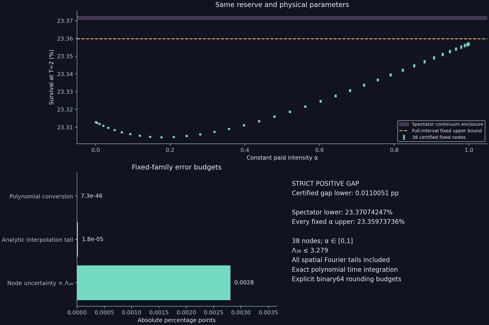

## Validated Brownian continuum advantage at T=2

The spectator strategy beats **every constant paid intensity in [0,1]** at time two by at least **0.0110051 percentage points**. The proof includes spatial Fourier tails, exact polynomial time integration, roundoff and a complete parameter-interval cover.

The comparison uses the original physical parameters, uniform dispersed start and four fuel molecules. A spectator-dependent reaction forms and maintains attraction without an external controller. [Complete proof and evidence](CONTINUUM-CERTIFICATE.html) · [Exact continuum comparison](../results/continuum-validated-comparison.json) · [Independent replay](../results/continuum-validated-independent-replay.json).

The earlier short-time theorem proves spectator loss for \(0<t\le0.0008\). The passive ground state has exact decay rate \((7-\sqrt{17})/4\); the spectator has a strictly larger decay rate and eventually loses. These statements coexist with a finite-horizon advantage when the certified time-two gap is positive. The result does not establish a molecular realization, a chemistry-to-biology transition, or confirmed publication priority.

[Earlier continuum proofs and historical calculation](CONTINUUM-ORGANIZATION.html) · [Residual theorem](../research/continuum-residual.md) · [Validated spatial arithmetic](../research/validated-spatial.md) · [Exact time analysis](../research/validated-time.md) · [Final verification](../results/continuum-validated-verification.json)
