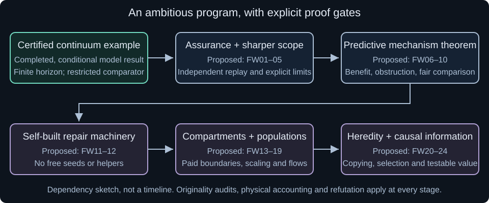

# Future work: from a certified example to a theory of self-maintaining organization

**Research agenda, not a list of established discoveries.** This program spans mathematical assurance, mechanism, chemistry, biology and operational questions about agency. Every item below is proposed. Broad neighboring fields already have substantial literatures; the novelty of each precise future claim must be audited before it is advertised as new.

The starting point is the [certified Brownian comparison](CONTINUUM-CERTIFICATE.html): at time two, one fuel-sensitive organization mechanism beats every constant paid-channel intensity in the declared family by at least 0.0110051 percentage points. It loses at sufficiently short and sufficiently long horizons. The model starts with preassembled complexes; its molecular realization, generality and publication priority remain unestablished. [What we learn and what is not novel](CONTINUUM-CERTIFICATE.html#what-do-we-learn-from-the-certified-continuum-result) · [Exact receipt](../results/continuum-validated-comparison.json)

The ambition is to build a theory that predicts **when a physical system can construct, maintain, reproduce and transmit its own organization under explicit resource limits**. A useful answer may be a sharp limitation or counterexample. Success need not take the form of a larger positive advantage.

In this agenda, fuel \(F\) and waste \(W\) are chemical species whose counts, free energies and reverse reactions enter the ledger. A catalyst participates in a reaction without being consumed by its net stoichiometry. Assembly produces functional units from building blocks; spatial organization arranges their positions or interaction states. These are distinct tasks.

## How to read the gaps

| Kind | What remains | What it means for the completed result |
|---|---|---|
| Assurance | Independent PDE recomputation, smaller trusted arithmetic kernel, clean-environment replay and external proof review. | These strengthen confidence and portability. The current computer-assisted theorem already has a stated arithmetic contract and retained evidence. |
| Scope | Exact optimizer, crossover locations, explicit robustness region, different starts, stronger comparators and other failure criteria. | The existing result does not quantify over these extensions. They are not silently included in “best fixed.” |
| Physical realization | Elementary reactions, fabrication and preparation costs, measured rates, crowding and a laboratory implementation. | The effective reaction model is not a calibrated molecular device. |
| Biological organization | Construction of repair machinery, internal regeneration, compartments, replication and heredity. | Preassembled maintenance is not a demonstration of life or an overcoming of the chemistry-to-biology barrier. |
| Originality | Exact claim comparisons and specialist scrutiny. | Correctness, usefulness and publication priority are separate questions. |

## Recommended order

Begin with **FW01–05**, which make the current result easier to trust, reproduce and interpret. Pursue **FW06–08** as the main theorem program. Make **FW11–12** the first major chemistry-to-biology extension: the previously deferred task of assembling and maintaining the repair machinery itself is still pending. Connect compartments, scaling and replication only after the accounting and failure events are stable.

Much of the proof and computation can be attempted in a solo computational project. Molecular realization and experiments require suitable expertise and facilities. This document does not claim those resources exist or that outreach has occurred. The ordering is a dependency recommendation, not a forecast of completion dates.

| Track | Work items | Desired scientific advance |
|---|---|---|
| A. Close the present study | FW01–05 | Reproducible assurance, tight comparisons and explicit domains of validity |
| B. Extract a design principle | FW06–10 | Predictive conditions for resource-sensitive regulation and useful function |
| C. Build the organization | FW11–15 | Endogenous machinery, repair dependencies, compartments and spatial scaling |
| D. Generalize the mathematics | FW16–19 | Conditional physical limits, driven systems and compositional proofs |
| E. Approach biology and agency | FW20–23 | Heredity, selection, causal information and experimental tests |
| F. Improve discovery itself | FW24 | An auditable proposal-to-theorem workflow |

## A. Close the present study

### FW01 — Independently recompute the continuum survival enclosures

**Gap.** The independent checker replays parameter coverage, source/cache hashes, exact trial continuity and scalar interval assembly. It does not independently recompute every spatial residual contraction.

**Deliverable.** A second implementation using a genuinely different validated discretization or residual representation, reproducing the spectator and full constant-family enclosures. Begin with the same physical parameters and launch, then compare all correction and tail terms.

**Acceptance test.** Compatible rigorous intervals and a documented error decomposition. Agreement between two unvalidated grids or two programs sharing the same unexamined quadrature is insufficient. A discrepancy must be explained before enlarging the scientific claim.

### FW02 — Reduce the trusted kernel and verify clean-environment reproduction

**Gap.** The primary calculation assumes its documented IEEE 754/Arb contract. Runtime probes and tests are valuable, but they do not constitute a formal verification of every floating-point operation.

**Deliverable.** Formalize the residual identity, temporal polynomial integration, Fourier-tail inequality and parameter maximum in a proof assistant or small auditable checker. Replay the full certificate from a clean checkout on independent platforms, without relying on local matrix caches.

**Acceptance test.** Missing data, altered constants, invalid tails, incomplete parameter covers and incompatible arithmetic must fail closed. State which numerical libraries remain trusted. Bit-identical output is not required across different environments if each produces a valid enclosure; mathematical compatibility is required.

### FW03 — Identify the actual best constant strategy and tighten the gap

**Gap.** The certificate bounds the constant-family supremum. It does not prove that its exact maximizer is \(\alpha=1\), or identify all maximizers.

**Deliverable.** Enclose derivatives near candidate optima, exclude competing regions and certify an attaining constant strategy. Report

\[
L_*\le\sup_{\alpha\in[0,1]}S_\alpha(2)\le U_*,
\qquad \delta_-\le G(2)\le\delta_+.
\]

**Acceptance test.** The lower endpoint comes from an admissible construction, and the upper endpoint covers the entire interval. Improve accuracy until it resolves a scientific question, not merely to accumulate decimal places. This is initially a sharpened benchmark, not a presumed conceptual discovery.

### FW04 — Determine the geometry of the advantageous time window

**Gap.** A bounded positive component around time two is proved, but its actual endpoints and uniqueness are unknown. The long-time witness is too conservative to locate a crossover.

**Deliverable.** A certified sign diagram for

\[
G(T)=S_\star(T)-\sup_\alpha S_\alpha(T),
\]

including optimizer changes, finite boundary zeros and a rigorous large-time tail. Combine time-interval enclosures with validated spectral information and ground-state overlap bounds.

**Acceptance test.** Treat the optimized envelope as potentially nonsmooth. Root counting for one fixed arm does not count the zeros of the whole envelope. Prove uniqueness under stated conditions, or exhibit multiple separated advantage windows. Do not interpolate arbitrarily many time derivatives across a generator-domain issue at time zero.

### FW05 — Certify robustness, preparation sensitivity and parameter uncertainty

**Gap.** Continuity implies an unspecified positive neighborhood; no explicit physical tolerance box has been certified. The current launch is fixed and uniform.

**Deliverable.** Give an explicit region \(\Theta\), a launch class \(\mathcal M\), and a time interval \(I\) such that

\[
\inf_{\theta\in\Theta,\,\mu\in\mathcal M,\,T\in I}
\left[S_{\star,\theta,\mu}(T)-\sup_\alpha S_{\alpha,\theta,\mu}(T)\right]>0.
\]

**Acceptance test.** Specify what uncertainty means, including correlations between measured rates. A collection of favorable sampled points does not cover a box. If the useful region is narrow, report that fact; a small gap alone does not prove fragility.

## B. Extract a design principle

### FW06 — Prove a predictive mechanism theorem

**Question.** Which balance of encounter delay, repair demand, fuel opportunity cost and reversible back reactions makes inventory-sensitive organization worthwhile?

**Deliverable.** Structural sufficient conditions for benefit, a useful quantitative lower bound, and a null regime or counterexample for a declared class of reaction diffusions. Use dimensionless inputs such as \(\eta a^2/D\), \(\kappa Na^2/D\), potential depth, affinity and compartment geometry.

**Acceptance test.** The conditions should predict behavior without solving a separate optimization at every point. The [standard sensitivity/Taylor entry point](CONTINUUM-CERTIFICATE.html#a-rigorous-entry-point-using-established-mathematics) is available; deriving its sign and a useful bound from physical structure is the unproved step. A condition that merely restates “the computed gain is positive” supplies no explanatory principle.

### FW07 — Challenge the result with stronger, fairly priced fixed designs

**Gap.** Optimizing one scalar intensity is a restricted comparator. Other static potentials, passive affinities, geometries or allocations could eliminate the advantage.

**Deliverable.** Preregister a stronger fixed-design family with matched molecule inventory, preparation, energy allowances, risk exposure and kinetic capacity. Calculate the best member with the same rigor used for the candidate.

**Accounting requirement.** For a fixed Hamiltonian and canonical equilibrium \(\pi\), the nonequilibrium free-energy difference is

\[
\mathcal F(\mu)-\mathcal F(\pi)=k_BT D_{\mathrm{KL}}(\mu\Vert\pi).
\]

Use the equilibrium of the full physical process, not a renormalized killed-survival weight. This gives a preparation-work lower bound, not an automatically attainable finite-time protocol. Changing a potential can change this allowance. Force and equilibrium weights are coupled by detailed balance, so deleting drift while retaining inconsistent reaction energetics is not a valid matched control.

**Decision test.** If a fairly priced static alternative wins, revise the claimed value of regulation instead of weakening the baseline.

### FW08 — Characterize which autonomous gates chemistry can actually realize

**Question.** Which rate profiles \(s_b\) can be implemented by low-order reactions without extra hidden stores, species or programmable observers?

**Deliverable.** A constructive map from admissible spectator reactions to fuel-dependent conductances, preserving stoichiometry, both reaction directions and local detailed balance. Establish realization limits and include catalyst construction and reset costs where required.

**Acceptance test.** An arbitrary independently optimized vector of fuel-edge rates is an upper-bound relaxation until a physical realization is supplied. A formal reaction-network construction involving extremely high molecularity is not automatically an elementary molecular mechanism. Compare the best realizable gate with the idealized design optimum.

### FW09 — Require useful output, not survival alone

**Question.** Does organization still help when the system must perform a common productive task?

**Deliverable.** A resource-consistent joint reliability/work frontier, for example

\[
\Pr\{\tau>T,\;Y(T)\ge J\},
\]

where \(Y\) counts declared net useful output or delivered work. Charge the output register, load and reversals. Establish achievable constructions and upper bounds under the same throughput requirement.

**Acceptance test.** A design cannot win by becoming inactive or by counting reversible cycling as free net production. Maximizing maintenance-only survival does not prove superior useful function. The existing theory of work and free energy is a foundation, not a new discovery to claim.

### FW10 — Price observation, memory and control explicitly

**Question.** How much of the value of an ideal state-aware controller survives when sensing, storage, response delay and reset use the same physical resources?

**Deliverable.** Compare constant gates, realizable autonomous circuits and an explicitly identified ideal-information relaxation. Derive a bound on the benefit lost to partial observation and implementation costs, using jump-process filtering or other suitable stochastic-calculus tools.

**Acceptance test.** An unpriced fully observed controller supplies an upper bound, not a fair autonomous competitor. A belief state is a mathematical description, not a free physical memory. Information-flow thermodynamics is an established neighboring field; its stationary assumptions must be checked before using it here. [Starting reference](https://arxiv.org/abs/1402.0419)

## C. Build the organization

### FW11 — Assemble and maintain the repair machinery from unorganized building blocks

**Deferred chemistry-to-biology task.** Extend the spatial model so that its functional catalysts are products of its own reactions, rather than supplied at launch. Assembly, organization and repair must share the finite inventory.

**Deliverable.** A reversible, mass- and energy-accounted network with an unconditional formation-and-maintenance outcome, such as

\[
\Pr\{\tau_{\mathrm{form}}\le t_a,\;
\tau_{\mathrm{loss}}-\tau_{\mathrm{form}}\ge T\}.
\]

Here loss is defined after formation. Applying the present “first zero healthy complexes” rule unchanged to an initially unassembled system would declare failure at time zero.

**Acceptance test.** Pay for a seed or include an admissible nucleation route. If every reaction producing an active catalyst already requires one and none is initially present, that model cannot bootstrap. Count failed formation attempts; do not report only survival conditional on successful assembly. The earlier well-mixed assembly model provides a starting case, not a completed spatial self-production theory. [Earlier study](SELF-ASSEMBLY.html)

### FW12 — Discover laws of mutual repair and repair-network topology

**Question.** Which arrangements of catalysts that repair one another are most resilient at fixed construction cost, catalytic capacity and fuel?

**Deliverable.** Compare cycles, redundant helpers, bottlenecks and distributed repair using a common first-collapse event. Seek bounds involving indispensable catalytic cut sets or directed reaction hypergraphs, with attaining networks or counterexamples.

**Acceptance test.** Adding an edge cannot supply extra catalysts or rate capacity for free. Separate stoichiometric closure, reachability and stochastic persistence: an autocatalytic set need not remain functional for a long time in a finite population. Structural autocatalysis algorithms and chemical organization theory are established foundations. [Hordijk–Steel](https://pubmed.ncbi.nlm.nih.gov/15038982/) · [Dittrich–Speroni di Fenizio](https://pubmed.ncbi.nlm.nih.gov/17415616/)

### FW13 — Make compartments endogenous and costly

**Question.** Can a system build a boundary that improves encounters enough to repay membrane, transport and maintenance costs?

**Deliverable.** Couple assembly to compartment size, permeability, leakage, osmotic work and boundary failure. Compare self-built confinement with equally priced passive adsorption or preconstructed confinement.

**Acceptance test.** A reflecting wall or smaller volume cannot appear as a free intervention. Reversible placement and transport rules must match the declared equilibrium or driving. Determine whether survival benefits remain after paying for the boundary and its repair. [Spatial detailed-balance foundation](https://arxiv.org/abs/2201.04099)

### FW14 — Determine how lifetime scales with system size and reserve

**Question.** Does resource-sensitive organization change a large-deviation exponent, only a prefactor, or neither?

**Deliverable.** Specify a limit with \(M\) functional units, reserve \(N_M\), volume and reaction rates scaled consistently. Prove or refute an asymptotic law such as

\[
\lim_{M\to\infty}M^{-1}\log\mathbb E[\tau_M]=I,
\]

only in a regime where that form is justified. Retain the exact small model as a checkpoint.

**Acceptance test.** Separate organizational benefit from ordinary redundancy. An “all units fail simultaneously” event can become rare merely by adding units. Closed-reserve depletion can invalidate a stationary metastable approximation. Gaussian diffusion approximations near extinction require particular care; retain the discrete reaction physics in the rare-event analysis. [Extinction theory starting point](https://arxiv.org/abs/0907.0070)

### FW15 — Add orientation, crowding and paid active search

**Question.** Are encounter delays still decisive when binding needs the right orientation, mobility depends on conformation, and other molecules obstruct motion?

**Deliverable.** A controlled sequence of transport models with calibrated or bounded changes: rotational diffusion, excluded volume, confinement geometry and then energy-consuming motility. Derive useful encounter/survival bounds rather than simply adding a larger simulator.

**Acceptance test.** Thermal diffusion is different from active propulsion. A motor or nonconservative drive must have an explicit energy source and ledger. Validate a limit in which the existing model is recovered, and identify where a well-mixed approximation becomes provably adequate or inadequate.

## D. Generalize the mathematics

### FW16 — Find conditional resource–lifetime bounds and their obstructions

**Question.** What universal statements remain possible once energy, geometry, damage exposure and kinetic capacity are all specified?

**Deliverable.** A sharp bound with a matching construction or a no-go theorem explaining why the proposed bound cannot exist. Explore resource-aware supermartingales and stopped reaction currents, retaining reverse fuel-regenerating events.

**Mandatory obstruction check.** Energy alone cannot set an absolute kinetic lifetime. Rescaling a generator to \(L_c=cL\) preserves its equilibrium while

\[
S_c(t)=S_1(ct),\qquad \mathbb E[\tau_c]=\mathbb E[\tau_1]/c
\]

when the mean is finite. Thus a nontrivial absolute bound needs a physical time/risk scale, not just an upper rate ceiling that permits arbitrarily slow damage. This elementary time-rescaling observation is not claimed as new.

**Acceptance test.** State optional-stopping and integrability assumptions. Failure at a health boundary is not automatically passage through an entropy-production threshold; steady-state stopping identities cannot simply be applied to a relaxing finite-reserve launch. [Stopping thermodynamics](https://arxiv.org/abs/1903.08115) · [First-passage current bounds](https://arxiv.org/abs/1706.09027)

### FW17 — Introduce metabolism and open resource flows

**Question.** What changes when the system can replenish fuel or harvest work from an explicitly modeled environment?

**Deliverable.** An open-system counterpart with supply, waste removal, transport, chemostat maintenance or environmental energy explicitly charged. Compare finite-episode persistence with sustained nonequilibrium operation under a common input-power budget.

A chemostat maintains specified concentrations by external exchange. Chemical affinity is the chemical-potential driving for a reaction, and its dependence on composition must be retained.

**Acceptance test.** Do not reuse the present common-Gibbs self-adjoint spectral ordering after introducing incompatible driving. Determine when a longer lifetime is bought by greater throughput from the environment. An open sustained regime is a different model from the current closed finite-inventory benchmark.

### FW18 — Optimize survival in changing or adversarial environments

**Question.** Which conclusions survive uncertain hazards, correlated shocks and changing spatial conditions?

**Deliverable.** A robust or Bayesian model with an explicitly stated uncertainty set, observation process and common resource budget. Study the difference between optimizing average survival and protecting the worst admissible environment.

**Acceptance test.** Correlated hazards can defeat ordinary redundancy. An adversary cannot change parameters beyond the declared physical constraints, and a controller cannot observe hidden changes for free. Certify the uncertainty set rather than treating favorable random scenarios as a guarantee.

### FW19 — Build compositional, resource-preserving coarse-graining

**Question.** Can modules be connected or simplified while preserving a first-passage guarantee and the fuel ledger?

**Deliverable.** Conditions for exact lumpability or bounded-error reduction, followed by a composition theorem for survival certificates. Maps should preserve specified inventories, failure predicates and relevant preparation information; quantify errors when spatial memory is discarded.

**Acceptance test.** Calling a network a category or drawing a commutative diagram is not the result. Require a concrete theorem that transfers an observable bound through the map or interconnection. Compositional reaction networks and Markov processes already exist; the target is a useful resource/first-passage extension with audited priority. [Reaction networks](https://arxiv.org/abs/1704.02051) · [Markov composition](https://arxiv.org/abs/1508.06448) · [Coarse-graining](https://arxiv.org/abs/1710.11343)

## E. Approach biology and agency

### FW20 — Couple maintenance to replication, division and heredity

**Question.** Can internally maintained organization reproduce itself while transmitting useful structure?

**Deliverable.** Explicit templates, copying errors, building blocks, division and partitioning, with paid construction and common environmental support. Compare survival, viable offspring, copying fidelity and resource efficiency.

**Acceptance test.** A long-lived nonreproducing system is not necessarily evolutionarily fit. Copying and division must not be free model operations. Closed finite-resource episodes and indefinitely growing populations need different supply assumptions. Self-replication thermodynamics has direct precedents; a new contribution needs a narrower claim. [Starting reference](https://arxiv.org/abs/1209.1179)

### FW21 — Study ecology, collective repair and the origin of division of labor

**Question.** When does it pay for units or compartments to share repair, specialize or compete for fuel?

**Deliverable.** A population of resource-accounted units with exchange, spatial competition and heritable variation. Seek conditions under which cooperation or specialization changes persistence or reproductive success, and identify vulnerability to exploiters or correlated collapse.

**Acceptance test.** Compare total community input, construction and delivered function. Apparent cooperation cannot be an uncharged transfer from an external helper. Distinguish selection for short-term individual survival from selection for lineage growth. A new population model does not automatically supply a new evolutionary principle.

### FW22 — Measure the causal value of information and organization

**Question.** Which correlations or internal structures are necessary for continued functioning, rather than merely present while it functions?

**Deliverable.** Resource-matched counterfactual interventions with a declared viability functional \(V\), for example

\[
\Delta V=V(\mu)-V(\mathcal I\mu),
\]

where \(\mathcal I\) removes a specified correlation or structural coupling. Account for the free energy changed by the intervention itself. Compare useful information with total Shannon correlation and with chemically implementable observations.

**Acceptance test.** A survival-based value is operational and depends on the chosen system boundary and task. It is not a proof of consciousness, moral value or intrinsic purpose. Causally defined semantic information already has a substantial precedent. The new target would be a precise resource-accounted extension or obstruction. [Kolchinsky–Wolpert](https://arxiv.org/abs/1806.08053)

### FW23 — Translate the model into a falsifiable experiment

**Question.** Can a real molecular or colloidal system realize the relevant channels and measurable first-collapse outcome?

**Deliverable.** Select a feasible chemistry with domain expertise; measure rates, affinities, transport and preparation costs; preregister controls and power analysis. Propagate parameter uncertainty through the theoretical comparison. Prefer a robust, experimentally resolvable regime before treating the current small margin as an experimental target.

**Acceptance test.** Endpoint cluster yield or fluorescence is not automatically uninterrupted functional survival. Separate evidence of assembly from evidence of repair and their common budget. Finite-step trajectories that validate broad dynamics do not statistically resolve an arbitrarily small survival gap. Report negative results and uncertainty rather than fitting away discrepancies. [Existing experimental-feedback precedent](https://pubmed.ncbi.nlm.nih.gov/39557837/)

## F. Improve discovery itself

### FW24 — Build a rigorous AI-assisted discovery and refutation loop

**Question.** Can automated exploration produce hypotheses whose physical accounting and proof obligations are independently checkable?

**Deliverable.** A pipeline from typed reaction specifications to conservation laws, detailed-balance checks, candidate mechanisms, validated optimization and small replayable certificates. Keep the approximate proposer separate from the correctness checker. Add independent implementations, held-out model families and adversarial certificate tests.

**Acceptance test.** Search engines, language models and optimization scores are not originality certificates. Penalize hidden resources and failed accounting before optimizing performance. Retain counterexamples and failed hypotheses. Evaluate whether the workflow finds useful new theorems or well-defined obstructions, rather than merely producing more documents or favorable numerical instances.

## A compact program worth committing to

| Gate | Concrete release | Continue when… | Reconsider when… |
|---|---|---|---|
| 1. Assurance | Independent continuum implementation and clean replay, FW01–02 | Interval comparisons agree under explicit arithmetic assumptions. | A disagreement or hidden dependency remains unexplained. |
| 2. Explanation | A mechanism claim with a constructive bound and null case, FW06–08 | Its conditions are physically meaningful and survive the closest prior-theorem comparison. | The claim is only a repackaged gradient identity or a weaker baseline. |
| 3. Scope | Explicit robustness, a stronger static family and useful-output comparison, FW05/07/09 | The advantage survives, or a sharp limitation is established. | Extra free preparation, geometry or kinetic capacity accounts for the result. |
| 4. Self-production | Formation and maintenance of internally constructed repair machinery, FW11–12 | Unconditional success is certified with all seeds and helpers charged. | Function depends on uncounted supplied organization or postselection. |
| 5. Biology-facing synthesis | Compartments, replication and lineage persistence, FW13/20/21 | Mass, energy, heredity and environmental supply are explicit and testable. | Biological labels outrun the mechanisms actually modeled. |

This is a research portfolio, not a requirement to pursue all 24 items simultaneously. The main conceptual bet is FW06; the major biology-facing bet is FW11–12. Strong negative theorems are valid outcomes of either.

## Evidence and originality contract for every future project

Before a major run, write the exact claim and its negation, the full comparator, all resources, the launch/preparation, the failure or work event, and the admissible interventions. Specify proof obligations and the evidence that could refute the mechanism. Audit the nearest theorems and experiments by their actual assumptions and conclusions.

Retain source versions, environments, units, exact inputs, separate truncation/quadrature/roundoff/sampling budgets, full optimization coverage and rejected hypotheses. Label calculator, checker and external-review independence precisely. A narrower certified statement is preferable to an unsupported broad one. Specialist review and experimental collaboration require appropriate arrangements and user approval before outreach.

The foundational links above are starting points, not evidence that these directions are unoccupied. [Scope of this source check](../research/future-work-sources.md) · [Current research assessment](CONTINUUM-CERTIFICATE.html#does-this-establish-anything-conceptually-new) · [Development journey](DEVELOPMENT-JOURNEY.html)
