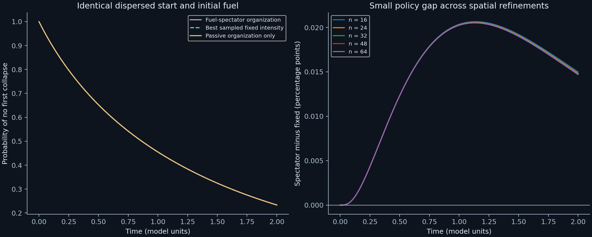

## Paid autonomous organization: the next verified benchmark

The system now starts uniformly dispersed and forms a finite-depth attractive interaction mode through reversible passive and fuel-paid reactions. Organization and repair share four fuel/waste molecules. A spectator-fuel reaction provides a local response to inventory without an external controller. [Full model, stochastic calculus, proofs and visuals](PAID-ORGANIZATION.html).

At the prespecified time two, the n=48 finite-grid certificate bounds the gap to **the optimum over all constant paid-binding intensities alpha in [0,1]** between **0.014604 and 0.014715 percentage points**. The n=64 numerical values are 23.369977% survival for the candidate and 23.355279% for the fixed attaining sample. This is a small effect, not the earlier 23-point free-localization benefit.

There are 57 passing tests, 60,000 independent finite-lattice paths, 180,000 separate continuum SDE paths and stopped fuel/organization ledgers. The path precision cannot resolve the small policy gap; the interval certificate proves it for the stated finite grids. The subsequent [validated Brownian comparison](CONTINUUM-CERTIFICATE.html) addresses the continuum error and the complete constant-intensity family. Removing the attractive well reverses the n=16 comparison, but that changes both force and binding energetics. An open-bath limit gives an exact no-advantage control when the spectator generator equals a fixed-family member.

The comparison is against best constant paid-channel intensity with shared other parameters, not all fixed organizations or molecular architectures. Real molecular recognition/fabrication costs remain unverified. The audit records 29 queries and 26 sources; no new general concept or established publication priority is claimed. [Audit](../research/organization-originality-audit.md) · [Interval/path receipt](../results/organization-verification.json) · [Continuum step check](../results/organization-continuum-check.json).
