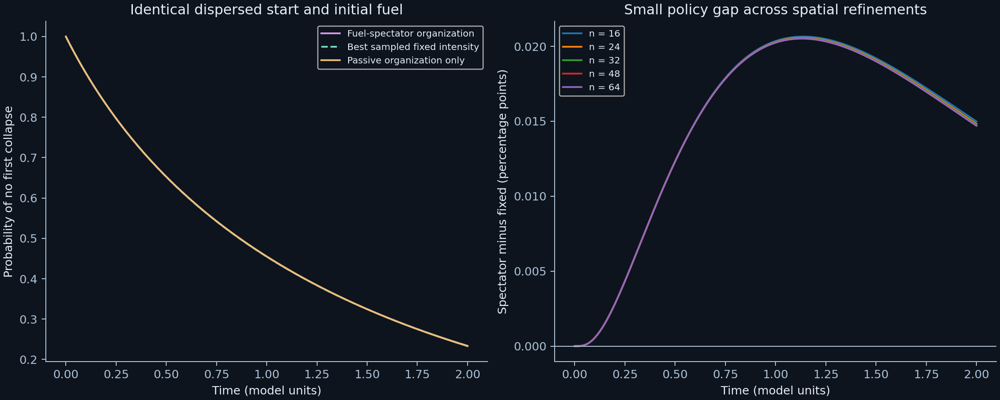
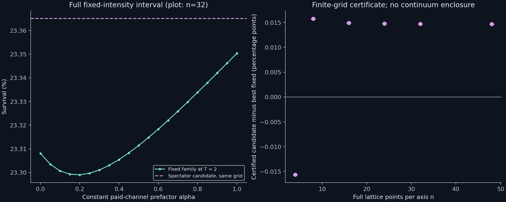
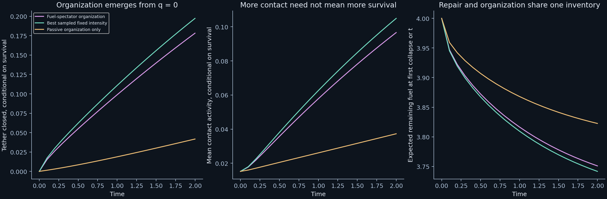

# Paid autonomous spatial organization: a small certified finite-grid effect

This study asks whether a system starting dispersed can use the same finite fuel stock to organize its repair partners and repair damage, and outperform a specified best constant strategy. An originality audit and a written benchmark specification preceded the experiment. The result is a small finite-grid advantage, not a new general principle or a demonstrated biological mechanism. [Audit](../research/organization-originality-audit.md) · [Search and access receipt](../research/organization-search-receipt.json) · [Preregistered instance](../research/organization-preregistration.md)

**“Best fixed” has a precise, restricted meaning here:** every constant paid-binding prefactor \(\alpha\in[0,1]\), with all other landscape and kinetic parameters shared. It does not mean every fixed material, affinity, architecture or time-homogeneous reaction network. The autonomous network itself has time-homogeneous rates. The comparison is against constant paid-channel intensity in the stated model.

## 1. Model and identical starting resources

Two preassembled functional complexes start with one healthy and one damaged, uniformly dispersed in a periodic cube, in an open interaction mode \(q=0\), with four fuel molecules and no waste. Collapse is the first time both complexes are damaged. The mission is survival to the prespecified model time \(T=2\). Initial function does not require a dimer, so this is maintenance supported by self-generated organization, not formation-conditioned selection.

The state is \((x,h,b,q)\), where \(x\in\mathbb T_L^3\), \(h\in\{0,1,2\}\), \(b\in\{0,\ldots,N\}\), \(w=N-b\), and \(q\in\{0,1\}\). Define

\[
v(x)=\left(1-\frac{|x|_{\rm per}^2}{a^2}\right)_+^2,
\quad g=v^2,\quad U_0=0,\quad U_1=\delta-Ev.
\]

In mode 1 the pair has a finite-depth attractive potential. It is not a rigid tether: the particles can leave contact while remaining in that mode. Mode changes do not teleport particles or reset their positions. Between chemical jumps,

\[
dX_t=-D\nabla U_{q_t}(X_t)\,dt+\sqrt{2D}\,dW_t\pmod L.
\]

The drift is the thermal force associated with the interaction energy, unlike the force-free previous study. Its piecewise polynomial gradient is Lipschitz. Bounded reaction intensities coupled to this diffusion define a nonexplosive switching process.

@@PARAMETERS@@

All arms share this potential, inventory, initial distribution, passive channel, damage/repair channels and maximal paid-channel ceilings. These are hypothetical dimensionless parameters. No molecular synthesis cost or elementary recognition mechanism for an engineered spectator-binding site has been established. Equal model resources must not be interpreted as a demonstrated equality of real molecular fabrication costs.

## 2. Paid formation and its microscopic reverse

Thermal damage and restoration retain per-complex rates \(\eta\) and \(\eta/2\). Contact repair retains the previous reversible rates \(\kappa b g\) from HD to HH and \(\kappa wg/2\) from HH to HD, with the accompanying fuel/waste change. They are the same in both interaction modes.

Write \(m(u)=\min(1,e^{-u})\). At a common position and healthy count, the additional reversible edges are:

| Edge | Forward rate | Reverse at its destination |
|---|---|---|
| Passive: \((q=0,b)\leftrightarrow(q=1,b)\) | \(k_0g\,m(U_1)\) | \(k_0g\,m(-U_1)\) |
| Paid: \((q=0,b)\leftrightarrow(q=1,b-1)\) | \(k_1g\,b\,s(b)m(U_1)\) | \(k_1g\,(w+1)s(b)m(-U_1)/8\) |

Every permitted event has its reverse. In the constant family \(s(b)=\alpha\). In the autonomous candidate,

\[
s(b)=\frac{b-1}{N-1}.
\]

The second factor corresponds to a fuel spectator: open mode plus \(2F\) reversibly becomes closed mode plus \(F+W\). Forward propensity is proportional to \(b(b-1)\), while reverse propensity at the destination is proportional to \((b-1)(w+1)\). The spectator comes back unchanged. This is an effective concerted reaction law, not an external lookup of the reserve or a controller with an unpaid measurement record.

At full fuel, the candidate and \(\alpha=1\) have identical paid binding power. At the last fuel molecule the candidate disables that paid edge in both directions. The constant family includes passive-only organization (\(\alpha=0\)) and all intermediate paid intensities, not just the two endpoints. Suppression of reverse paid events is also part of the candidate's behavior; preserving the last fuel molecule is not established as the sole cause of any benefit.

## 3. Thermodynamic accounting and exact proofs

### Proposition 1: common equilibrium and common initial free energy

The full uncensored process has Gibbs density proportional to

\[
\pi(x,h,b,q)\propto
\binom2h 2^{2-h}\binom Nb8^{-b}e^{-U_q(x)}.
\]

This law is shared by every constant arm and the spectator arm. Diffusion satisfies zero flux with density proportional to \(e^{-U_q}\). The passive jump ratio is \(e^{-U_1}\). Across a paid edge the Gibbs target/source ratio is \(8b e^{-U_1}/(w+1)\), exactly its directional rate ratio; the common \(s(b)g\) cancels. Where it vanishes both fluxes vanish. Damage and repair preserve the previous local balance ratios, including the label multiplicity of HH/HD. Combining these reversible components proves detailed balance. The common initial law and common \(\pi\) give equal initial nonequilibrium free energy relative to the same equilibrium reference.

Thus installing the interaction state is a chemical energy change accounted for in the transition ratio. It is not an externally switched potential supplied for free.

### Proposition 2: stopped fuel, organization and energy identities

Let \(J_D,J_R,J_P,J_0\) be signed forward damage, repair, paid mode closure and passive mode closure counts. At every time, and at \(t\wedge\tau\),

\[
\Delta h=-J_D+J_R,\qquad
\Delta b=-J_R-J_P,\qquad
\Delta q=J_P+J_0.
\]

The dimensionless state energy is \(b\log8-(2-h)\log2+U_q(x)\). Therefore

\[
\Delta\mathcal E=-J_D\log2-J_R\log4-J_P\log8+\Delta U.
\]

The potential increment includes continuous motion and conformational jumps. These are state and event identities, proved by checking the increments of each channel and summing. Fuel is conserved with waste but may be regenerated by reverse reactions. There is no externally replenishing fuel reservoir in the closed comparison.

For killed calculations, live endpoint fuel excludes the fuel held by already collapsed trajectories. To obtain fuel remaining at the stopped time, add the absorption reward \(\int_0^t\eta\,\mathbb E[b_s\mathbf1_{h_s=1,\tau>s}]\,ds\). The analogous reward retains mode \(q\) at collapse. The implementation checks these stopped expectations against integrated directional counts.

### Proposition 3: survival and the switching-diffusion generator

For smooth periodic \(f\),

\[
\mathcal Lf=D(\Delta f-\nabla U_q\cdot\nabla f)
+\sum_j a_j[f(z+\nu_j)-f(z)].
\]

Itô's formula and compensated reaction clocks give the generator martingale, stopped at \(\tau=\inf\{t:h_t=0\}\). The killed backward equation is \(\partial_tu=\mathcal L_{\rm kill}u\), with initial payoff one on live states and zero on failure. The probability of interest averages this solution over the common dispersed launch. This is first-collapse survival, not full-chain occupancy after possible recovery. [Explicit stochastic-calculus chapter](STOCHASTIC-CALCULUS.html)

### Finite-grid short-time controls: paying first can hurt

The following Taylor identities are asserted for each specified finite lattice generator, where all time derivatives exist. Angle brackets denote the orbit-weighted common spatial launch. The Metropolis acceptance factor has a kink at zero energy difference; a continuum fourth-order statement would require a separate generator-domain or weak-adjoint justification.

The first two survival derivatives are independent of the organization policy. From the common HD/full-fuel/open-mode launch,

\[
S_\alpha'''(0)-S_0'''(0)
=-\alpha\eta\kappa k_1N\langle g^2m(U_1)\rangle.
\]

The spectator and \(\alpha=1\) agree through cubic order. Hence passive-only organization beats these paid arms for sufficiently short missions. The paid reaction consumes repair fuel before its force has time to change contact statistics.

One more generator application gives

\[
S_{\rm spectator}^{(4)}(0)-S_1^{(4)}(0)
=\frac{\eta\kappa^2Nk_1}{2}\langle g^3m(U_1)\rangle>0.
\]

To see the latter term, write the common \(\mathcal L^2\mathbf1\) as a position-dependent function of health and fuel, independent of mode. The two organization generators have identical rows at the full-fuel open launch. The first relevant difference becomes reachable after repair to HH with \(N-1\) fuel: the fixed arm's excess paid rate is \(k_1g m(U_1)\), and its extra fuel loss changes \(\mathcal L^2\mathbf1\) by \(-\eta\kappa g/2\). Multiplying by the initial repair rate \(\kappa Ng\) gives the displayed positive spectator-minus-fixed coefficient. These are model-specific Taylor identities, not a claim of a new general stochastic-calculus principle. Their local signs do not establish the full-time optimum.

## 4. Certifying the full constant-intensity interval

The numerical spatial model is a periodic nearest-neighbor lattice with energy-tilted diffusion rates

\[
q^q_{ij}=D(n/L)^2\exp[-(U_q(j)-U_q(i))/2].
\]

These satisfy exact finite-model detailed balance under the Gibbs orbit weights. The quotient by signed permutations is exact for that lattice and the common launch. It remains a discretization of the switching diffusion.

For the fixed arm, \(Q_\alpha=A+\alpha B\). Choose dominating rates \(r_0,r_1\) for the base and paid generators, giving substochastic \(P=I+A/r_0\) and stochastic paid kernel \(R=I+B/r_1\). Conditional on \(n\) base and \(m\) paid Poisson candidates, uniformly interleaving their orders gives

\[
v_{n,m}=\frac n{n+m}Pv_{n-1,m}
+\frac m{n+m}Rv_{n,m-1},\qquad v_{0,0}=\mathbf1.
\]

Average over the independent base Poisson count to obtain \(u_m\in[0,1]\), then

\[
S(\alpha)=\sum_{m\ge0}e^{-\alpha r_1T}
\frac{(\alpha r_1T)^m}{m!}u_m.
\]

Differentiate this series using first and second differences of \(u_m\). An interval Taylor cover of the entire \([0,1]\) domain bounds the supremum. The independent verifier enumerates channels and lattice jumps separately, encloses exponential rates with directed Decimal arithmetic, propagates nonnegative interval kernels with conservative binary64 roundoff padding, and bounds discarded Poisson tails. It includes endpoint and interior-optimum controls. A sampled optimizer alone would not supply this upper bound. [Certificate construction and assumptions](../research/organization-verification-design.md) · [Executable verifier](../scripts/verify_organization.py)

The certificate concerns the exact specified **finite lattice model** under the verifier's arithmetic model, not the Brownian continuum. Production Chebyshev calculations are checked against these independent intervals. Series truncation, floating-point bounds, spatial discretization and statistical sampling are distinct error sources.

[Analytic optimizer controls](../results/organization-certificate-controls.json) retain an interior maximum and both endpoint maxima with known exact values. The same attaining fixed sample selected at T=2 on the finest certified grid is reused for the displayed time curves and other refinement levels. It is not claimed to optimize every time or to be the exact maximizer in place of the reported supremum enclosure.

## 5. Results at the preregistered horizon

@@CERTIFICATES@@

@@REFINEMENT@@





**The advantage is small.** Do not confuse approximately 0.0147 percentage points here with the previous 23-point free-localization effect. The present arms begin with the same dispersed preparation and pay for additional organization.

## 6. Does organization actually emerge, and is it paid?



@@ORGANIZATION@@

Interaction-mode occupancy, spatial contact and paid event counts are different observables. Passive binding can close the mode without fuel, so occupancy alone is not proof of paid formation. The receipt retains gross forward/reverse counts and stopped resource ledgers. More clustering need not give more survival: the full-intensity arm can maintain more contact while spending more fuel or exposing the pair to reverse chemistry.

## 7. Open-bath diagnostic and its no-go statement

For ideal macroscopic fuel/waste activities \(f,w\), fixed paid rates are proportional to \(\alpha f\) and \(\alpha w/8\). Spectator rates are proportional to \(f^2/(N-1)\) and \(fw/[8(N-1)]\). At \(f=N-1=3,w=1\), the spectator generator is exactly the \(\alpha=1\) fixed generator at every spatial and chemical state. It therefore cannot outperform the optimum over \(\alpha\in[0,1]\) in that open-bath model, at any time.

This equality is a controlled diagnostic of the inventory response, not a fair energetic competitor to the closed system. It removes both finite depletion and discrete fuel fluctuations, changes initial reverse activity, and is not an initial-rate-matched ablation. It does not prove that depletion alone causes the observed closed-model gap. Naively clamping the closed discrete count at \(b=N\) would incorrectly give different spectator factors at the two endpoints; macroscopic activities must be substituted consistently into the reaction stoichiometry.

### Removing the attractive well

@@ABLATION@@

This diagnostic sets only the well-depth parameter to zero at the same horizon and certifies the same constant-intensity family on n=16. It changes both mechanical attraction and the energy differences controlling mode transitions. It therefore is not a clean isolation of the force from every other effect of the well. The early quartic policy difference above can occur before diffusion influences the relevant generator terms; that fact also prevents attributing all of the advantage to mechanical attraction.

## 8. Independent verification and limits

@@VERIFICATION@@

@@CONTINUUM@@

Independent path sampling checks overall dynamics and event ledgers. Its sampling uncertainty is much larger than the roughly \(1.5\times10^{-4}\) survival difference, so it does **not** statistically establish the small policy advantage. That comparison is supported by the finite-model interval certificate. Spatial refinement and finite-step SDE comparisons do not constitute a rigorous continuum advantage proof.

## 9. Originality and scientific significance

The audit found close precedents for autonomous batch-fuel assembly, reversible regeneration, feedback in self-assembly and improvement over constant interactions. It inspected 29 exact search queries and retained 26 source records. The exact bounded comparison here was not identified in those inspected sources, but absence of an exact match is not proof of originality. [Full claim-by-claim audit](../research/organization-originality-audit.md)

The result is a narrow, reproducible example: a spectator-dependent paid organization reaction can beat the best constant paid-channel prefactor on the certified lattice, under shared model resources. It does not establish superiority over all fixed organizations or the best possible passive material. The construction uses hypothetical effective reaction laws; a molecular implementation, fabrication costs and a rigorous continuum discretization enclosure remain open. This is a step toward studying endogenous organization, not an overcoming of the chemistry-to-biology barrier.

## Reproduce

```powershell
python -m pip install -e .
python -B scripts/verify_organization.py
python -B scripts/run_organization.py
python -B scripts/run_organization_ablation.py
python -B scripts/organization_continuum_check.py
python -B scripts/build_organization_docs.py
```

The documentation builder additionally needs Markdown and Playwright/Chrome. The fine certificate can require substantial RAM and time; its exact levels, arithmetic, source hashes and path seeds are retained. No credentials or external data are needed to reproduce the numerical model.

[Core model](../src/purposeful/organization.py) · [Independent tests](../tests/test_organization.py) · [Numerical data](../results/organization.json) · [Finite-grid certificate and path receipt](../results/organization-verification.json) · [Continuum timestep check](../results/organization-continuum-check.json) · [Model equations](../research/organization-model-design.md)
