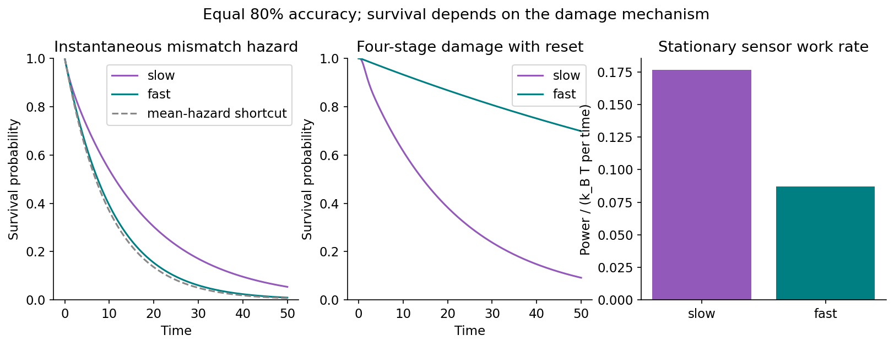
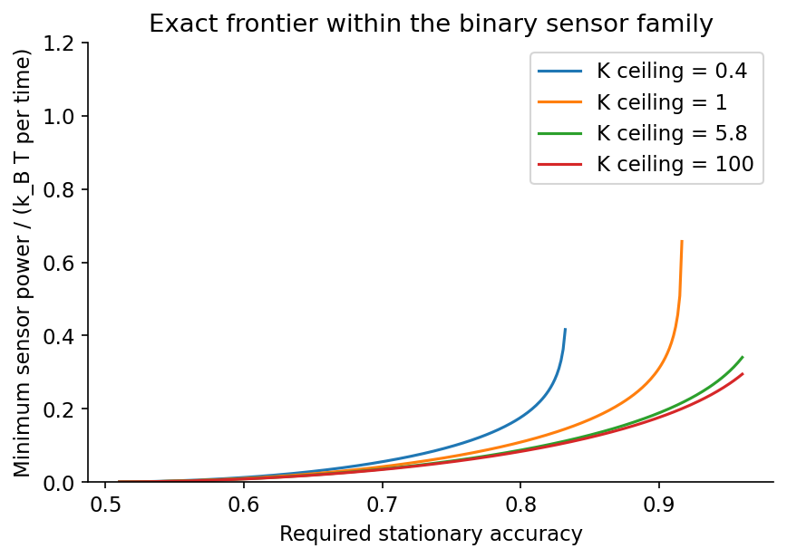

# Physical sensing costs do not uniquely rank task survival

**Research note, version 0.1 — 16 November 2026**  
**Status:** analytical and computational results in a restricted model; novelty unestablished; not peer reviewed.

## Abstract

We investigate a specific bridge between physical information processing and sustained functional behavior. A binary memory responds to an externally switching signal through thermal transitions satisfying local detailed balance. We derive the exact stationary power required to meet an accuracy target under a kinetic-capacity ceiling, and couple the resulting dynamics to two explicit effective failure laws. At fixed environment and accuracy, increased kinetic capacity lowers the sensor's stationary work rate but increases its asymptotic failure exponent under instantaneous mismatch-dependent killing. For the same sensor pair, a multistage exposure-and-reset law reverses the finite-time survival ranking. Matrix-exponential calculations, full-state thermodynamic flux checks, and independent event-driven simulations test the results. These statements do not constitute universal bounds on agency or a complete physical model of self-maintenance. Their contribution is a reproducible account of why temporal error structure and failure mechanisms must be included when connecting information efficiency to task survival.

## 1. Research question and relation to the broader ambition

The motivating ambition is to make explanations traverse the boundary from physical dynamics through information to useful and persistent activity. A general claim that information has thermodynamic cost is already established. Likewise, formal work already connects information to viability and agency [L1–L5 in the literature audit]. The question here is narrower: can stationary information quality and energetic efficiency reliably order continued task performance?

We study a controlled counterexample with identical environmental statistics and identical stationary accuracy. The task is to match an external binary condition. Mismatch can cause failure immediately at a specified hazard or through a multistage exposure mechanism. This is a minimal effective task model. A physical actuator, repair work, and resource-dependent degradation are deliberately left open and must not be inferred from the word "survival."

## 2. Explicit physical assumptions

The signal flips at rate r. A thermal memory has a mismatch energy gap A in units of k_B T_bath. Its correction and error rates are a=K/(1+exp(-A)) and b=K/(1+exp(A)); therefore log(a/b)=A. The external source that changes the signal also supplies or recovers the work required to change the memory's energy. Its separate signal-generation cost is outside the boundary. Hardware costs associated with large K are unmodeled; we explicitly constrain K where making minimum-cost claims.

The mismatch variable is a two-state Markov process, with entry u=r+b and exit v=r+a. Put s=2r+K, q=u/s and d=1-2q. Stationary accuracy is 1-q, mutual information is ln 2+q ln q+(1-q)ln(1-q), and stationary net work/heat throughput is P=A r d. All quoted power values concern this continuously operating, unfailed stationary sensor. They are not average costs conditioned on survival, finite-battery budgets, or costs of the effective repair process.

## 3. Bound and construction

For accuracy at least 1-q_star and K<=Kmax, the exact family-restricted minimum is

    Pmin = 2 r d_star atanh[d_star(1+2r/Kmax)], d_star=1-2q_star.

It is finite only when d_star<Kmax/(2r+Kmax). The attaining construction uses K=Kmax and A=2atanh[d_star(1+2r/Kmax)]. The proof is monotonicity in accuracy and capacity; the complete derivation is in `model.md`. The usual information–dissipation inequality is recovered as an unlimited-capacity limiting case. This is a specialization/derivation, with no priority claim.

## 4. Linking temporal structure to reliability

Under failure law H, mismatch produces additional hazard h, optionally atop baseline delta. Exact survival is the exponential of a two-state killed generator. At stationary initialization, its path expression is E exp[-delta T-h integral Z(t)dt]. Consequently exp[-(delta+hq)T] is a lower bound, not the exact answer. Temporal correlations matter.

At fixed accuracy the asymptotic exponent is delta+(s+h-sqrt((s+h)^2-4qsh))/2. Its derivative with respect to s is positive, whereas physical sensor power decreases with K and s. More thermodynamically efficient sensing can therefore have a larger asymptotic failure exponent under this particular task. The effect is driven by survivor selection: slow trajectories include persistent matches that dominate the surviving population. It must not be interpreted as a universal preference for slow or inaccurate sensors.

Failure law D instead advances through n damage stages while mismatched and resets upon matching. This distinguishes long uninterrupted exposure from repeated short exposures. For n=1 it reproduces law H with h=1/tau; for larger n it can reverse the sensor ordering.

## 5. Constructive comparison

With r=0.1 and accuracy 0.8, choose K=0.4 and K=5.8, adjusting the energy gap to preserve accuracy. Both store approximately 0.192745 nats of instantaneous information. Their stationary power is respectively 0.176666 and 0.087135 k_B T_bath per time unit.

At horizon 20, the slow and fast designs survive law H (h=0.5) with probabilities approximately 0.302646 and 0.153486. Under law D (four stages, mean uninterrupted damage duration 2), the corresponding probabilities are 0.382572 and 0.867882. Thus the faster, lower-dissipation sensor is worse under one task law and better under the other. The two laws are calibrated to the same mean lethal uninterrupted exposure of 2; their distributions of lethal duration differ. These are within-law sensor comparisons, not a claim that the two failure processes are equivalent.

## 6. Verification and transfer

The package checks local detailed balance, stationary distributions, and equality of heat, external work, and entropy production using independent four-state flux accounting. The full four-state killed generator agrees with the reduced two-state survival formula. Exact matrix exponentials are compared with seeded Gillespie simulations with reported Wilson intervals. The single-stage damage model reproduces the instantaneous-hazard model exactly.

The generated `summary.json` and `verification.md` contain numerical residuals and Monte Carlo results. The transfer experiment sweeps four target mismatch levels, three horizons, four damage depths, and three initial conditions, for 144 cases. It records successes and failures of the ranking reversal rather than discarding inconvenient cases. The grid counts do not estimate any probability over real environments. No biological or device measurements were used.

## 7. What is connected and what remains missing

The demonstrated chain is: microscopic transition rates and energy gap -> stationary information and temporal correlation -> path-dependent effective survival. An explicit restricted bound gives the physical price of one part of the chain. The reversal explains why a static information measure cannot substitute for the temporal and causal structure of a task.

The next barrier is reciprocal coupling: finite reserves and damage should modify sensing and action, while those processes replenish or deplete the reserves. A thermodynamically consistent repair mechanism must include the work of resetting damage. Without these extensions, the present construction is a driven sensor with a reliability criterion, not a self-maintaining agent.

## 8. Candidate contribution and publication threshold

The useful candidate is the joint treatment of a transparent physical sensing frontier and task-dependent reliability ordering. The constituent information-thermodynamic and Markov-process methods are established. Neither a new fundamental law nor literature priority has been established. Before publication, broader review of sensory efficiency, dynamic disorder, Markov-modulated survival, and intermittent-exposure models is required. An empirical implementation would further test the physical adequacy of the model.

## References

Full linked references, inspected sections, searches, and novelty limitations are recorded in [the literature audit](../research/literature.md). Complete proofs and preparation assumptions appear in [model.md](model.md). Executable code is in `src/purposeful/model.py`.
