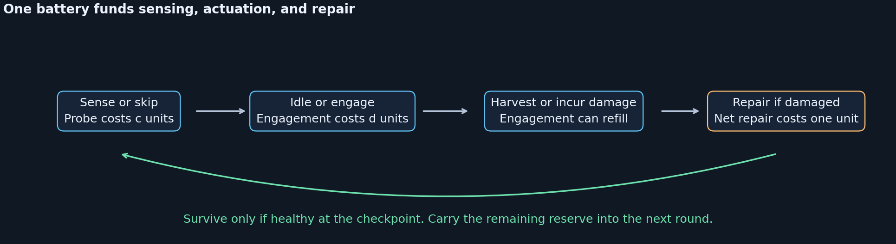
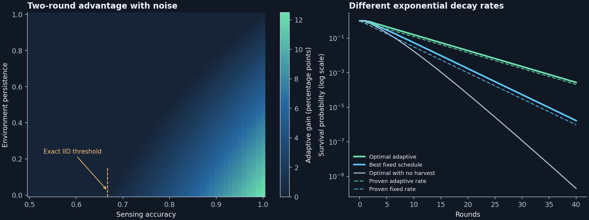
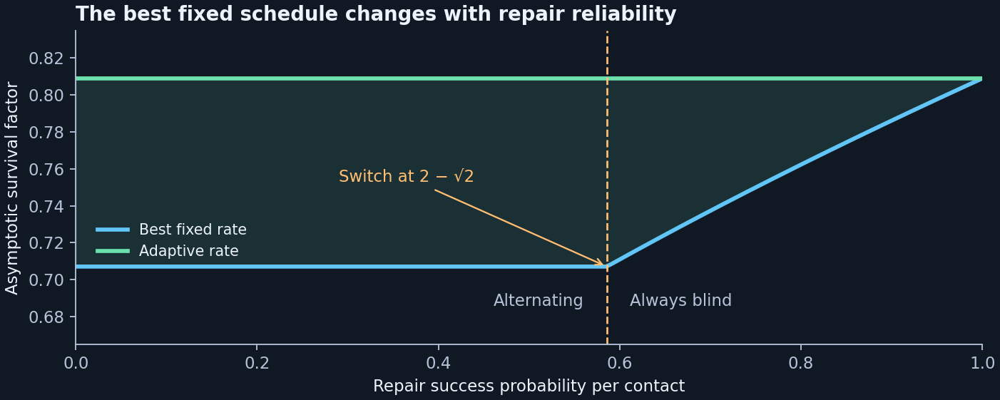
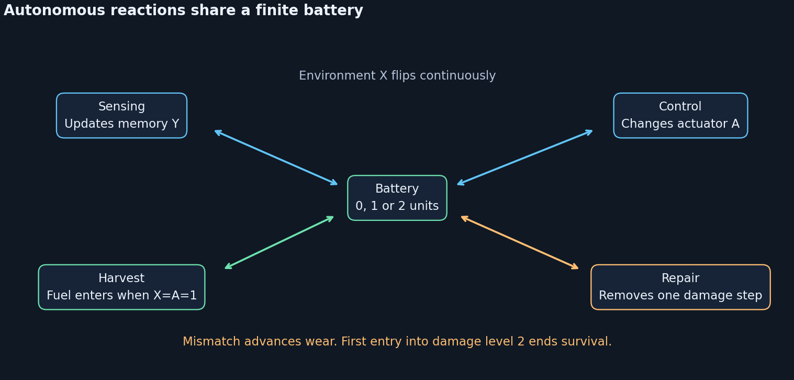
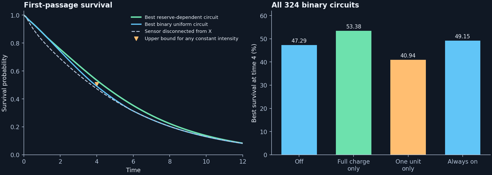
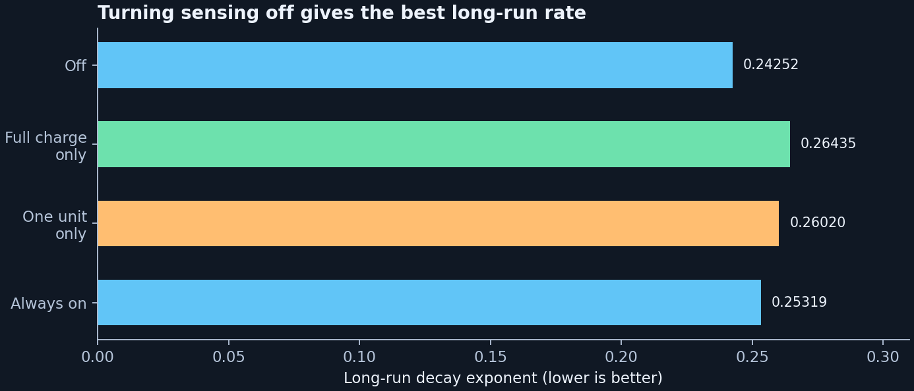

# Reserve-dependent sensing and survival in two finite-state physical architectures

AI-assisted research workspace draft · 17 November 2026

## Abstract

We study survival of devices whose sensing, control, and repair compete for finite stored energy. In a checkpoint model with endogenous harvesting, we construct a strict two-round sensing-feedback advantage and derive its accuracy threshold. For a symmetric two-unit device, we prove an exact asymptotic separation from every fixed sensing word and identify a switch in its optimal fixed regime. In an autonomous reversible reaction network, we certify a finite-time advantage over all constant sensing intensities within a specified control class, while the best binary asymptotic circuit leaves sensing off. The comparisons establish architecture-dependent value of information. We provide explicit assumptions, attaining constructions, numerical certificates, and reproducible code. Priority and independent proof review remain open.

## Motivation and relation to previous work

Information thermodynamics and information-dependent viability provide the conceptual setting [1–5,11]. Battery-dependent costly sensing and energy-harvesting control are established [6–8]. Controlled reachability and products of nonnegative matrices provide the mathematical tools [9,10]. Our candidate contribution is a pair of explicit, fully specified survival examples with analytically or computationally certified optima. Each statement below quantifies over its declared policy or circuit class. The autonomous system uses a maintained fuel reservoir, and the checkpoint construction uses supplied phase timing and work registers.

The finite-time comparison and the asymptotic comparison are distinct objectives. Changing architectures changes several physical assumptions simultaneously. We therefore claim conditional results within each model, with no causal inference that removing a clock alone determines the outcome.


## Main results and the logic connecting them

The results use two meanings of time: the integer round count \(N\) in the checkpoint model and continuous duration \(T\) in the autonomous model. All energetic statements specify what is inside the accounting boundary. No molecular mechanism is assumed merely because a Markov edge has a thermodynamically admissible rate ratio.

**Theorem A (finite-horizon checkpoint control).** Under the supplied-phase protocol below, the Bellman recurrence gives the supremum survival probability over all admissible history-dependent, randomized controllers. A deterministic maximizing policy and maximum-rate repair attain it. The proof is conditioning plus induction, with repair reduced to a two-state master equation.

**Theorem B (strict feedback value).** For two rounds, perfect readout, initial reserve two, unit sensing and engagement costs, capacity and harvest at least two, and IID opportunity probability \(q\in(0,1)\), adaptive sensing strictly exceeds every precommitted sensing word whenever \(0<\kappa<1\). At \(q=\kappa=1/2\) and capacity/harvest two the values are \(7/8\) and \(3/4\). With symmetric readout accuracy \(f\), this instance has a strict advantage precisely for \(f>2/3\). These constants belong to this architecture and parameter choice.

**Theorem C (all-word asymptotic comparison).** In the symmetric, perfect-readout, two-unit checkpoint model, the optimal adaptive and fixed-word survival root rates are

\[
r_{\rm ad}=\frac{1+\sqrt5}{4},\qquad
r_{\rm fixed}=\frac12\max\left\{\sqrt2,\frac{1+\sqrt{1+4\kappa}}2\right\}.
\]

The upper bounds apply even to nonperiodic words chosen separately for each horizon. Matching stationary or alternating constructions attain the rates. The proof reduces the fixed problem to products of two nonnegative matrices plus bounded additive terms. Without harvesting, finite reserves give the same root rate \(1-q(1-\rho)\) to both classes. Thus replenishment is essential to this example's exponential advantage.

**Theorem D (certified autonomous instance).** With the exact rational parameters and launch distribution specified below, one of 324 static binary circuits is uniquely optimal at \(T=4\). It senses at full reserve only. Writing \(D=288230376151711744\), its certified survival satisfies

\[
\frac{153847617132986168}{D}\le S_{\rm winner}\le
\frac{153847742532300097}{D}.
\]

Every other binary circuit has survival at most \(153763933422971466/D\). Allowing a constant sensing activity anywhere in \([0,1]\), with each actuator table reoptimized, gives the uniform comparator bound

\[
\sup_{\alpha,\,\mathrm{table}}S_{\rm uniform}(4)
\le\frac{145923831922267153}{D}
<\frac{153847617132986168}{D}.
\]

This is a certified gap of at least about 2.75 percentage points. Its proof combines nonnegative uniformization, outward integer rounding, and a rigorous interpolation remainder. The finite binary optimum is sharp within its declared class; the continuum upper bound need not be attained.

**Theorem E (the large-time objective selects differently).** Among the same binary autonomous circuits, the best reachable spectral decay exponent is attained with sensing off. The exponent is about \(0.24252027\), smaller than the best exponent with any sensing enabled. Exact positive-vector ratio bounds certify the ordering. This does not optimize all analogue circuits at infinite time.

The scientific lesson is that information's survival value depends jointly on temporal error structure, resource state, fuel access, damage dynamics, and the horizon. A finite-time advantage and an exponential-rate advantage are different statements. The golden ratio here is the eigenvalue of a two-state surviving reserve process, not evidence of a universal biological constant. Detailed definitions and proofs follow.


## Checkpoint architecture and proofs

*Model boundary note: the derivation below retains the assumptions of this study. Statements about later extensions are historical and should be read alongside the subsequent studies.*


A finite battery funds sensing, actuation, and reversible repair. Correct
actuation can move work from a finite environmental packet back into the
battery. For the specified checkpoint architecture, we derive the **exact
survival probability attainable from each initial reserve**. We then give a
two-round family with a strict feedback advantage, an exact noise threshold,
and a case where feedback improves the exponential rate of survival over
**every** precommitted sensing schedule.

### 1. One reserve, with feedback through the environment



A healthy device starts a round with \(b\in\{0,\ldots,C\}\) units in its battery.
A unit has energy \(\epsilon k_BT\). The hidden binary environment \(X\) has
stationary probability \(q\) of state \(1\). That state makes a work packet
accessible to an engaged actuator. From one round to the next the transition
law is

\[
P(X=1\mid X_{\rm prev}=j)=q(1-\rho)+\rho j,\qquad j=0,1 .
\]

The launch prior is \(q\) when the previous state is unknown. The parameter
\(\rho\in[0,1]\) measures persistence. For \(0<q<1\) and \(0<\rho<1\), a thermal
two-state switch realizes this law by relaxing for time \(\Delta\) with total
rate \(-\log(\rho)/\Delta\) and energy gap \(k_BT\log((1-q)/q)\). The IID case
uses fresh equilibrium flags. The flag is held fixed from sensing through
repair. Endpoints with degenerate probabilities can be read as preparations
or limits of these switches.

1. **Sense or skip.** A probe pays \(c\ge1\) units into an isolated work
   receiver and reveals a bit \(Y\) with \(P(Y=X\mid X)=f\in[1/2,1]\).
2. **Idle or engage.** Idle is action \(A=0\), which has no work bill. Engagement
   is \(A=1\) and pays \(d\ge1\) units, regardless of the environment. This bill
   is due before any harvesting. If \(X=A=1\), transfer up to \(H\) units from
   the external packet into the battery, stopping at capacity. A match with
   \(X=A=0\) transfers nothing.
3. **Repair a mismatch.** The load permutes the degenerate damage bit by
   \(D\mapsto D\mathbin{\mathrm{XOR}}[X\ne A]\). During mismatch, the contact
   opens the reversible pair
   \((D=1,b,R=0)\leftrightarrow(D=0,b-1,R=1)\) for \(b\ge1\), with \(R\) a
   repair receipt. Forward repair releases \(\epsilon k_BT\) as heat. Its
   reverse absorbs the same heat, restores the battery unit, and clears the
   receipt. With a sum-of-rates ceiling \(\Gamma\) and contact duration \(\tau\),
   the maximum probability of ending this contact healthy is
   \(\kappa=(1-e^{-\Gamma\tau})/(1+e^{-\epsilon})\), as in Study 02.
4. **Check the damage bit.** The first damaged checkpoint ends operation.
   The experiment tolerates a healthy checkpoint at zero reserve. On a
   surviving path the work receipts reveal the previous \(X\) by \(X=A
   \mathbin{\mathrm{XOR}} R\). This reveals past conditions through the
   consequences of action, with current conditions hidden until the next
   probe or checkpoint.

#### Microscopic accounting and admissible control

A powered gate can be an ideal energy-conserving swap on the device plus its
work registers. For example, with an initially empty sensing receiver \(w_s\),
an energy-degenerate readout bit \(y=0\), and a noise bit \(e\) with
\(P(e=1)=1-f\), swap the two states

\[
(b,w_s=0,y=0,X,e)\leftrightarrow
(b-c,w_s=c,y=X\mathbin{\mathrm{XOR}}e,X,e).
\]

Each allowed pair preserves total energy and the non-overlapping receiver
levels make the transformation reversible. The engagement bill can be
transferred by the corresponding swap with the actuation receiver. Its
nonzero level is the action receipt. The harvest swap retains the residual
packet energy, so the reverse is well defined even when capacity clips the
transfer. The two-state noise bit can have a thermal bias with gap
\(k_BT\log(f/(1-f))\), and serves only as an unchanged control. After the
action, the same XOR uncomputes \(Y\) from the preserved \(X,e\) and the probe
receipt. The ideal perfect probe uses \(e=0\). Repair rates have ratio
\(k_+/k_-=e^\epsilon\), consistent with the energy difference of the full
repair pair. Work receivers retain their records. No step erases an unknown
readout or automatically recharges a spent battery.

On each surviving round the pathwise ledger, in units of \(\epsilon k_BT\), is

\[
b'=b-c\,\mathbf1_{\rm probe}-d\,\mathbf1_{\rm engage}
  +h_{\rm admitted}-\mathbf1_{\rm repaired}.
\]

Repeated forward and reverse repair jumps cancel except for the final net
transition. Lost reserve moves into the work receivers or the bath. Admitted
work comes from the explicit packet, and rejected work remains there.
The two powered gates have prescribed positive work bills. These are
properties of the stipulated task hardware.
Externally supplied components are the phase clock, prepared receivers and
receipt registers, thermal flags, and packets. The bound below is on the
initial **operating battery** given those resources. It imposes no price on
building the apparatus or on maintaining the clock and receipts. The
controller has access to reserve and receipts, and has no current \(X\)
input except the paid readout. The environment still couples physically to
the actuator and damage gate. The IID proofs need no previous-state receipt
in the control policy.

### 2. Sharp survival frontier and attaining control

Let \(V_n(j,b)\) be the best survival probability with \(n\) rounds left, prior
index \(j\), and reserve \(b\). Index \(j=\ast\) denotes a stationary launch.
The base is \(V_0=1\). For any nonnegative continuation \(v(j,b)\), define
\(G_v(x,a,r)\) for the paid or unpaid battery \(r\) immediately before
actuation. Action \(a\) is admissible when \(r\ge da\). Let \(z=r-da\).
The four live-outcome rules collapse to

\[
G_v(x,a,r)=
\begin{cases}
v(x,\min(C,z+aH)) & x=a,\\
\kappa\,v(x,z-1) & x\ne a,\ z\ge1,\\
0 & x\ne a,\ z=0.
\end{cases}
\]

Write \(p_j(x)\) for the current prior and \(L_f(y\mid x)\) for the symmetric
readout likelihood. Maxima range only over affordable actions. The exact
Bellman update is

\[
\begin{aligned}
B_v(j,b)&=\max_a\sum_x p_j(x)G_v(x,a,b),\\
P_v(j,b)&=\sum_y\max_a\sum_x p_j(x)L_f(y\mid x)G_v(x,a,b-c),\quad b\ge c,\\
V_{n+1}(j,b)&=\max\{B_{V_n}(j,b),P_{V_n}(j,b)\}.
\end{aligned}
\]

Omit the probe option when \(b<c\). The max in the blind branch comes
before knowing \(X\). In the probe branch, the max occurs separately for each
observation. These are joint probabilities of \((x,y)\), so no division by
a possibly zero observation probability is needed.

**Proof of both directions.** Given a mismatch, every permitted contact
schedule ends healthy with probability at most \(\kappa\). Its only live
outcome has the same battery and inferred \(x\), irrespective of the contact
schedule. The maximum-rate contact thus dominates for every nonnegative
continuation. Once a round survives, the next prior depends only on its
inferred \(x\) and the remaining battery. Conditioning on the available
information bounds each possible decision by the corresponding maximum.
Induction from \(V_0=1\) bounds arbitrary history-dependent or randomized
controllers. Conversely, store the maximizing mode and action for each
entry of the table and use the maximum-rate repair contact. Every step of
the induction attains equality. The adaptive frontier uses \(O(NC)\) time
and space. Monotonicity in \(b\) follows by induction since the live branch
maps are nondecreasing in remaining reserve and additional reserve only
adds affordable actions. For target \(\eta\), invert \(V_N\) over
\(b=0,\ldots,C\) to obtain an exact minimum initial battery or infeasibility.

#### A strong fixed-schedule comparator

A fixed sensing schedule is any length-\(N\) binary word chosen before the
first round. It still gets optimal feedback for actuation, including the
current readout on scheduled probe rounds. If the scheduled probe is
unaffordable it falls back to blind action, which gives the comparator a
more favorable rule than failing on the spot. Allowing it to electively
cancel an *affordable* scheduled probe on depleted paths would make its
sensing decision a feedback rule.

Each word composes monotone maps \(B,P\) with the fallback. We compute the
maximum over all words, including nonperiodic schedules. The implementation
prunes a suffix only if another suffix dominates its entire vector of
continuation values. Applying any common prefix preserves that dominance.
The comparison is exact. In the worst case the number of undominated
vectors is exponential. Randomizing over fixed schedules cannot exceed
their maximum.

### 3. Exact separation after two rounds


Set \(c=d=1\), \(H\ge2\), \(C\ge2\), and start with \(b=2\). Take IID flags
with \(q\in(0,1)\), perfect sensing, and \(\kappa\in(0,1)\). The optimal
last-round survival with 0, 1, or at least 2 units is \(1-q,m,1\), where
\(m=\max(1-q+q\kappa,q)\). At one unit skipping the probe is strictly best
because spending it leaves only the possibility of a correct idle. At two
or more units a probe is strictly best because blind action has positive
mismatch probability and \(\kappa<1\).

Probing first and acting on the readout gives
\(A=(1-q)m+q\). The two possible blind alternatives give
\(S_0=1-q+q\kappa m\) and \(S_1=q+(1-q)^2\kappa\).
We have \(A>S_1\) because \(m>\kappa(1-q)\).
If \(m=1-q+q\kappa\), then \(A-S_0=q^2(1-\kappa^2)>0\).
If \(m=q\), then \(A-S_0=3q-1-(1+\kappa)q^2\).
The latter is concave on \([1/(2-\kappa),1]\), where at the left endpoint it
agrees with the positive first expression and at the right endpoint it equals
\(1-\kappa>0\). Thus probing first is strictly required. The unique optimal
action after the probe matches the flag. Each flag has positive probability,
and the resulting reserves require opposite probe decisions on the next
round. A fixed schedule cannot attain \(A\), even if it optimizes every
actuation decision. The strict separation holds over the whole open
\((q,\kappa)\) parameter family.

For the symmetric instance \(q=\kappa=1/2\), \(C=H=2\), choose
\(\epsilon=\ln3\) and \(\Gamma\tau=\ln3\) to realize the repair probability.
The four fixed schedules \(00,01,10,11\), with 1 denoting probe, attain
\(9/16,5/8,3/4,3/4\). The adaptive optimum is \(7/8\). With capacity two,
the adaptive controller reaches 80% using \(2\ln3\,k_BT\) of initial
battery and every fixed schedule falls short even at full charge.

### 4. Noise and persistence



The zero-information limit \(f=1/2\) makes the probe dominated by skipping.
The readout supplies only an independent coin and spending its work cannot
increase the optimal nondecreasing continuation. Increasing \(f\) cannot
lower the optimal survival of either policy class. A better symmetric
channel can be degraded to a worse one using an independent random flip
after paying the same sensor bill, and the optimized controller dominates
that simulated strategy. The same reasoning applies to the fixed comparator
word by word.

For the symmetric two-round instance with IID flags, **the adaptive
advantage is strictly positive exactly when \(f>2/3\)**. In the last round,
one unit always favors skipping. At two units, after probing, the posterior
\(\theta=P(X=1\mid Y)\) gives live probabilities \(1-\theta/2\) for idle and
\(\theta\) for engagement. The two equally likely posteriors are \(f\) and
\(1-f\). The optimized last-round survival at two units is therefore \(3/4\)
for \(f\le2/3\) and \((1+3f)/4\) above it. Below or at the threshold, a fixed
second-round skip can realize the adaptive result for any first-round choice.

Above the threshold, an optimal first-round skip uses idle strictly and
reaches both one and two units on live paths. If the first round probes,
idle after \(Y=0\) and engagement after \(Y=1\) are the unique maximizing
actions. The branch with \(X=Y=0\) reaches one unit, and \(X=Y=1\) reaches
two. In either case the final probe decisions conflict. For
\(f>2/3\), subtracting the first-round blind value from its probe value gives
\(3f^2/8-3/16\). Consequently the first-round probe is strictly favored
only above \(1/\sqrt2\), with a tie there. For \(f\le2/3\), the first-round
probe value is no greater than its value at \(2/3\), which is below the
blind value.

Persistence changes the posterior before any costly probe. The same
Bellman proof applies because live work receipts distinguish the preceding
flag. At \(f=0.9,\rho=0.5\) the symmetric example still gains 2.8125
percentage points in two rounds. The heatmap is a numerical illustration
of the exact finite-state recurrence. The IID threshold above is proved
analytically.

### 5. Exact long-horizon rate separation

Keep the symmetric IID instance with perfect sensing, \(C=H=2\), and
start at full charge, but allow any repair success probability
\(0<\kappa<1\). Let \(a_N\) be optimal adaptive survival and \(s_N\) the
largest survival of any length-\(N\) precommitted schedule. Then

\[
\lim_{N\to\infty} a_N^{1/N}=\frac{1+\sqrt5}{4},\qquad
\lim_{N\to\infty} s_N^{1/N}
 =\frac12\max\!\left(\sqrt2,\frac{1+\sqrt{1+4\kappa}}2\right).
\]

These are survival factors per round on an exponential scale. Adaptive
sensing wins strictly for every \(0<\kappa<1\).
Alternating fixed probe and blind rounds attains the fixed rate below
\(\kappa=2-\sqrt2\). Always acting blind attains it above that threshold.
Both attain it at equality. The survival ratio grows exponentially while
both absolute survival probabilities tend to zero.



**Adaptive upper bound and construction.** Let \(v=(x,y,z)\) list
continuation values at reserves 0, 1, 2. When \(0\le x\le y\le z\), the
blind and scheduled sensing maps are

\[
 B(v)=(x/2,\max(y/2+\kappa x/2,z/2),z/2+\kappa y/2),\quad
 P(v)=(x/2,x/2,(y+z)/2).
\]

Each preserves the ordered nonnegative cone. With
\(r=(1+\sqrt5)/4\), take \(u_0=\min(1,(2r-1)/\kappa)>0\) and
\(w=(u_0,1,2r)\). Then \(\max(B(w),P(w))\le r w\) componentwise because
\(\kappa u_0\le2r-1\) and \(2r^2=r+1/2\). The inequality
\(\mathbf1\le w/u_0\), order preservation, and homogeneity give
\(a_N\le(2r/u_0)r^N\).
For the lower bound use a stationary policy. With two units, probe and
match the environment. With one unit, engage blind to try to replenish.
On reserve states 1 and 2 its live matrix is
\(\bigl(\begin{smallmatrix}0&1/2\\1/2&1/2\end{smallmatrix}\bigr)\)
with eigenvalue \(r\) and positive right eigenvector \((1,2r)\).
Since \((1,2r)/(2r)\le\mathbf1\), starting at two units attains at least
\(r^N\).
The attaining stationary policy uses no repair on surviving paths. It
spends the probe when two units can cover it and the possible action.
At one unit it takes the risk of blind engagement to get back to two.
That is why the adaptive exponential factor is independent of \(\kappa\),
even though repair can improve finite-horizon survival.

**Fixed upper bound and construction.** Work with doubled maps \(2B,2P\),
so \(x=1\) throughout a backwards evaluation from \((1,1,1)\).
For \(u=(y,z)^T\), the blind map is between \(Lu\) and
\(Lu+(\kappa,0)^T\), and the probe map equals \(Ju+(1,0)^T\), with

\[
 L=\begin{pmatrix}0&1\\\kappa&1\end{pmatrix},\qquad
 J=\begin{pmatrix}0&0\\1&1\end{pmatrix}.
\]

Write \(e=(0,1)^T\) and \(g_k=(1,1)L^k e\). Then \(JL^kJ=g_kJ\),
\(g_0=1\), \(g_1=2\), and \(g_{k+2}=g_{k+1}+\kappa g_k\)
since \(L^2=L+\kappa I\).
Put \(\ell=(1+\sqrt{1+4\kappa})/2\) and \(m_*=\max(\sqrt2,\ell)\).
Induction gives \(g_k\le m_*^{k+1}\) because \(m_*^2\ge m_*+\kappa\).
Any word in \(L,J\) can be split at occurrences
of \(J\). The interior \(L\)-runs contract to factors \(g_k\), and the
initial and final \(L\)-runs have norm bounded by a constant times \(m_*^k\)
because \(L\) has two distinct eigenvalues of absolute value at most
\(m_*\). Hence every word of length \(n\) has norm at most \(K m_*^n\)
for one finite constant \(K\), independent of the word.
Summing the bounded additive inputs along any word retains a constant
times \(m_*^N\) upper bound. Dividing by \(2^N\) gives the fixed rate
upper bound. Conversely, the doubled maps dominate their homogeneous
parts. Since \(JL e=2e\), an alternating schedule achieves at least
\(2^{\lfloor N/2\rfloor}/2^N\). The all-blind schedule dominates
\((L/2)^N(1,1)^T\), which gives rate at least \(\ell/2\) by the positive
eigenvector of \(L\). The matching constructions and the word bound
establish the fixed rate, including for nonperiodic and horizon-dependent
schedules.

**Robust rate gap.** Return to repair success \(\kappa=1/2\). At stationary
probability \(1/2\) and persistence \(\rho<1\), the probability of any full
flag path relative to the IID path
is between \((1-\rho)^{N-1}\) and \((1+\rho)^{N-1}\).
For the adaptive construction, restrict to the event that all \(N\) noise
bits are correct, with probability \(f^N\). For the fixed upper bound,
give the fixed controller perfect accuracy, which can only help.
This proves the inequalities

\[
\liminf a_N(f,\rho)^{1/N}\ \ge f(1-\rho)r,\qquad
\limsup s_N(f,\rho)^{1/N}\ \le(1+\rho)/\sqrt2 .
\]

In particular \(f=0.97,\rho=0.03\) preserves strict exponential separation.
These inequalities certify an open region and allow the full feedback
policy to exploit reserve and prior conditions.

#### Removing harvest removes the exponential advantage

Set \(H=0\), keeping the paid operations, sensing accuracy, and repair.
On each live path at most \(C\) checkpoints can spend a net battery unit.
Every other checkpoint must be an idle match in environment \(0\).
For any set of \(j\) exceptional rounds, at least \(N-1-2j\) adjacent
pairs have both indices outside the set. In a Markov flag path all such
pairs must be \(0\to0\), each with probability \(p_{00}=1-q(1-\rho)\)
conditional on the forced preceding zero. Other constraints only remove
probability. A union bound over exceptional sets gives

\[
S_N\le\sum_{j=0}^{\min(C,N)}{N\choose j}
p_{00}^{\max(0,N-1-2j)}.
\]

The policy that always skips and idles survives whenever all flags are zero,
with probability \((1-q)p_{00}^{N-1}\) for a stationary launch and \(N\ge1\).
Thus for \(0<q<1\) and \(\rho<1\), both optimal adaptive and best fixed
survival have exact per-round root rate \(p_{00}\) regardless of the
initial reserve. The bound allows finite-horizon advantages. The
exponential separation in the symmetric example depends on replenishment.

#### A limitation for every finite device in this class

For \(0<q<1,\rho<1\), let \(p_{\min}>0\) be the least probability of either
flag among all launch and preceding-flag priors. Put
\(L_0=\lfloor C/c\rfloor+1\).
Under any policy there is probability at least \(p_{\min}^{L_0}\) of
reaching a first mismatch within the next \(L_0\) rounds from a healthy state.
To see it, until a mismatch occurs, at each probed round ask for \(X=0\).
That branch either mismatches immediately or uses at least \(c\) battery
units with no harvest. At the first blind round ask for the flag opposite
its chosen action. Each requested outcome has conditional probability at
least \(p_{\min}\) and there can be at most \(\lfloor C/c\rfloor\) consecutive
probed rounds on this branch. At the forced mismatch the survival
probability is at most \(\kappa\). Consequently every controller satisfies

\[
S_N \le \bigl[1-(1-\kappa)p_{\min}^{L_0}\bigr]^{\lfloor N/L_0\rfloor}.
\]

The bound explains why continued harvesting and feedback cannot eliminate
all risk under this protocol. It is a uniform, generally loose bound.
The Bellman frontier is the sharp finite-horizon result.

### 6. Verification and research status

Run from the project root.

```powershell
python scripts/run_closed_loop.py
$env:PYTHONPATH = 'src'
python -B -m unittest discover -s tests -v
```

The tests enumerate short decision trees independently of the vectorized
Bellman solver, evaluate the attaining policy, compare the best fixed
envelope against every fixed word in those trees, and obtain repair
probabilities from a two-state matrix exponential. They check the pathwise
energy ledger, the analytical noise threshold, and the exponential
construction. The figures and the numerical arrays are generated by the
same reproduction script. The results record is
[closed-loop.json](../results/closed-loop.json).

Finite-horizon survival recursions are instances of established stochastic
reachability. Prior work on energy-harvesting transmitters already optimizes
costly sensing with feedback over correlated channels. Prior work on
energy-harvesting estimation also derives energy-dependent optimal
scheduling. Energy-harvesting reliability has also been studied as an
outage problem with exogenous arrivals. Switching-system analysis supplies established tools for
growth rates of matrix products.
[Stochastic reachability](https://arxiv.org/abs/1407.5449) ·
[Costly channel sensing](https://arxiv.org/abs/1703.10519) ·
[Energy-harvesting estimation](https://arxiv.org/abs/1908.06070) ·
[Energy-outage analysis](https://arxiv.org/abs/1702.01648) ·
[Blondel and Nesterov on nonnegative matrix products](https://perso.uclouvain.be/vincent.blondel/publications/09BN.pdf)

The candidate contributions are the reversible shared-reserve construction,
the two-round strict separation over an open parameter family, the
two-thirds threshold, the exact exponential separation from all fixed
sensing words, and the threshold at which the best fixed regime changes.
This targeted comparison leaves priority unestablished. The proofs apply to
an externally timed, checkpointed device with supplied packets and ideal gates. A
continuous-time controller paid from the same battery, with physically
priced clock and memory operations and failure between checkpoints, is a
separate extension.

## Autonomous architecture and certificates

*Model boundary note: the derivation below retains the assumptions of this study. Statements about later extensions are historical and should be read alongside the subsequent studies.*


**Reserve-dependent sensing improves finite-time survival in this autonomous
model. Its advantage does not extend to the best asymptotic decay rate of
the same benchmark.** The model is a continuous-time Markov jump process
with fixed reaction barriers. Sensing, control, and repair each consume a
unit of the same battery when they run forward. Correct control opens an
external fuel channel. All enabled reactions have finite, positive reverse
rates.

### 1. Autonomous reaction network



A state is \(s=(b,x,y,a,d)\). The battery \(b\) runs from 0 to capacity \(C\).
The environment \(x\), sensor memory \(y\), and actuator \(a\) are binary.
Damage \(d\) takes values 0, 1, and 2. Define failure as the **first entry
into \(d=2\)**. A device at \(b=0\) can still operate if the available
reactions allow it.

In units of \(k_BT\), let \(\epsilon\) be the energy of a battery unit,
\(\delta\) the energy released by one step of damage, and \(\mu\) the
chemical work available from one unit of fuel. Use \(0\le\delta<\epsilon<\mu\)
and internal energy \(E(s)=b\epsilon-d\delta\). All other states have
degenerate energies. Each enabled edge has a forward rate \(k_+\).
The reverse rate is fixed by local detailed balance,

\[
 \log(k_+/k_-)=W-\Delta E,\qquad
 \Delta E=E(s')-E(s),
\]

where \(W\) is the chemical work supplied to the device on the forward
jump. The right-hand side is the heat released to the bath in units of
\(k_BT\). Signs reverse on a backward jump.

| Forward channel | Condition and state change | Bath heat on forward jump |
|---|---|---:|
| Environment | \(x=0\to1\), independent of the other bits | \(0\) |
| Sense | \(b\ge1,\ y\ne x\). Set \(y=x\) and spend one unit | \(\epsilon\) |
| Control | \(b\ge1\). Move \(a\) toward the circuit's selected target and spend one unit | \(\epsilon\) |
| Harvest | \(x=a=1,\ b<C\). A fuel conversion increases \(b\) by one | \(\mu-\epsilon\) |
| Wear or terminal damage | \(x\ne a\). Increase \(d\) by one | \(\delta\) |
| Repair | \(d=1,\ b\ge1\). Return to \(d=0\) and spend one unit | \(\epsilon-\delta\) |

The state can change by any enabled reaction at any time. There is no phase
variable, externally prescribed pulse, or checkpoint in the physical
dynamics. \(x\) is a thermal switch with equal flip rates. The only supplied
work during operation is the explicitly priced harvest reaction, powered by
a fuel reservoir at fixed chemical potential. Its reverse returns chemical
work and removes a battery unit. The static gates represent a choice of
barriers at fabrication. They multiply both directions of a channel at
once. For example, the reverse of a paid correction restores a battery unit
and turns a correct sensor into an incorrect one. A reverse repair can
create damage while replenishing the reserve. Reactions remain microscopically
reversible even at \(d=2\), but trajectories are stopped there for the
first-passage question.

This is an autonomous **open** system. The fuel reservoir is maintained
outside the device, and the initial battery and actuator position are
prepared. Fabrication and maintaining the ambient fuel concentration are
outside the initial operating-reserve bound.

#### Which circuits can compete?

The binary circuit class chooses for each funded level \(b=1,\ldots,C\)
whether to enable sensing at its full reference rate. The actuator circuit
chooses one of three settings at each funded pair \((b,y)\): disable
forward movement, target 0, or target 1. It never receives \(x\) directly.
Each setting indexes the **higher battery endpoint** of the reversible edge,
so the corresponding return path is always retained. A circuit's rates
depend on its actual current state, with no access to elapsed time.

The fixed-sensing comparator has the same actuator truth tables. Its
sensing activity is identical at every funded level. We compare with both
binary choices and every constant intensity \(\alpha\in[0,1]\), where
\(\alpha\) multiplies both sensing rates. The latter is a larger comparator
class than the binary family. The sharp adaptive optimum below is for
binary sensing gates and the stated actuator tables.

### 2. Sharp survival bound

For each circuit \(c\), retain states with \(d<2\). The row subgenerator
\(Q_c\) has all live transition rates, and its diagonal retains the outgoing
rate into \(d=2\). Let \(\pi_b\) initialize the battery at \(b\), draw \(x\)
uniformly, and set \(y=a=d=0\). Then

\[
 S_c(T,b)=\pi_b e^{TQ_c}\mathbf1,\qquad
 S^*(T,b)=\max_{c\in\mathcal C}S_c(T,b).
\]

The first identity follows from the killed forward equation. The finite
class \(\mathcal C\) has \(2^C3^{2C}\) circuits. Enumerating that class gives
an exact bound and its matching construction: install a circuit that
attains the maximum. The construction fixes all its rate barriers before
launch. Evaluating a different horizon can select a different circuit.
There is no switching between circuits during operation. Random selection
of a circuit before launch cannot beat the largest value.

A separate maximization over the outgoing rates from each live state would
allow the reverse of an edge to be set independently of its forward rate.
That relaxation could violate local detailed balance. The exact enumeration
keeps every forward–reverse pair linked.

#### Certification with integer arithmetic

The benchmark uses rational rates. Choose a common uniformization rate
\(\Lambda\) at least as large as the largest exit rate, and put
\(P_c=I+Q_c/\Lambda\). Each \(P_c\) is nonnegative and substochastic. Expanding
the matrix exponential gives

\[
 S_c(T,b)=e^{-z}\sum_{k=0}^\infty\frac{z^k}{k!}\,\pi_bP_c^k\mathbf1,
 \qquad z=\Lambda T .
\]

The Poisson series is a mathematical way to evaluate a continuous-time
chain. \(\Lambda\) is not a physical device clock.

For rational \(T\), write \(w_k=z^k/k!\) and \(Z_L=\sum_{k=0}^Lw_k\).
If \(L+2>z\), the omitted unnormalized tail is at most
\(R_L=w_{L+1}/(1-z/(L+2))\), by a geometric comparison. Hence each retained
normalized weight lies between \(w_k/(Z_L+R_L)\) and \(w_k/Z_L\), and
the normalized tail is at most \(R_L/Z_L\). The code rounds those rational
bounds outward to an integer grid. It also propagates lower and upper
vectors for \(P_c^k\mathbf1\) with floor and ceiling division. Nonnegative
matrix entries preserve componentwise bounds at every power. Every
uncomputed survival factor is at most one. Summing the rounded products
and adding the tail to the upper bound certifies the survival
probabilities. The benchmark compares integer numerators on a common
denominator. It isolates the winning circuit even after every competitor
receives its upper bound.

### 3. Finite-time adaptive advantage survives



Use capacity two, \((e^\epsilon,e^\delta,e^\mu)=(8,2,128)\), and forward
rates

| Environment | Sense | Control | Harvest | Wear | Terminal damage | Repair |
|---:|---:|---:|---:|---:|---:|---:|
| \(1/2\) | \(11\) | \(21/2\) | \(17/4\) | \(5/2\) | \(5/2\) | \(21/4\) |

The rates are an example selected by exploratory numerical search. The
certificate applies to these exact rational parameters. Start full and
observe at \(T=4\). Each row below optimizes all 81 actuator truth tables.

| Sense at \(b=1\) | Sense at \(b=2\) | Best survival at \(T=4\), approximately |
|---|---|---:|
| Off | Off | 47.2884% |
| Off | On | **53.3766%** |
| On | Off | 40.9363% |
| On | On | 49.1504% |

The unique best binary circuit senses at full charge only. At one unit the
actuator targets the sensor reading. At full charge it targets 1 when
\(y=1\), while disabling forward actuation when \(y=0\). The winner's lower
bound exceeds the highest upper bound of the other 323 circuits. This is
an energy-reserve feedback rule implemented by static state-dependent
reaction pathways. For example, a correct update from \(b=2\) can leave
one unit for the commanded move, after which matching engagement opens
the fuel channel.

Optimizing all binary circuits at each starting reserve gives about
29.7976%, 36.9134%, and 53.3766% survival for zero, one, and two units,
respectively. Thus **two units, or \(2k_BT\log 8\), are necessary and
sufficient to reach 52% survival at \(T=4\)** within this class. The
certificate compares both smaller reserves directly, without assuming
that more initial charge always helps a given circuit.

#### Against every constant sensing intensity

For one actuator table write \(Q_\alpha=Q_0+\alpha A\), where \(A\) is the
sensing generator with activity one. Duhamel's identity, differentiated
twice, expresses \(S''(\alpha)\) as two insertions of \(A\) between
substochastic semigroups, integrated over an ordered time simplex with
a factor of two. Their induced infinity norms are at most one, so

\[
 |S''(\alpha)|\le T^2\|A\|_\infty^2 .
\]

The linear interpolation error on an interval of width \(h\) is at most
\(T^2\|A\|_\infty^2 h^2/8\). Therefore, evaluate all 81 actuator tables on
the 257 nodes with \(h=1/256\), take the largest certified node upper
bound, and add the error allowance. The result bounds the whole continuum
by 50.6275%, below the adaptive winner's certified lower bound. Both classes use
the same actuator choices and bath accounting. The bounds also certify
strict separation for \(T\in[3.99,4.01]\). In any circuit,
\(-k_{\rm failure}\le\partial_T S\le0\), since the probability loss rate
is the current mass in the failure-enabled live states times their
terminal jump rate. Thus the certified gap at \(T=4\) can shrink by at
most \(0.025\) over this interval.

#### Does the direct information channel matter?

In a separate comparison, remove the direct coupling \(x\to y\). An enabled
sensor now flips the memory independent of \(x\) at the same forward
reference rate, spends the same battery unit, and has the same reverse
heat. It can still use reserve-dependent gates, and the controller can
still use both reserve and \(y\). Endogenous correlations can remain.
Reoptimizing all 324 circuits of this comparison leaves the best
survival below the informative winner. Thus paying for an
environment-independent memory flip cannot explain the observed advantage.

### 4. The long-run separation does not transfer in this example



For any circuit, restrict \(Q_c\) to live states reachable from the launch
distribution. The live graph is connected on that set because every
internal edge has its reverse and the two launch states communicate by
the environment flip. Perron–Frobenius applied after a positive diagonal
shift of this irreducible Metzler matrix gives the real spectral
abscissa \(\lambda_c\), and
\(\lim_{T\to\infty}\log S_c(T,b)/T=\lambda_c\).

The numerical eigensolver only proposes a positive integer vector \(v\).
The certificate checks the following componentwise ratios in exact
rational arithmetic,

\[
 \min_i (Q_cv)_i/v_i\ \le\ \lambda_c\ \le\
 \max_i (Q_cv)_i/v_i .
\]

Indeed, if \(l v\le Q_cv\le u v\), positivity of the killed semigroup
sandwiches \(e^{tQ_c}v\) between \(e^{lt}v\) and \(e^{ut}v\).
Comparison of \(\mathbf1\) with constant multiples of \(v\) yields the same
exponential bounds on survival. The reachability restriction prevents
unreachable sensor states from supplying an artificial leading eigenvalue.

Among the 324 binary circuits, the optimized large-time exponent
\(-\lambda_c\) is about **0.24252027** and is attained with sensing off.
The best exponents with sensing enabled only at full charge, only at one
unit, or at both funded levels are about 0.26435182, 0.26019620, and
0.25318551, respectively. The exact intervals for all circuits with
some sensing lie strictly above the best off exponent. The unrestricted
binary optimum and the uniform binary optimum thus share the same
long-run decay rate. The continuum of constant sensing activities was
bounded for the finite-time comparison. The spectral comparison here is
for binary circuits.

### 5. Reproduce and read the evidence

```powershell
python scripts/run_autonomous.py
$env:PYTHONPATH = 'src'
python -B -m unittest discover -s tests -v
```

[Results and exact enclosure values](../results/autonomous.json) include the
winning gates, the best uniform-intensity enclosure, and the reachable
spectral intervals. Tests check every physical reverse edge and energy
ratio, compare the certified intervals with an independent matrix
exponential, and check spectral and interpolation enclosures. Continuous
autonomous information thermodynamics, uniformization, and spectral
comparison are established tools. The specific finite-time separation,
its information-channel comparison, and its loss at large time are
candidate contributions in this architecture. Literature priority is
unestablished. [Autonomous energy and information flows](https://arxiv.org/abs/2209.10644)
· [Rigorous Poisson truncation](https://web.stanford.edu/~glynn/papers/1988/FG88.html)

## Appendix — Paid repair contact and its sharp energy bound

Let a repair pair have damaged probability \(1-p(t)\), healthy probability \(p(t)\), energy drop \(\epsilon k_BT\), and sum of directional rates \(\gamma(t)\in[0,\Gamma]\). Fixed local detailed balance implies

\[
k_+(t)=\gamma(t)\sigma(\epsilon),\quad
k_-(t)=\gamma(t)[1-\sigma(\epsilon)],\quad
\sigma(x)=\frac1{1+e^{-x}}.
\]

With a damaged start, \(p(0)=0\) and the master equation is
\(p'=\gamma(t)[\sigma(\epsilon)-p]\). Integration gives

\[
p(\tau)=\sigma(\epsilon)\left[1-e^{-\int_0^\tau\gamma(t)\,dt}\right]
\le(1-e^{-\Gamma\tau})\sigma(\epsilon)=\kappa.
\]

Equality holds by taking \(\gamma\equiv\Gamma\). The protocol may choose the barrier schedule before contact but cannot latch the first repair using unpriced within-contact feedback. On a live outcome, the net battery expenditure is exactly one unit, irrespective of back-and-forth jumps. This proves the repair bound used by Theorem A.

For exogenous stresses, let \(M\) count the number of stressed checkpoints in \(N\) rounds, continued mathematically even beyond a device failure. With \(B\) identical reserve units, sequential conditioning bounds survival on every flag path by \(\kappa^M\mathbf1_{M\le B}\). Maximum-rate contact attains each factor, so

\[
S^*(B)=\sum_{m=0}^{\min(B,N)}\Pr(M=m)\kappa^m.
\]

This argument allows arbitrarily correlated stresses. With \(m\ge1\) certain stresses and variable positive battery gaps whose sum is at most \(F\), put \(a=1-e^{-\Gamma\tau}\). Since
\((\log\sigma)''=-\sigma(1-\sigma)<0\), Jensen's inequality yields

\[
\Pr(\mathrm{survive}\mid M=m)
\le a^m\prod_{i=1}^m\sigma(\epsilon_i)
\le [a\sigma(F/m)]^m.
\]

For \(F>0\), exactly \(m\) equal gaps and maximum-rate contact attain equality. This is a conditional allocation theorem for a known stress count. It does not optimize an unknown count with arbitrary gaps. The clock, load gate, and initial preparations remain supplied resources outside this reserve bound.


## Evidence and reproduction receipts

The dossier build reran the existing test suite. The machine-readable receipt records the full output, UTC execution time, and SHA-256 hashes of source, tests, and mathematical notes. Passing tests supports implementation agreement within the tested cases. The proofs and certificates carry the mathematical claims. [Fresh verification receipt](../results/dossier-verification.json)

| Study | Executable source | Reproduction | Numerical evidence |
|---|---|---|---|
| 01 | [model.py](../src/purposeful/model.py) | [run_study.py](../scripts/run_study.py) | [summary](../results/summary.json), [all 144 cases](../results/transfer.csv) |
| 02 | [reserve.py](../src/purposeful/reserve.py) | [run_reserve_study.py](../scripts/run_reserve_study.py) | [independent full-state test](../tests/test_reserve.py) |
| 03 | [closed_loop.py](../src/purposeful/closed_loop.py) | [run_closed_loop.py](../scripts/run_closed_loop.py) | [arrays and example](../results/closed-loop.json) |
| 04 | [autonomous.py](../src/purposeful/autonomous.py) | [run_autonomous.py](../scripts/run_autonomous.py) | [integer and rational enclosures](../results/autonomous.json) |

The earlier run-manifest contains historical hashes and package versions for Study 01. Two hashes were already stale on first inspection. The present receipt identifies the exact sources used for this dossier's fresh test run. The 30 tests are a local reproducibility check. Independent scientific review remains pending.


## Literature comparison and novelty assessment

The targeted search on 17 November 2026 used combinations of “survival”, “adaptive sensing”, “finite reserve”, “paid repair”, “golden ratio”, “spectral radius”, and autonomous information thermodynamics. Exact-expression searches for the two-thirds sensing threshold and the characteristic rate constants returned substantial unrelated material. A missing search hit supplies limited evidence. The search is not a proof that the formulas have never appeared in another notation or field.

| Prior source | Established overlap | Specific distinction requiring further priority review |
|---|---|---|
| Hartich, Barato and Seifert (2014), [bipartite stochastic thermodynamics](https://arxiv.org/abs/1402.0419) | Four-state examples, information flow, and thermodynamic inequalities | Our equal-accuracy task-ranking combination and restricted kinetic frontier |
| Kolchinsky and Wolpert (2018), [semantic information and agency](https://arxiv.org/abs/1806.08053) | Causal relation between information and viability | The reserve-constrained constructive bounds and specific feedback comparisons |
| Abad, Ercetin and Gündüz (2017), [costly channel sensing](https://arxiv.org/html/1703.10519v2) | Sensing spends energy, battery-dependent policies exploit correlated conditions | Our survival objective, paid repair, exact two-round separation, and explicit exponents |
| Vasconcelos et al. (2019), [energy-harvesting estimation](https://arxiv.org/abs/1908.06070) | Globally optimal scheduling with finite batteries | The present damage process and survival criterion |
| Guruacharya and Hossain (2018 version), [self-sustainability and outage](https://arxiv.org/abs/1702.01648) | Eventual outage, stochastic energy input, asymptotic bounds | Finite capacity with actions gating fuel and explicit repair |
| Tkachev et al. (2014), [controlled Markov reachability](https://arxiv.org/html/1407.5449v1) | Optimal event probabilities and dynamic programming | Our explicit closed-form example and model-specific constructions |
| Blondel and Nesterov (2009), [nonnegative matrix products](https://perso.uclouvain.be/vincent.blondel/publications/09BN.pdf) | Spectral growth bounds and special matrix families | The two matrices induced by this sensing task and its regime-switch formula |
| Ehrich and Sivak (2023), [autonomous energy and information flows](https://www.frontiersin.org/journals/physics/articles/10.3389/fphy.2023.1108357/full) | Autonomous information thermodynamics and molecular-machine interpretation | Our shared-reserve first-passage comparison and its digital-circuit certificate |
| Fox and Glynn (1988), [Poisson probability computation](https://web.stanford.edu/~glynn/papers/1988/FG88.html) | Rigorous Poisson truncation and CTMC evaluation | Our small integer-grid implementation is a verification tool within established methodology |
| Chen, Chen and Ma (2026), [finite-time autonomous information machine](https://arxiv.org/abs/2604.15953) | Finite-time autonomous information/energy tradeoffs | The abstract studies erasure and refrigeration; our survival circuit differs. Full theorem comparison remains pending |
| Liu and Darabi (2005), [control with a dynamic sensing set](https://skoge.folk.ntnu.no/prost/proceedings/ifac2005/Fullpapers/03504.pdf) | Controller survival, changing observability, and sensor repair | Their finite-automaton formulation does not give this shared-reserve thermodynamic comparison |
| Hasidi and Kalech (2021), [anticipatory troubleshooting](https://www.mdpi.com/2076-3417/11/3/995) | Survival-aware diagnosis and maintenance decisions | Their reported experiments omit sensing costs; the objectives and physical constraints differ |

The Hartich, Kolchinsky, Vasconcelos, Guruacharya, and Chen entries were checked at abstract or overview level in this pass. The costly-sensing and reachability full HTML pages and the matrix-product paper were opened for their formulations. The Liu–Darabi introduction and the Hasidi–Kalech experimental discussion were also inspected. This is a targeted comparison, not an exhaustive full-text survey. The initial package contains a separate five-paper thermodynamic audit. [Earlier literature audit](../research/literature.md) · [Dated search receipt and access depths](../research/priority-search-2026-11-17.md)

**Assessment.** Generic information-to-viability connections, autonomous information engines, battery-dependent sensing, Bellman optimization, and uniformization are established. No exact prior match was identified for the present complete combination of assumptions and formulas. The most focused novelty candidates are the checkpoint rate formula and switch at 2−√2, the model-specific noise threshold, and the certified continuous-time separation with its asymptotic reversal. Their priority remains unestablished.

## Publication readiness and limitations

The accompanying manuscript is a candidate research draft with full mathematical definitions, proofs, references, and computational supplements. It carries no claim of established priority, peer review, or arXiv acceptance. Its author line identifies an AI-assisted workspace draft so that a human author can take responsibility before submission.

The sharp checkpoint bounds are within stated policy classes. The continuous-time sharp optimum is over binary circuit gates with restricted control tables; its uniform-intensity comparator permits a continuum only in the sensing multiplier. Arbitrary analogue reserve-dependent sensing, arbitrary reaction architectures, and every possible controller are outside that optimization. The finite-time autonomous benchmark was selected through exploratory search. The certificate verifies the exact chosen rates; it supplies no frequency estimate for how often such advantages occur in physical devices.

The direct-sensor-disconnection comparison changes its channel structure and may retain indirect information through the reserve. It demonstrates the performance difference for that intervention. It does not isolate a universal number of useful bits or a general thermodynamic price of meaning. Operating energy omits apparatus preparation and fabrication. The checkpoint model relies on supplied clocks and registers, while the autonomous model relies on a maintained fuel reservoir and designed barriers.

Before submission, a human reviewer should check the optimal-policy inequalities, the matrix-product proof for all fixed words, and the implementation of interval rounding. Priority review should extend to partially observed control, intermittent toxic exposure, occupation-time reliability, joint spectral radii, and autonomous molecular networks. An explicit mass-action realization would strengthen the chemical interpretation. A self-assembly model would address a new question about where the architecture comes from.


## References

1. U. Seifert. *Stochastic thermodynamics, fluctuation theorems and molecular machines*. Reports on Progress in Physics 75, 126001 (2012). [arXiv:1205.4176](https://arxiv.org/abs/1205.4176).
2. D. Hartich, A. C. Barato, U. Seifert. *Stochastic thermodynamics of bipartite systems: transfer entropy inequalities and a Maxwell's demon interpretation*. Journal of Statistical Mechanics, P02016 (2014). [arXiv:1402.0419](https://arxiv.org/abs/1402.0419).
3. J. M. Horowitz, M. Esposito. *Thermodynamics with continuous information flow*. Physical Review X 4, 031015 (2014). [arXiv:1402.3276](https://arxiv.org/abs/1402.3276).
4. S. Still, D. A. Sivak, A. J. Bell, G. E. Crooks. *Thermodynamics of prediction*. Physical Review Letters 109, 120604 (2012). [arXiv:1203.3271](https://arxiv.org/abs/1203.3271).
5. A. Kolchinsky, D. H. Wolpert. *Semantic information, autonomous agency, and nonequilibrium statistical physics*. Interface Focus 8, 20180041 (2018). [arXiv:1806.08053](https://arxiv.org/abs/1806.08053).
6. M. Salehi Heydar Abad, O. Ercetin, D. Gündüz. *Channel Sensing and Communication over a Time-Correlated Channel with an Energy Harvesting Transmitter* (2017). [arXiv:1703.10519](https://arxiv.org/abs/1703.10519).
7. M. M. Vasconcelos, M. Gagrani, A. Nayyar, U. Mitra. *Optimal scheduling strategy for networked estimation with energy harvesting* (2019). [arXiv:1908.06070](https://arxiv.org/abs/1908.06070).
8. S. Guruacharya, E. Hossain. *Self-Sustainability of Energy Harvesting Systems: Concept, Analysis, and Design* (2017, revised 2018). [arXiv:1702.01648](https://arxiv.org/abs/1702.01648).
9. I. Tkachev, A. Mereacre, J.-P. Katoen, A. Abate. *Quantitative model-checking of controlled discrete-time Markov processes* (2014). [arXiv:1407.5449](https://arxiv.org/abs/1407.5449).
10. V. D. Blondel, Y. Nesterov. *Polynomial-time computation of the joint spectral radius for some sets of nonnegative matrices*. SIAM Journal on Matrix Analysis and Applications 31, 865–876 (2009). [doi:10.1137/080723764](https://doi.org/10.1137/080723764).
11. J. Ehrich, D. A. Sivak. *Energy and information flows in autonomous systems*. Frontiers in Physics 11, 1108357 (2023). [doi:10.3389/fphy.2023.1108357](https://doi.org/10.3389/fphy.2023.1108357).
12. B. L. Fox, P. W. Glynn. *Computing Poisson Probabilities*. Communications of the ACM 31, 440–445 (1988). [Author page](https://web.stanford.edu/~glynn/papers/1988/FG88.html).
13. W. Chen, M. Chen, Y.-H. Ma. *Finite-Time Thermodynamics of an Autonomous Information Machine* (2026). [arXiv:2604.15953](https://arxiv.org/abs/2604.15953).
14. J. Liu, H. Darabi. *Reconfiguration of Discrete Event System Controllers with Dynamic Sensing Set*. IFAC World Congress (2005). [Proceedings PDF](https://skoge.folk.ntnu.no/prost/proceedings/ifac2005/Fullpapers/03504.pdf).
15. N. Hasidi, M. Kalech. *Anticipatory Troubleshooting*. Applied Sciences 11(3), 995 (2021). [doi:10.3390/app11030995](https://doi.org/10.3390/app11030995).
