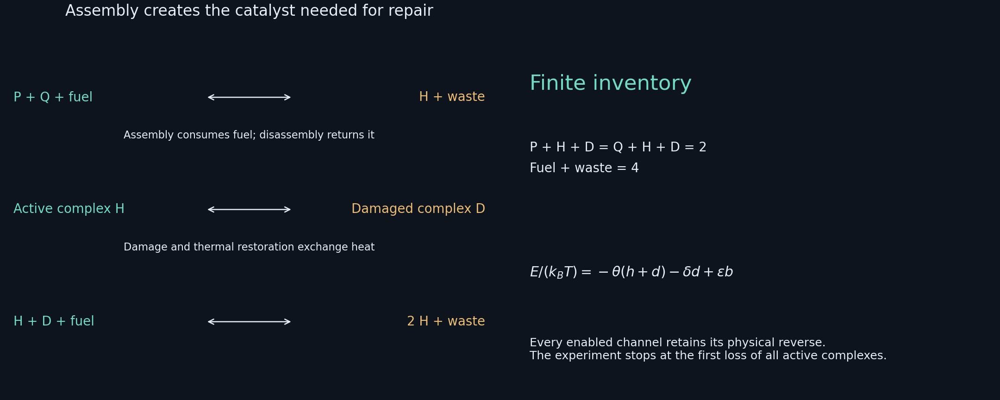
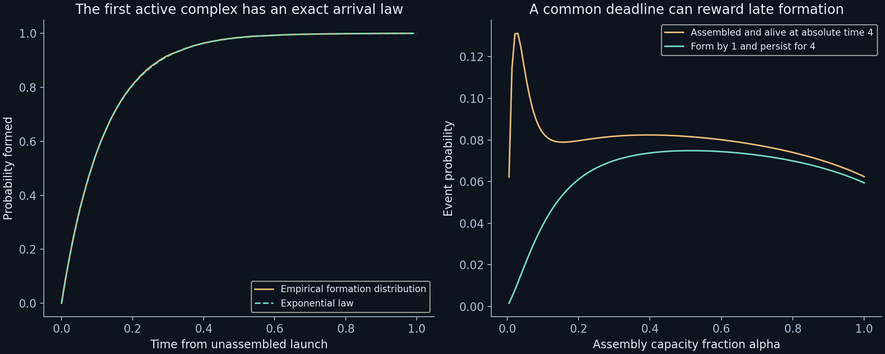
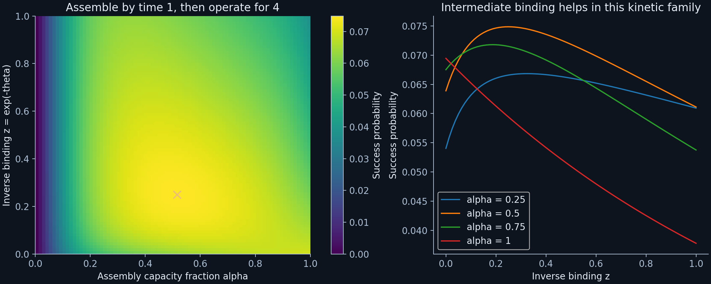
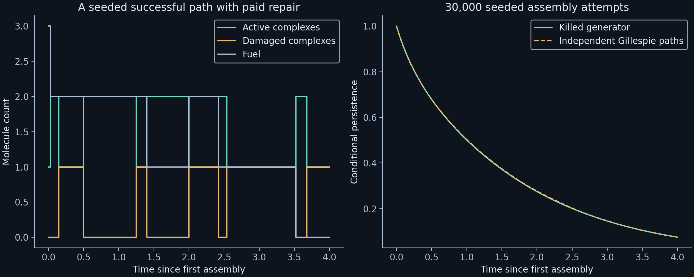
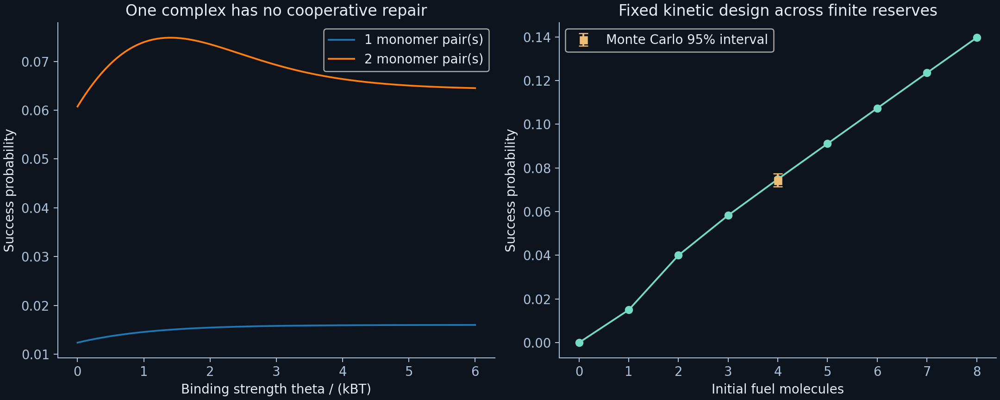

# Study 05 — A finite chemical system that assembles its repair catalysts

This study starts with complementary monomers, fuel, and no functional complex. A reversible assembly reaction produces an active complex. Two assembled complexes can cooperate in repair: an active one catalyses restoration of a damaged one while consuming fuel. All chemical species stay inside a fixed-volume compartment coupled to a heat bath. The functional population, its maintenance capacity, and the remaining fuel evolve together.

The mathematical model is an ideal stochastic reaction network. Species identities, standard-state energies, and effective mass-action channels are stipulated. An experimental molecular realization remains a separate task. The system has transient self-maintenance. Replication, heredity, a membrane, evolution, and manufacture of its monomers are further biological requirements.



## Chemical vocabulary and physical assumptions

A **monomer** is a building block. Two complementary monomers \(P,Q\) can associate into a complex. \(H\) denotes its functional conformation and \(D\) its damaged conformation. **Catalysis** means that an existing \(H\) enables a reaction and is recovered at the end of that reaction. The second \(H\) in the repair product is the restored damaged complex. A **propensity** is the instantaneous jump rate given the current molecule counts. Stochastic mass action multiplies a rate constant by the number of available reactant combinations.

Initially there are \(M\) copies of each monomer and \(N\) fuel molecules \(F\). Waste \(W\) starts absent. The conserved inventories are

\[
P+H+D=Q+H+D=M,\qquad F+W=N.
\]

Write the state as \(s=(h,d,b)\), where \(b=F\), \(w=N-b\), and \(m=M-h-d=P=Q\). The state space is finite. All energies are in units of \(k_BT\), and the reference volume is one. Assign monomers and waste zero standard energy, fuel energy \(\epsilon=\log 8\), and complex energies \(-\theta\) and \(-\theta-\delta\), with \(\delta=\log2\). Thus

\[
E(h,d,b)=-\theta(h+d)-\delta d+\epsilon b.
\]

The binding parameter is \(z=e^{-\theta}\in(0,1]\). Its endpoint \(z=0\) is an infinite-binding limit used in the compactified optimization. Every reported attaining physical design has \(z>0\).

The device family has a static assembly-capacity fraction \(\alpha\in[0,1]\). With reference rates \(A,R,\eta>0\), define

\[
a=A\alpha,\qquad r=R(1-\alpha)z.
\]

This is an explicit kinetic design assumption. Increasing binding stabilizes the complex against disassembly and slows the conformational access needed for repair. The factor \(1-\alpha\) describes shared fabrication capacity for the two pathways. It does not represent a fractional initial fuel allotment. Actual fuel spending is counted molecule by molecule. Local detailed balance constrains rate ratios and leaves this kinetic dependence to the model designer.

| Reaction | Forward propensity | Reverse propensity evaluated at the current state |
|---|---|---|
| \(P+Q+F\rightleftharpoons H+W\) | \(a m^2b\) | \(azhw/8\) |
| \(H\rightleftharpoons D\) | \(\eta h\) | \(\eta d/2\) |
| \(H+D+F\rightleftharpoons2H+W\) | \(r hdb\) | \(r h(h-1)w/4\) |

The \(h(h-1)\) factor counts an ordered catalyst/product pair. It is part of the rate convention. With this convention the forward and reverse factorials match exactly. These effective reactions include three-reactant channels. Their kinetic realization through actual intermediates has yet to be specified.

Thermal restoration \(D\to H\) absorbs energy from the bath. Fuel-coupled catalytic repair supplies an additional pathway. Retaining both reverses is necessary for the declared thermodynamics. Fuel can regenerate on reverse jumps, so the number of forward repairs can exceed the number of net fuel-consuming repairs.

## Theorem 1 — Exact thermodynamic consistency

For \(0<\alpha<1\) and \(z>0\), define the unnormalized weight

\[
\omega(h,d,b)=\frac{z^{-(h+d)}2^d8^{-b}}
{(m!)^2h!d!b!w!}.
\]

Every enabled reaction edge satisfies

\[
\omega(s)q(s,t)=\omega(t)q(t,s).
\]

**Proof.** For assembly, the ratio of target and source weights is

\[
\frac{\omega(h+1,d,b-1)}{\omega(h,d,b)}
=\frac{8m^2b}{z(h+1)(w+1)},
\]

which equals the corresponding propensity ratio. Damage gives \(2h/(d+1)\). Repair gives

\[
\frac{\omega(h+1,d-1,b-1)}{\omega(h,d,b)}
=\frac{4db}{(h+1)(w+1)}.
\]

Its propensity ratio is the same, since the catalytic factor \(h\) cancels. This proves detailed balance edge by edge. At \(\alpha=0\) or \(1\), a disabled pathway loses both directions and the remaining edges retain detailed balance.

The count-state free energy is

\[
\mathcal G(s)=E(s)+\log[(m!)^2h!d!b!w!].
\]

Consequently \(\log[q(s,t)/q(t,s)]=-\Delta\mathcal G\). The factorial term accounts for the mixing and counting entropy. A normalized version \(\pi\) of \(\omega\) is stationary, including when the full graph has more than one communicating class. For any full-ensemble distribution \(p_t\),

\[
\frac{d}{dt}D(p_t\Vert\pi)
=-\frac12\sum_{s,t}(p_sq_{st}-p_tq_{ts})
\log\frac{p_sq_{st}}{p_tq_{ts}}\le0.
\]

The inequality follows from \((x-y)\log(x/y)\ge0\). Conditional survivor distributions use a killed process and need not obey this full-ensemble formula. No chemical reservoir is replenished during a run. Preparation of monomers, fuel, and reaction barriers precedes the experiment.

**Evidence.** Exact rational checks verify every forward/reverse weight identity and each conserved inventory. A separately constructed floating-point full generator has stationary weight \(\pi\) and decreasing relative entropy in the tested cases. [Thermodynamic tests](../tests/test_assembly.py)

## Theorem 2 — A sharp resource–organization bound

Let \(J_A\) count forward assembly minus disassembly jumps, and \(J_R\) forward catalytic repair minus its reverse. On every trajectory from the unassembled launch,

\[
J_A=h+d,\qquad J_A+J_R=N-b.
\]

Therefore reaching \(k\) assembled complexes after at least \(r\ge0\) net catalytic repairs requires

\[
N\ge k+r.
\]

For \(2\le k\le M\), this count bound is sharp. With \(N=k+r\), first assemble \(k\) active complexes. Then repeat \(r\) times a damage jump followed by a fuel-consuming repair catalysed by another surviving complex. Every cycle restores \(h=k\), uses one fuel molecule, and retains at least one active catalyst. The final state has \(h=k,d=0,b=0\). For interior parameters the finite reaction sequence has positive probability in every positive time interval. Thus the lower resource requirement has a matching physical reaction path. This is a feasibility statement. A high target probability requires the separate kinetic frontier below.

**Proof of the ledger.** Assembly increments both complex count and fuel expenditure by one. Repair changes fuel expenditure and \(J_R\) by one while preserving complex count. Damage preserves both quantities. Reverse jumps reverse the same increments. Induction over jumps proves both identities.

For the ideal species-energy assignment, the bath-energy ledger also telescopes:

\[
Q_{\rm bath}(t)=E(s_0)-E(s_t)
=\epsilon(N-b)+\theta(h+d)+\delta d.
\]

The initial fuel energy \(N\epsilon\) is only one source of the available energy drop. Binding and damage change the species energy too. The full physical graph obeys the finite bound

\[
Q_{\rm bath}(t)\le N\epsilon+M(\theta+\delta).
\]

For \(M\ge2,N\ge M\), assemble all \(M\), spend the remaining fuel in damage–repair cycles, and damage all complexes to attain the endpoint energy. Stopping at the first loss of all active complexes restricts this construction to its final collapse event. Count-state entropy production includes the factorial entropy as well as this species-energy bookkeeping.

**Evidence.** The independent event-driven simulator checks the two count identities after every jump. It also accumulates the jump energy changes and compares their sum with the endpoint energy. [Simulation and ledger receipt](../results/assembly-evidence.json)

## Theorem 3 — Assembly time and persistence have exact laws

Let \(\tau_A\) be the first appearance of \(H\). Before \(\tau_A\), only assembly can occur, at rate

\[
\lambda=aM^2N.
\]

Hence \(\tau_A\sim\operatorname{Exp}(\lambda)\) when \(\lambda>0\), with density \(\lambda e^{-\lambda t}\), distribution \(1-e^{-\lambda t}\), mean \(1/\lambda\), and quantile \(-\log(1-p)/\lambda\). If \(M=0\), \(N=0\), or \(a=0\), assembly never occurs. The launch reaction consumes one fuel molecule and starts the maintenance process at \(s_*=(1,0,N-1)\).

After launch define functional collapse as the first time \(h=0\). The physical network retains its reverse reactions beyond collapse. The first-passage experiment stops there. Form the row subgenerator \(Q\) on states with \(h>0\), retaining all outgoing rates on the diagonal, including rates into collapse. Then

\[
S(t)=e_{s_*}^{\mathsf T}e^{tQ}\mathbf1.
\]

For assembly deadline \(D\) and required lifetime \(L\) after first assembly, the exact success probability is

\[
V(D,L;\alpha,z)=(1-e^{-\lambda D})S(L).
\]

**Proof.** The waiting-time statement follows from the single enabled launch channel. The first post-launch state is deterministic. The strong Markov property makes its subsequent trajectory independent of the waiting time. The killed forward equation yields \(S\), and multiplying the two independent event probabilities yields \(V\).

If the question instead asks whether the device has assembled and remains functional at a common absolute time \(T\), the exact probability is

\[
J(T)=\int_0^T\lambda e^{-\lambda u}S(T-u)\,du.
\]

It is evaluated with a history-labelled launch state and the post-launch killed generator. A physical return to the initial counts after launch enters failure. Treating it as a new launch would count a different event. Optimizing \(J(T)\) can reward very late assembly. The benchmark uses \(V\), which requires every successful device to function for the full lifetime \(L\).

With a single initial fuel molecule, after first assembly further association and catalytic repair are inaccessible before collapse. Thus \(S(t)=e^{-\nu t}\), where \(\nu=\eta+az/8\), and

\[
J(T)=\lambda\frac{e^{-\nu T}-e^{-\lambda T}}{\lambda-\nu}.
\]

At \(\lambda=\nu\), the continuous limit is \(\lambda T e^{-\lambda T}\). This holds for arbitrary \(M\) with \(N=1\).

**Evidence.** Tests compare this closed form against the generator, including the equal-rate limit. Numerical integration of the convolution independently agrees with the history-labelled block matrix exponential. [First-passage tests](../tests/test_assembly.py)



## Theorem 4 — An analytic sharp bound and its attaining design

For one monomer pair \(M=1\) and \(N\ge1\), the active complex has no partner with which to perform cooperative repair. Its post-launch loss rate remains \(\eta+A\alpha z/8\). For fixed \(z>0,D>0,L>0\),

\[
V=(1-e^{-c\alpha})e^{-\eta L-d\alpha},\quad
c=AND,\quad d=AzL/8.
\]

The sharp upper bound over \(\alpha\in[0,1]\) is the value of this expression at

\[
\alpha_* = \min\left\{1,\frac{\log(1+c/d)}{c}\right\}.
\]

Installing that static design attains equality. For \(z=0\), the maximizing value is \(\alpha_*=1\). If either duration is zero the corresponding limiting expression applies.

**Proof.** For \(\alpha>0\),

\[
\frac{d}{d\alpha}\log V=\frac{c}{e^{c\alpha}-1}-d,
\qquad
\frac{d^2}{d\alpha^2}\log V
=-\frac{c^2e^{c\alpha}}{(e^{c\alpha}-1)^2}<0.
\]

There is a unique unconstrained maximum, followed by clipping to the allowed interval. At fixed \(\alpha>0\), \(V\) decreases strictly with \(z\) when \(L>0\). Thus stronger binding always helps in this single-complex family. The intermediate-binding result in the next section requires additional organization and the specified repair kinetics.

## Two-complex benchmark and a global certificate

Use \(M=2,N=4,A=1,R=4,\eta=1,D=1,L=4\). The free design parameters are the static constants \((\alpha,z)\in[0,1]^2\). No clock changes their values during a trajectory. The exact sharp design frontier is

\[
V^*=\max_{(\alpha,z)\in[0,1]^2}V(1,4;\alpha,z).
\]

The matrix entries are polynomial in \(\alpha,z\), so \(V\) extends continuously to the compact square and attains its maximum. The computational certificate encloses this continuum maximum to the tolerance recorded in its receipt. Its rational construction supplies a corresponding lower bound and an implementable design. The exact maximizing real parameters are characterized by this variational expression. The rational construction attains the lower bound within the certified optimization gap.



### Rational evaluation at a design point

For rational parameters, \(Q=K/d_0\) has an integer matrix \(K\). Choose \(\Lambda\) at least as large as its largest exit rate and write \(P=I+Q/\Lambda\). Nonnegative uniformization gives

\[
S(L)=e^{-x}\sum_{j\ge0}\frac{x^j}{j!}e_{s_*}^{\mathsf T}P^j\mathbf1,
\qquad x=\Lambda L.
\]

The existing integer enclosure code propagates powers using floor and ceiling division and bounds the Poisson tail with a rational geometric series. The same Poisson-weight bounds enclose \(e^{-\lambda D}\), giving an outward-rounded product for \(V\). The code checks integer overflow bounds. The launch state in \(J\) has terminal reward zero. Its successful post-launch states have terminal reward one.

### Bounding every point between evaluated designs

For a parameter rectangle with widths \(h_\alpha,h_z\), suppose \(|V_{\alpha\alpha}|\le C_\alpha\) and \(|V_{zz}|\le C_z\). Successive one-dimensional interpolation gives

\[
V(\alpha,z)\le\max_{\text{four corners}}V
+\frac{C_\alpha h_\alpha^2+C_z h_z^2}{8}.
\]

No mixed derivative bound is needed: interpolate in one coordinate and then the other, applying a convex combination to the first error.

Two independent derivative bounds are available. The semigroup norm bound uses the induced infinity norm and contracts every stochastic or killed propagator. For the two stages its pure second derivatives are bounded by

\[
C_\alpha\le(2DA M^2N+L\|Q_\alpha\|_\infty)^2,
\qquad C_z\le L^2\|Q_z\|_\infty^2.
\]

The suprema of these derivative matrix norms occur at endpoints of the other coordinate because each derivative is affine in that coordinate and a norm is convex.

An interior rectangle admits a tighter labelled-path bound. For a scalar parameter \(p\), with each channel intensity \(q_e(p)\) affine in \(p\), let \(Z=\partial_p\log\mathcal L\) be the path score and

\[
B=\sum_{\text{jumps }e}(q'_e/q_e)^2.
\]

Differentiating the path likelihood twice yields \(\mathcal L''/\mathcal L=Z^2-B\). The compensator identity gives

\[
\mathbb EZ^2=\mathbb EB
=\mathbb E\int\sum_e\frac{(q'_e)^2}{q_e}\,dt=I.
\]

For any parameter-independent success event with indicator \(f\),
\(V''=\mathbb E[f(Z^2-B)]\). Both positive and negative parts of \(Z^2-B\) have expectation at most \(I\), since each is bounded by \(Z^2\) or \(B\). Therefore

\[
|V''|\le I\le\sum_{\text{stages}}t_{\text{stage}}
\max_s\sum_e(q'_e)^2/q_e.
\]

The two stages can be represented as independent path segments whose indicators multiply. Channel labels retain separate assembly, repair, and damage events even when they share endpoints. For \(\alpha\), the assembly and repair contributions scale as \(1/\alpha\) and \(1/(1-\alpha)\). For \(z\), the disassembly and both repair directions scale as \(1/z\). These give explicit rational bounds on each interior rectangle. Boundary rectangles use the nonsingular semigroup bound. All rate-zero endpoints are covered through continuity.

A priority queue subdivides the rectangle with the largest current upper bound. Every split replaces its parent with two children whose union is exactly the parent. Every evaluated point has rational probability enclosures. The largest current leaf upper bound is therefore a global upper bound. Subdivision stops only when that bound is within the specified tolerance of an attained lower bound. A saved tree, corner enclosures, and a separate replay checker make the coverage and inequalities inspectable.

**Evidence.** [Optimization tree and exact intervals](../results/assembly.json) · [Reproduction script](../scripts/run_assembly.py) · [Certificate replay](../results/assembly-certificate-check.json)

## What resource allocation looks like on surviving paths

At the rational design \(\alpha=33/64,z=1/4\), the exact success probability is about \(0.074867\). Its initial assembly rate is \(8.25\), so formation by time one has probability about \(0.999739\). Most losses occur during maintenance.

Conditioning the endpoint distribution on persistence gives approximately 1.97685 assembled complexes and 1.24699 remaining fuel molecules. The ledger then gives 0.77616 net catalytic repairs. These are conditional means across successful paths. They sum to the four-molecule inventory, with fuel spending on assembly and repair generated by the dynamics. The evidence file retains independently simulated forward repair counts as a separate quantity.



The independent simulation uses six directly implemented mass-action channels and seed 1731. Of 30,000 initial attempts, 29,991 assembled by the deadline and 2,229 met the full maintenance requirement. Its estimate is 0.0743 with a 95% Wilson interval approximately \([0.07139,0.07732]\). Successful paths collectively performed 3,621 forward catalytic repairs. The maximum energy-ledger residual was about \(1.8\times10^{-15}\). These are stochastic implementation checks. The rational certificate establishes the optimization inequalities.



## Eventual loss and the meaning of self-maintenance

Finite-time persistence can improve through cooperative repair. For every fixed finite-rate design with \(\eta>0\), eventual first loss of all active complexes has probability one. To prove it, bound the total rate of all channels other than forward damage by \(K\) over the finite state space. During an interval of length \(t_0>0\), require no such channel and require every initially healthy complex to damage. A dominating Poisson clock for the other channels and independent damage clocks give a probability at least

\[
p=e^{-Kt_0}(1-e^{-\eta t_0})^M>0
\]

of collapse, uniformly over all live states. Iterated conditioning gives

\[
S(t)\le(1-p)^{\lfloor t/t_0\rfloor}\longrightarrow0.
\]

This bound is generally loose. The exact exponential decay rate for a fixed design follows from the spectral abscissa of the live component reachable from \(s_*\). Every internal edge has its reverse, so this component is connected and its killed generator is irreducible. Perron–Frobenius theory then gives the sharp logarithmic limit. Positive integer vector ratios supply a rational enclosure for that exponent in the verification receipt.

## Evidence, limitations, and relation to Tsimerman's question

This model advances the project from a preinstalled machine to an explicit species-count network in which the repair catalysts must first assemble. Finite reactant inventories, thermal reverses, mixing entropy, and fuel use are included. The organization closes a specific functional dependency: active complexes restore other damaged complexes.

The reaction rules and kinetic access barriers are supplied by the model. The model contains no sensor, actuator, fuel-harvesting environment, membrane, or hereditary mechanism. Those features from other studies have not been silently inherited. This is a distinct assembly-and-maintenance architecture. Its relevance to the chemistry-to-biology question is the quantified dependence of persistence on the construction of functional components. Its chemical and biological scope remains assessable from the declared species and reactions.

Intermediate binding optima, fuel-driven assembly, and chemical self-maintenance have substantial precedents. The most focused candidate result here is the certified interior optimum for this closed finite-inventory first-passage problem, together with its exact resource ledger and analytic single-complex comparison. The generic ideas and methods are established. [Study-specific literature comparison](../research/assembly-literature.md)

Run the study, evidence generator, and certificate replay from the repository root:

```powershell
python -B scripts/run_assembly.py
python -B scripts/assembly_evidence.py
python -B scripts/check_assembly_certificate.py
$env:PYTHONPATH = 'src'
python -B -m unittest discover -s tests -v
```

The full probability surface is illustrative sampling. The complete rectangle cover and its outward inequalities establish the claimed continuum bound. [Source implementation](../src/purposeful/assembly.py) · [Independent tests](../tests/test_assembly.py) · [Simulation and figure data](../results/assembly-evidence.json)
