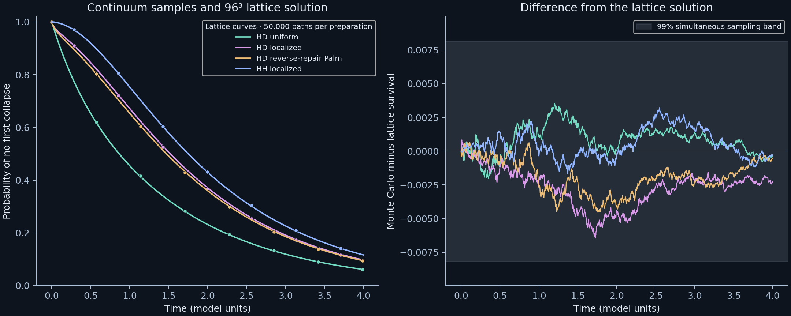

# What the spatial model teaches us, and the next research claim

Assessment recorded on 17 November 2026, before implementing paid autonomous spatial organization. This page distinguishes completed results from the proposed next experiment. [Spatial model and proofs](SPATIAL-REPAIR.html) · [Scientific dossier](SCIENTIFIC-DOSSIER.html)

## What we learned

Spatial preparation can substantially change survival even after count-model reaction rates have been calibrated. The comparator matches every uniform-start forward repair mean and preserves its reverse equilibrium ratio. It is not fitted to survival. For the selected HD launch with four initial fuel molecules, the maximum sampled localized gap is 23.208 percentage points. The independent continuous-space calculation gives a 99% simultaneous lower bound of 22.24 points against the fixed finest-grid-calibrated comparator. The uniform numerical gap is 1.340 points; its confidence lower bound does not establish a continuum gap above one point.

Position carries information absent from chemical counts. From identical HD counts and fuel \(b>0\),

\[
S_\mu''(0)=\eta\left(\frac32\eta+\kappa b\,\mathbb E_\mu g\right).
\]

Different expected initial contact activity produces different exact survival curvatures. One preparation-blind count model given the same chemical launch cannot reproduce both. This is an elementary consequence of the generator, not a claimed new lumpability theorem.

Proximity is not universally beneficial. In the reversible model it accelerates reverse repair as well. For an HH launch with waste \(w>0\),

\[
S_\mu''(0)=-\eta\left(2\eta+\frac{\kappa w}{2}\mathbb E_\mu g\right).
\]

Increasing contact activity worsens early survival in that launch through the reverse channel. These local derivatives do not establish a global ordering at every horizon.

## Does this establish a conceptually new principle?

No. The project now has a finite-inventory, first-collapse benchmark with explicit verification, but its publication priority is unestablished. The broader mechanism—spatial correlations and rebinding defeating rate-renormalized descriptions—is established. Takahashi, Tănase-Nicola and ten Wolde demonstrated consequential rebinding effects in biochemical signaling in 2010. [Primary paper](https://ir.amolf.nl/pub/5456/15114OA.pdf)

The model's evidence comprises 51 passing tests, four spatial grids, 200,000 formal continuous-space paths and another 200,000 fresh-seed review paths. It separates exact mathematical deductions, exact-arithmetic polynomial truncation bounds, observed mesh convergence and sampling confidence. It does not provide a rigorous continuum discretization-error enclosure or a biological calibration. [Formal receipt](../results/spatial-repair-verification.json) · [Fresh-seed receipt](../results/spatial-repair-review-check.json) · [Originality audit](../research/spatial-repair-originality-audit.md)

## Strongest next direction: paid autonomous organization

The localized preparation is supplied at launch. The current system neither creates that proximity nor decides whether maintaining it is worthwhile. The next question is:

> Can a system starting dispersed use its finite resources to assemble and release repair partnerships, and outperform the best fixed organization under the same resource and kinetic constraints?

Fuel-driven organization itself has substantial precedents; it is not a novelty claim. [Earlier work on chemical fuel consumption and self-assembly](https://www.nature.com/articles/s41565-018-0250-8)

### Gate 1: isolate the mechanism and audit the exact claim

Compare the closed finite-inventory case with an explicitly open chemostatted diagnostic. Determine whether depletion adds an effect beyond ordinary encounter memory. The current study has not established that it does. Search the exact proposed comparison across self-assembly, physical feedback, reliability and stochastic control, and compare the closest full-text equations and theorems before implementation.

### Gate 2: make organization endogenous and account for its costs

Introduce reversible binding and unbinding or an equivalent physically specified organization mechanism. Account for binding energies, construction materials, fuel, waste and all reverse reactions. Charge organizational operations and repair to the same inventory. Start from a dispersed preparation and include passive binding among the competitors. Localization does not inherently require continuous dissipation: equilibrium binding can localize particles. No automatic binding-versus-repair-access penalty should manufacture the conclusion.

### Gate 3: target a theorem or a decisive counterexample

For a precisely bounded fixed-design family, identical initial resources and all organizational costs included, seek

\[
S_{\rm autonomous\ organization}(T)
>\sup_{\theta\in\Theta_{\rm fixed}}S_{\rm fixed}(T;\theta).
\]

The scope of the supremum must be explicit. A search over a few fixed designs is insufficient. Ideally obtain an attaining construction and a regime where an advantage is impossible. Failure to find an advantage is a valid research outcome; parameters and comparators must not be selected merely to force a positive result.

The potentially substantive contribution is a sharp statement about **when creating organization pays for itself in survival**. Whether that exact statement is new requires a separate originality audit. Additional model complexity, numerical separation and general use of stochastic calculus cannot establish novelty by themselves.

## Status of the proposed work

At the time of this assessment, paid autonomous spatial organization is a proposed experiment. Its implementation and any resulting findings must have a separate report and receipts. This page preserves the reasoning that motivated that next step without retroactively presenting it as an established result.
