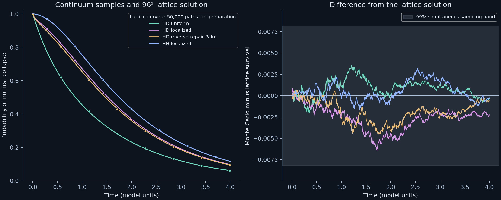

## 11. Correcting the novelty claim before extending the model

After Study 05, the user challenged whether the project had established any new concepts. The assessment was narrowed: intermediate binding optima, chemical persistence and fuel-supported maintenance have extensive precedents. A model-specific certificate and different numerical values do not establish a new general idea. The project adopted a claim-by-claim originality audit: state the proposed claim, inspect neighboring literature, compare actual equations and theorems, and try to derive away the claimed novelty before promoting it.

The user then proposed stochastic calculus. The concrete opportunity was to resolve molecular positions and encounter delays while retaining chemical jumps and finite fuel. A preliminary reflecting-sphere calculation showed why a long mean encounter time alone is inadequate evidence for a spatial correction. Its exact capture probability, 32.9294%, was almost the same as the matched-mean exponential prediction, 32.9276%. A localized launch instead gave 88.6561%. These were classical benchmark calculations with assumed target geometry, not a biological calibration. [Historical plan and calculation](STOCHASTIC-CALCULUS-PLAN.html)

## 12. Implementing and independently checking spatial maintenance

The user authorized a two-complex pilot, required the originality audit first, and requested parallel implementation and verification with durable receipts. The audit supported a targeted numerical extension without a novelty claim. Separate work covered the primary-literature audit, the model and solver, and independent reference calculations and Brownian paths. Integration retained the exact model boundary: two preassembled complexes, periodic relative position, reversible contact-gated repair, finite fuel/waste and fast-mixed small fuel molecules.

The thermodynamic gate required the same spatial activity in both directions of every repair pair. Full equilibrium was distinguished from survival killed at the first all-damaged state. The comparator was strengthened from one reference-rate calibration to a separate uniform-start forward mean for every fuel edge, with its reverse coefficient paired to preserve equilibrium. Both comparators are shown; neither was fitted to survival.

The implementation exploits exact signed-permutation symmetry of each periodic lattice, then compares four spatial refinements. An independent continuous-space path method uses exact Gaussian Brownian increments at dominating Poisson candidates, avoiding a Brownian timestep approximation. Tests separately assemble a labelled grid generator, a dense exponential, a spherical Doi benchmark, limiting cases and event ledgers.

From an HD/full-fuel launch, localized preparation gives a maximum sampled gap of 23.208 percentage points from the edge-calibrated count chain, compared with 1.340 points for uniform preparation. The two calibration choices give nearly the same localized discrepancy in this case. An exact second-derivative calculation explains why one count model that ignores preparation cannot reproduce both launches. These findings concern the selected model and parameter choice; they do not establish an unexplored general principle.

The final record contains 51 passing tests, four grids, 200,000 formal continuous-space paths and 200,000 additional fresh-seed paths. Numerical truncation bounds, observed spatial convergence and statistical confidence are explicitly separated. For localized HD, a 99% simultaneous lower bound on the maximum gap from the fixed calibrated comparator is 22.24 points. No rigorous continuum discretization enclosure is claimed. All 104 equations in the standalone report rendered on desktop and mobile; the publication rebuild records its own current browser checks.

The outcome gives a precise qualification to the original Tsimerman-inspired ambition: stronger mathematical tools reveal when a reduction discards operationally important information. They do not automatically supply a novel scientific concept, an enzyme mechanism or a bridge to biological life. The existing paper remains a Studies 01–05 draft; the spatial maintenance report is published separately.

[Complete spatial report](SPATIAL-REPAIR.html) · [Originality audit](../research/spatial-repair-originality-audit.md) · [Formal verification](../results/spatial-repair-verification.json) · [Fresh-seed review](../results/spatial-repair-review-check.json) · [Source and artifact integrity](../results/spatial-repair-integrity.json)
