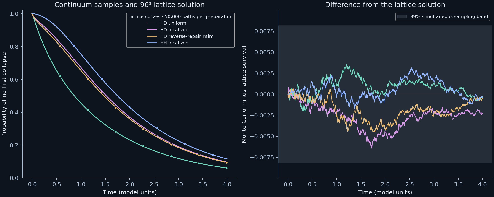

## Latest extension: two-complex spatial repair

The five studies below now have a spatial maintenance extension. Two preassembled point complexes diffuse in a periodic cube, change between healthy and damaged states, and perform reversible contact-gated repair using finite fuel and waste. Fuel is fast-mixed; the larger repair partners have resolved positions. This is maintenance, with no assembly channels or adaptive sensing controller.

**[Read the complete spatial model, proofs, figures and verification](SPATIAL-REPAIR.html).** The [original implementation plan](STOCHASTIC-CALCULUS-PLAN.html) records the preliminary calculation that motivated the comparison.

The count comparator matches each uniform-start forward repair mean while preserving its reverse equilibrium ratio. No survival curve is fitted. With one healthy and one damaged complex and four initial fuel molecules, the largest sampled survival gaps are:

| Spatial preparation | Maximum sampled gap from edge-calibrated count model |
|---|---:|
| Uniform | 1.340 percentage points |
| Localized | 23.208 percentage points |
| Gate-weighted, corresponding to a reverse-repair event position law | 21.354 percentage points |

At time four, localized spatial survival is 9.718%, compared with 5.606% for the count comparator. All parameters are exploratory dimensionless choices, not biological measurements.

The exact short-time argument explains why preparation information cannot generally be compressed into fixed count rates. From the same healthy/damaged counts and fuel count \(b>0\),

\[
S_\mu''(0)=\eta\left(\frac32\eta+\kappa b\,\mathbb E_\mu g\right).
\]

Different initial expected contact activity gives different survival curvature. One preparation-blind count model given the same chemical launch cannot reproduce both. This is an application of established generator methods, not a claimed new lumpability theorem.

**Verification:** 51 tests pass, including nine new structural and independent-reference checks. Four spatial refinements use 32, 48, 64 and 96 lattice points per axis; the largest final adjacent-grid curve change is 0.0000330 in absolute probability. Formal verification uses 200,000 continuous-space paths, with another 200,000 fresh-seed review paths retained separately. The formal 99% simultaneous sampling half-width is 0.008176. For localized HD, the confidence lower bound on the maximum gap from the fixed finest-grid-calibrated count curve is 22.24 percentage points. The uniform result does not establish a continuum gap above one point at that confidence level. Spatial refinement differences are not rigorous continuum error enclosures.

[Numerical data](../results/spatial-repair.json) · [Formal verification](../results/spatial-repair-verification.json) · [Fresh-seed check](../results/spatial-repair-review-check.json) · [Browser checks](../results/spatial-repair-ui-validation.json) · [Delivery integrity](../results/spatial-repair-integrity.json)

**Originality and barriers:** the audit examined 28 queries and retained 20 source records, including direct precedents for spatial detailed balance, calibrated reversible rates and rebinding. This is a finite-inventory first-collapse benchmark; no new general concept is established. It does not overcome the chemistry-to-biology barrier. Molecular realization, spatial self-assembly, heredity and experimental validation remain open. The study has not isolated fuel depletion as the cause of the gap. [Originality audit](../research/spatial-repair-originality-audit.md) · [Search and access-depth receipt](../research/spatial-repair-search-receipt.json)

The existing manuscript/PDF covers Studies 01–05. The spatial report is a separate extension and is not presented as part of that manuscript.
