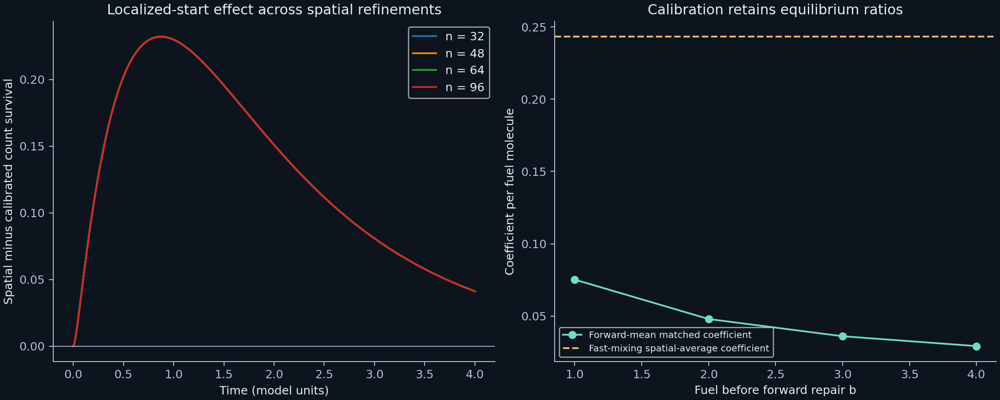
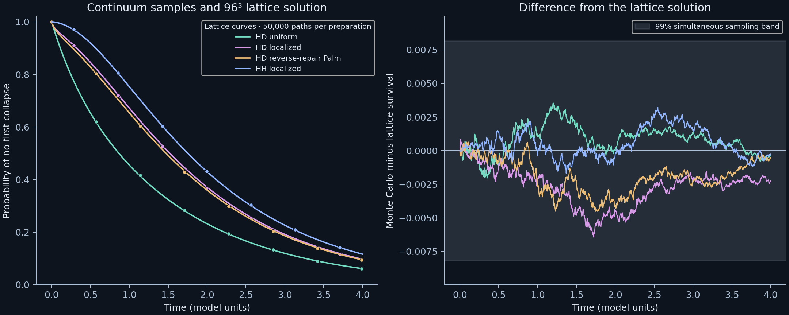

# Two diffusing complexes, finite fuel, and the limits of a calibrated count model

This study implements the maintenance-only spatial extension of Study 05. Two complexes already exist. Each can be healthy or damaged, and a healthy complex can help repair a damaged partner when they are near one another. Repair and its microscopic reverse exchange a finite stock of fuel and waste. Brownian motion changes their relative position. We compare functional survival from uniform, localized, and gate-weighted preparations with count models calibrated before examining survival. The gate-weighted position law is the equilibrium law at repair events, but some chemical launches are synthetic controls, as explained below.

The originality audit came first. It identified spatial detailed balance, diffusion-dependent rates, localization, and repeated encounters as established concepts. The present experiment is a reproducible, model-specific extension. Neither a new scientific concept nor a new general theorem is claimed. [Audit and equation-level comparisons](../research/spatial-repair-originality-audit.md) · [Search receipt](../research/spatial-repair-search-receipt.json)

## 1. Precise scope and physical assumptions

Two preassembled labelled complexes move independently in a periodic cube of side \(L\). Their relative displacement \(x=X_1-X_2\) belongs to the torus \(\mathbb T_L^3\) and obeys

\[
dx_t=\sqrt{2D}\,dW_t\pmod L,
\qquad D=D_1+D_2.
\]

Diffusivity is the same in every chemical state. The complexes are point particles without steric exclusion or an interaction potential. A contact gate changes reaction kinetics, not the mechanical energy. Fuel and waste are treated as fast-mixed small molecules, while the two larger repair partners have resolved positions. Thus this is a hybrid spatial model; resolving fuel diffusion would be a further model change.

There are \(N\) fuel-plus-waste molecules, \(b\) of them fuel and \(w=N-b\) waste. The gate is

\[
g(x)=\left(1-\frac{|x|_{\rm per}^2}{a^2}\right)_+^4,
\qquad 0<a<L/2,
\]

where \(|x|_{\rm per}\) is the minimum-image distance. It is bounded by one, is three times continuously differentiable, and has compact support away from the periodic seams. Its spatial average is exactly

\[
\langle g\rangle=2\pi(a/L)^3 B(3/2,5).
\]

The default parameters are explicit exploratory choices in model units, **not measured biological repair parameters**. In particular, this experiment is distinct from the dimensional GFP tracer calculation in the implementation plan.

@@PARAMETERS@@

## 2. Reversible chemistry and its energy ledger

Each labelled complex has a reversible damage reaction \(H\rightleftharpoons D\), with rates \(\eta\) and \(\eta/2\). For either choice of the damaged partner, the repair pair is

\[
(H_1,D_2,b)\mathrel{\mathop{\rightleftharpoons}^{\kappa b g(x)}_{\kappa(w+1)g(x)/4}}
(H_1,H_2,b-1).
\]

Both directions leave positions unchanged. The identical spatial gate in each direction is essential. When both complexes are healthy there are two reverse channels. Aggregating exchangeable labels gives the count \(h\in\{0,1,2\}\), with rates

\[
\begin{aligned}
(h,b)&\to(h-1,b) &&\eta h,\\
(h,b)&\to(h+1,b) &&\eta(2-h)/2,\\
(1,b)&\to(2,b-1) &&\kappa b g(x),\\
(2,b)&\to(1,b+1) &&\kappa(N-b)g(x)/2.
\end{aligned}
\]

Only feasible transitions are included. There is no assembly or dissociation in this subnetwork: both directions of those channels are absent from the outset.

In thermal units, choose

\[
\beta E(h,b)=b\log8-(2-h)\log2.
\]

Let \(M_D\) be net forward damage events and \(M_R\) net forward repair events. Every trajectory obeys

\[
\Delta h=-M_D+M_R,\qquad
\Delta b=-M_R,\qquad
\beta\Delta E=-M_D\log2-M_R\log4.
\]

These are exact event identities. Reverse repair regenerates fuel and recreates damage. Consequently, \(b\) is finite but is not required to decrease monotonically. The heat bath supplies thermal fluctuations; no external chemical reservoir replenishes the inventory. The bookkeeping is an idealized stochastic-thermodynamic model, not a molecular implementation of an enzyme.

### Proposition 1: invariant law and detailed balance

The **uncensored** process is reversible with uniform positions and chemical law

\[
\pi(h,b)=\binom2h (1/3)^h(2/3)^{2-h}
\binom Nb(1/9)^b(8/9)^{N-b}.
\]

Proof. The labelled unnormalized weight is \(2^{2-h}8^{-b}/[b!(N-b)!]\). Damage multiplies its ratio by two, giving the prescribed forward/reverse ratio. For a labelled repair edge, the target/source weight ratio is \(4b/(w+1)\), exactly the ratio of the two rates. Summing over labelled configurations with \(h\) healthy complexes produces the binomial multiplicity in \(\pi\). Brownian diffusion with constant \(D\) is reversible under uniform torus measure. Since each component has zero equilibrium flux, their generator sum is reversible under the product law. This is a direct application of established spatial detailed-balance theory. [Zhang and Isaacson](https://arxiv.org/html/2201.04099v3)

## 3. Survival is a first-passage event

Collapse occurs at the first time both complexes are damaged:

\[
\tau=\inf\{t:h_t=0\},\qquad
S_\mu(t)=\Pr_{\mu,h_0,b_0}(\tau>t).
\]

The full equilibrium process can subsequently recover from \(h=0\). The survival calculation stops there and permits no return. Equilibrium occupancy is therefore not survival probability.

For \(h=1,2\), the backward survival function solves

\[
\partial_t u=\mathcal L_{\rm kill}u,\qquad
u(0,x,h,b)=1,\qquad u(t,x,0,b)=0,
\]

with periodic spatial conditions. Here

\[
\mathcal Lf=D\Delta f+
\sum_{s'}q_x(s,s')[f(x,s')-f(x,s)].
\]

The coefficients are bounded and the chemical state space is finite. Brownian motion coupled to bounded Poisson reaction clocks therefore defines a nonexplosive process. Itô's formula plus compensated jump counts gives Dynkin's martingale and the backward equation. The maximum principle, or its probabilistic representation, gives \(0\le u\le1\). [Anderson and Kurtz](https://people.math.wisc.edu/~dfanderson/papers/SURVEY_AndKurtz.pdf)

### Three distinct spatial preparations

All comparisons retain the same initial chemical counts. Uniform preparation uses Lebesgue measure on the torus. Localized preparation has density proportional to \(\exp[-|x|_{\rm per}^2/(2\sigma^2)]\). The third preparation has density \(g(x)/\int g\). It is the equilibrium event-Palm position law of an enabled repair channel, because equilibrium positions are uniform and event intensity is proportional to \(g\).

The Palm preparation illustrates reaction-generated proximity. It is not claimed to represent every history-conditioned post-repair trajectory. For both \(HD\) and \(HH\) preparations the initial fuel is \(N\). A real reverse-repair event ending at \(HD,N\), or forward repair ending at \(HH,N\), may require a different pre-event fuel count; the reported position law is imposed independently of those chemical histories. In particular \(HH,N\) cannot be produced by a forward repair inside this fixed inventory. This distinction prevents an artificial preparation from being interpreted as an observed assembly trajectory.

## 4. Calibration before comparing survival

To calibrate forward repair at each available fuel count \(b\ge1\), clamp the chemistry at \(HD,b\), omit damage, and let Brownian motion run until a repair attempt fires with hazard \(\kappa b g(x)\). The mean \(m_b(x)\) solves

\[
(-D\Delta+\kappa b g)m_b=1
\]

periodically. Define

\[
c_b=\frac1{b\langle m_b\rangle}.
\]

The calibrated count chain uses forward rate \(b c_b\). The reverse partner on the **same fuel edge** uses \((w+1)c_b/4\) for each labelled orientation. This matches every uniform-start clamped forward mean and preserves every equilibrium rate ratio. It involves no fitting to survival curves and is more stringent than matching one reference fuel state.

A second comparator sets every \(c_b=c_N\), matching the initial full-fuel forward mean. We show it to expose calibration dependence. Neither comparator is asserted to match all waiting-time distributions or both forward and reverse mean encounter times. Such matching is generally incompatible with a single equilibrium-preserving multiplier.

### Proposition 2: why a matched mean can miss short-time survival

For a uniform stationary Brownian start, Jensen's inequality gives

\[
\Pr(\tau_b>t)=\mathbb E\exp\!\left[-\kappa b\int_0^tg(x_s)\,ds\right]
\ge e^{-\kappa b\langle g\rangle t}.
\]

Integrating over time yields \(c_b\le\kappa\langle g\rangle\). Fast diffusion averages the contact gate and leads to the count coefficient \(\kappa\langle g\rangle\); the finite-diffusion calibrated coefficient can be smaller.

For an initial \(HD,b\) and any spatial law \(\mu\), direct application of the killed generator twice gives

\[
S_\mu'(0)=-\eta,\qquad
S_\mu''(0)=\eta\left(\frac32\eta+\kappa b\mathbb E_\mu g\right).
\]

For the edge-calibrated count model, replace \(\kappa\mathbb E_\mu g\) by \(c_b\). Hence

\[
S_\mu(t)-S_{\rm count}(t)
=\frac{\eta b}{2}(\kappa\mathbb E_\mu g-c_b)t^2+o(t^2).
\]

Proof. The killed generator applied to the constant live payoff is \(-\eta\) in \(HD\) and zero in \(HH\). Applying it again in \(HD\) gives a contribution from collapse at rate \(\eta\), spontaneous recovery at rate \(\eta/2\), and paid repair at rate \(\kappa b g\). Spatial derivatives of the first generator image vanish because it is constant in position. This establishes the formula without diffusion approximation. The bounded, sufficiently regular gate justifies the semigroup expansion.

For the Palm law, \(\mathbb E_\mu g=\langle g^2\rangle/\langle g\rangle\). This explains why localization can affect early survival even after matching a uniform mean. It is a model-specific deduction using established generator and Jensen arguments, not a claimed new principle. It does not prove a sign for the difference at every later time.

**Corollary: one preparation-blind count model cannot reproduce both launches.** For two spatial laws \(\mu,\nu\) with different \(\mathbb E g\), the exact Brownian survival curves from the same \(HD,b\), \(b>0\), have different second derivatives. A count model given only the common initial chemical counts produces a single survival curve, so it cannot equal both. No choice of its fixed rate constants repairs that loss of preparation information. This is an elementary failure of a count-only reduction, not a new lumpability theorem. It follows analytically and does not rely on lattice convergence or Monte Carlo.

## 5. Deterministic solver and independent paths

The continuous model is approximated by a nearest-neighbor periodic lattice with spacing \(\ell=L/n\) and diffusion rate \(D/\ell^2\) to each of six neighbors. The finite-range gate is evaluated at lattice points; its physical radius stays fixed as the mesh is refined. This is a discretization of bounded-volume Doi killing, not a zero-range voxel reaction whose physical contact radius shrinks with the mesh.

Signed coordinate permutations leave the gate, payoff, and all three preparations invariant. The lattice chain can therefore be lumped exactly by sorting absolute coordinate indices. Orbit multiplicities provide uniform-volume weights. This symmetry reduction is exact for each finite lattice; the approximation is replacing continuum diffusion by that lattice.

The solver propagates the killed backward equation and solves the clamped calibration problem on the same lattice. Reversibility permits a symmetric representation. Numerical exponential evaluation and its truncation controls are checked separately from spatial refinement. Adjacent mesh differences are evidence of convergence, not rigorous continuum error enclosures.

### Exponential truncation bound

Let \(Q\) be the finite-grid killed backward generator and \(q=\max_i(-Q_{ii})\). Reversibility makes it self-adjoint in the equilibrium-weighted inner product, and Gershgorin bounds its spectrum in \([-2q,0]\). Thus \(B=I+Q/q\) has spectrum in \([-1,1]\), so every Chebyshev polynomial satisfies \(\|T_k(B)\|\le1\) in that norm. For \(s=qt\),

\[
e^{tQ}=e^{-s}\left[I_0(s)I+2\sum_{k\ge1}I_k(s)T_k(B)\right].
\]

The omitted scalar coefficients after degree \(K\) equal the probability that the absolute difference of two independent Poisson variables of mean \(s/2\) exceeds \(K\). Chernoff's inequality therefore bounds their sum by

\[
2\exp\left[s(\cosh\theta-1)-(K+1)\theta\right],
\qquad \theta=\operatorname{arsinh}((K+1)/s),\quad s>0.
\]

For a start concentrated at chemical state \(j\) with spatial weights \(\mu_i\), Cauchy–Schwarz converts this to an observable error by the factor

\[
C_j=\sqrt{\frac{\pi(\text{live})}{\pi(j)}
\sum_i\frac{\mu_i^2}{w_i}},
\]

where \(w_i\) are spatial orbit probabilities. The implementation chooses the degree so the product of this factor and the scalar tail bound is at most \(2\times10^{-14}\) for every reported start. This is an **exact-arithmetic polynomial-truncation bound**. Floating-point roundoff is checked against a separately assembled dense exponential on a small grid; it is not covered by this analytic tail bound.

An independent simulator instead generates continuous relative Brownian positions at candidate reaction times. In each chemical state a constant bound dominates the total reaction rate, because \(0\le g\le1\). Draw an exponential candidate time, advance position by a Gaussian increment with covariance \(2D\Delta t I\) modulo \(L\), and accept a channel using its actual rate at that position. Rejections retain the chemical state. Poisson thinning and the Markov property give the stated continuous jump-diffusion law, without a Brownian time grid. Pseudorandom sampling and floating-point arithmetic remain numerical operations; statistical uncertainty is reported explicitly.

## 6. Results and spatial refinement

@@RESULT_TABLE@@




@@REFINEMENT_TABLE@@

The sampled maximum curve gap is a lower bound on the time-continuous maximum for that numerical spatial grid. The instantaneous killing hazard is \(\eta\) in \(HD\) and zero in \(HH\). Thus each survival slope lies in \([-\eta,0]\), their difference is \(\eta\)-Lipschitz, and a time grid with maximum spacing \(\delta t\) gives the upper correction \(\eta\delta t/2\) when both endpoints are included. This time-interpolation bound does not bound spatial discretization error or floating-point propagation error.

## 7. Verification receipts and their scope

@@VERIFICATION@@



For \(M\) independent paths in each of \(J\) preparations, the Dvoretzky–Kiefer–Wolfowitz inequality with Massart's constant and a union bound give [Massart, 1990](https://doi.org/10.1214/aop/1176990746)

\[
\Pr\!\left(\max_{1\le j\le J}\sup_{0\le t\le4}
|\widehat S_j(t)-S_j(t)|>\epsilon\right)
\le2J e^{-2M\epsilon^2}.
\]

@@MC_BAND@@ This bounds the empirical survival error relative to the true continuous-path law on the observation horizon. Agreement of the lattice curve with the empirical band is a compatibility check, not a proof that the lattice error is zero. Pointwise Wilson intervals are also retained and have a different coverage interpretation.

The independent paths are a consistency check with confidence bounds, not a proof that every mesh value equals its continuum limit. Structural detailed balance and event identities are mathematical statements; unit tests exercise their implementation. Agreement across meshes and paths supports the selected numerical cases. It does not certify a continuum of parameter choices or establish experimental biological validity.

## 8. What we learn, and what remains open

This experiment asks a narrower question than whether diffusion matters in biology. Can a calibrated count model retain the functional survival prediction when molecular proximity is prepared differently and fuel is finite? The observable is first collapse; the compared chemistry, initial inventory, and equilibrium ratios remain explicit.

@@CONCLUSION@@

The model does not implement assembly, heredity, replication, endogenous sensing, or an adaptive controller. It does not overcome the chemistry-to-biology barrier. It supplies a tractable spatial maintenance test with an auditable thermodynamic construction. We have not isolated fuel depletion as the cause of the observed gap: that would require a separate matched chemostatted or inventory ablation. A future theorem about finite-resource spatial reliability would need a separate statement and originality audit.

## Reproduce and inspect

From the repository root, install the project with `python -m pip install -e .`. Then run:

```powershell
python -B scripts/run_spatial_repair.py
python -B scripts/verify_spatial_repair.py
python -B scripts/build_spatial_repair_docs.py
python -B scripts/check_spatial_repair_receipts.py --write-manifest
```

The documentation builder additionally requires `markdown` and Playwright with Chrome available. The numerical core uses NumPy and SciPy; figures use Matplotlib. After rebuilding and validating the study, `--write-manifest` seals the current deliverables. For a later integrity replay, run `python -B scripts/check_spatial_repair_receipts.py` without that flag. Hashes detect a stale result after code changes; they establish byte integrity, not mathematical correctness.

[Model source](../src/purposeful/spatial_repair.py) · [Experiment runner](../scripts/run_spatial_repair.py) · [Independent verification](../scripts/verify_spatial_repair.py) · [Unit tests](../tests/test_spatial_repair.py) · [Full numerical data](../results/spatial-repair.json) · [Verification receipt](../results/spatial-repair-verification.json)
