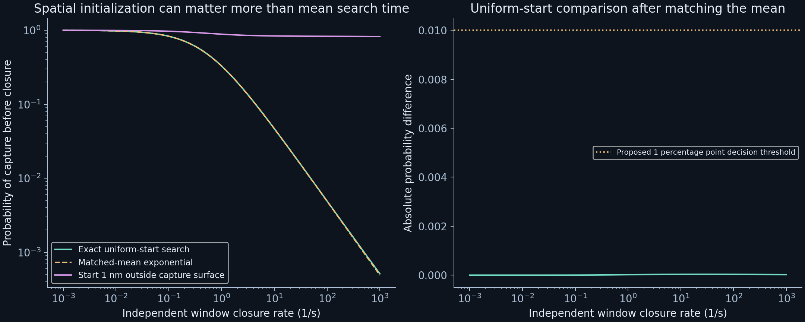
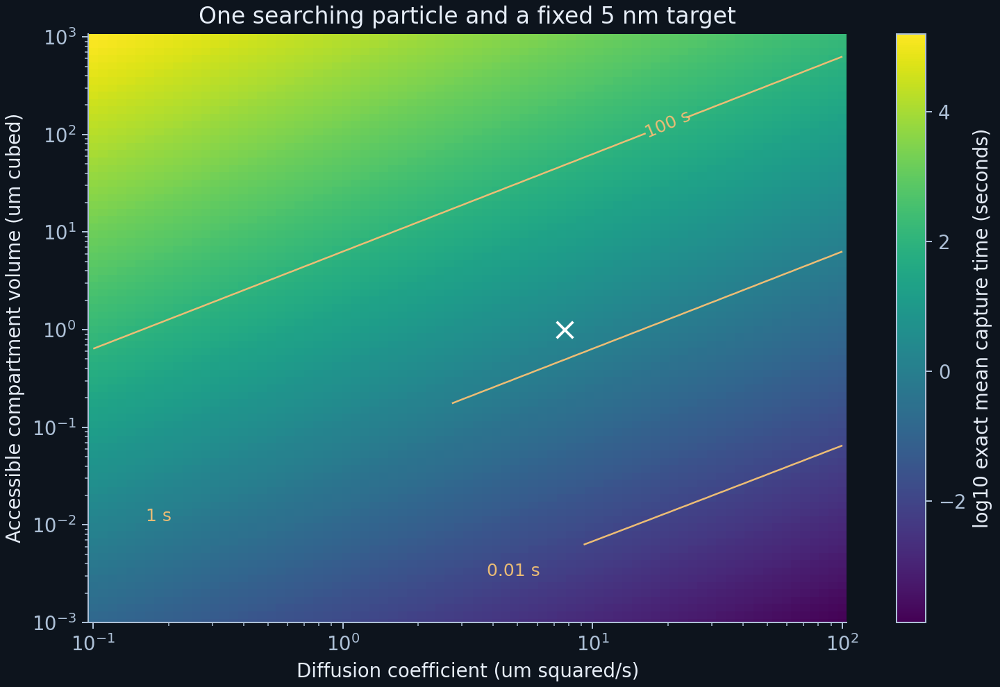

# Bringing stochastic calculus into finite-resource repair

*Historical planning document. The two-complex maintenance pilot is now implemented in the [spatial repair report](SPATIAL-REPAIR.html), with its own results and verification receipts. The proposed stages below retain the original plan's distinctions.*

The first implementation should measure when molecular positions change the prediction of functional survival after the chemical rates have been calibrated for diffusion. The current count model already has random reaction times. The additional state variables are particle positions and, in a later extension, molecular conformations. Fuel and molecule numbers continue to change through discrete reaction jumps.

This plan includes completed feasibility calculations and a tested analytical benchmark. The spatial chemical simulator, its detailed-balance construction, and any new theorem are proposed implementation stages. The new calculations reproduce classical diffusion-to-capture results. Their role is to choose the next experiment and expose assumptions before building a larger model.

## What the initial calculation says

Consider a mobile protein finding a fixed target with effective capture radius 5 nm inside an accessible volume of one cubic micrometre. Use diffusion coefficient 7.7 square micrometres per second as a measured tracer anchor. The exact mean search time in the spherical benchmark is **2.03696 seconds**. A free-diffusion crossing scale is **0.021645 seconds**. Repeatedly crossing the compartment can precede finding a small target.

For an independent observation window that closes at rate one per second, the exact probability of capture before closure is **0.32929410**. A count-model exponential waiting time calibrated to the same mean gives **0.32927628**. Their absolute difference is about **0.00001783**, or **0.001783 percentage points**. A long encounter time alone therefore supplies insufficient evidence that spatial resolution will change this observable appreciably.

Starting the same particle 1 nm outside the capture surface instead gives probability **0.88656113**. This is a deliberately localized preparation. It identifies initial separation and repeated near-contact encounters as concrete variables to test. These classical spatial effects have established precedents. The finite-resource feedback question would need a separate originality audit.



## Parameter provenance and units

| Input | Value or range | Status and interpretation |
|---|---|---|
| Protein diffusion coefficient | Reference \(D=7.7\ \mu\mathrm m^2/\mathrm s\) | Elowitz et al. measured apparent GFP diffusion \(7.7\pm2.5\) in *E. coli*. This is a mobility anchor, with no calibration to our abstract repair catalyst. |
| Capture radius | Reference \(a=0.005\ \mu\mathrm m\), sensitivity 2–10 nm | Assumed effective capture scale. A molecular realization must determine orientation and steric accessibility. |
| Accessible volume | \(10^{-3},10^{-2},1,10^3\ \mu\mathrm m^3\) | Assumed sensitivity cases. Larger values hold the number of searching particles fixed and hence dilute them. |
| Window closure rate | Reference \(\gamma=1\ \mathrm s^{-1}\), sensitivity \(10^{-3}\)–\(10^3\) | Assumed independent competing-event clock. It is a benchmark observation rule. |
| Target motion | Fixed for the exact spherical calculation | For a dilute, unbounded pair of independently moving particles, use \(D_{\rm rel}=D_H+D_D\) in the Smoluchowski estimate. Two mobile particles in a bounded cell require their joint geometry. |
| Surface reactivity | Example \(\kappa=10,1000\ \mu\mathrm m/\mathrm s\) | Assumed Robin-boundary sensitivities. These are not measured catalytic rate constants. |
| Initial positions | Uniform volume or fixed radial separation | An experimental preparation variable that count-only models discard. |

The GFP measurement and its fusion-protein comparison illustrate that mobility depends on molecule and environment. Its uncertainty is not an uncertainty interval for our unbuilt catalyst. The search-radius and damage assumptions require calibration against a chosen chemical system. [Elowitz et al., 1999](https://doi.org/10.1128/JB.181.1.197-203.1999)

The existing Study 05 time unit has \(\eta=1\) by convention. It has no experimentally established conversion to seconds. The dimensional calculation above is a separate feasibility scenario. Likewise, four fuel molecules are a deliberate small-inventory preparation. Selecting an ATP-based or other chemical realization requires measured fuel concentrations and an explicit reaction mechanism.

## Back-of-the-envelope calculation

For a perfectly reactive target in three dimensions, the dilute diffusion-limited rate constant is

\[
k_D=4\pi D_{\rm rel}a.
\]

Its dimensions are volume per time. For one searcher and one target in volume \(V\), the small-target mean-search estimate is \(V/k_D\). For an approximate well-mixed population of \(n\) independent searchers, the corresponding event-rate estimate is \(nk_D/V\). Exact first-arrival statistics for multiple walkers require their joint survival law, and cannot generally be inferred by dividing every first-passage time by \(n\).

At \(D=7.7,a=0.005,V=1\) in micrometre–second units,

\[
k_D=0.48380527\ \mu\mathrm m^3/\mathrm s,
\qquad V/k_D=2.06694731\ \mathrm s.
\]

The molar rate is about \(2.91\times10^8\ \mathrm M^{-1}\mathrm s^{-1}\), using \(1\ \mu\mathrm m^3=10^{-15}\) litres. One molecule in this volume corresponds to about 1.66054 nM. These are perfect-capture upper-rate estimates. Chemical conversion and orientation can lower an effective association rate.

The free-diffusion crossing scale for \(\ell=V^{1/3}=1\ \mu\mathrm m\) is

\[
t_{\rm cross}=\ell^2/(6D)=0.0216450\ \mathrm s.
\]

This root-mean-square displacement scale is a diagnostic, rather than a mixing-time theorem or mean target-search time. The dimensionless race parameter \(\gamma V/k_D\) is about 2.07 at \(\gamma=1\), indicating that capture and window closure compete. It does not by itself diagnose failure of a calibrated well-mixed description. [Smoluchowski and Collins–Kimball formulas in a primary theoretical study](https://pmc.ncbi.nlm.nih.gov/articles/PMC3945090/)

## An exact stochastic-calculus benchmark

Let a point particle diffuse outside a central target of radius \(a\), inside a reflecting sphere of radius \(R\). The accessible volume is \(V=4\pi(R^3-a^3)/3\). Before capture, its radial coordinate satisfies

\[
d\rho_t=\frac{2D}{\rho_t}\,dt+\sqrt{2D}\,dW_t-dL_t^R,
\qquad a<\rho_t\le R,
\]

where \(L_t^R\) is the upper-boundary reflection regulator, increasing only at \(R\). The process stops at \(\tau_a=\inf\{t:\rho_t=a\}\). The drift \(2D/\rho\) is the radial Itô term for three-dimensional Brownian motion. It is required even in the absence of a physical force.

### Mean first-passage time

Dynkin's formula gives the backward equation

\[
D\left(T''+\frac2rT'\right)=-1,
\qquad T(a)=0,\quad T'(R)=0.
\]

Integrating yields

\[
T(r)=\frac{R^3(1/a-1/r)-(r^2-a^2)/2}{3D}.
\]

The process \(T(\rho_{t\wedge\tau_a})+(t\wedge\tau_a)\) is a martingale. The reflecting contribution vanishes because \(T'(R)=0\). Taking expectations and then the first-passage limit gives \(T(r)=\mathbb E_r\tau_a\).

A uniform initial point has radial density \(4\pi r^2/V\). Its mean is

\[
\overline T=
\frac{(R-a)^2(5R^3+6R^2a+3Ra^2+a^3)}
{15Da(R^2+Ra+a^2)}.
\]

This stable factored expression agrees with direct quadrature of \(T(r)\). Its small-target limit recovers \(V/(4\pi Da)\), with a finite-volume correction. This gives an explicit connection between the Brownian model and the approximate count propensity.

### Capture before a competing event

Let an independent exponential clock of rate \(\gamma\) close the observation window. The relevant probability is a Laplace transform,

\[
q(r)=\Pr_r(\tau_a<\zeta)=\mathbb E_r e^{-\gamma\tau_a}.
\]

Itô's formula applied to \(e^{-\gamma t}q(\rho_t)\), stopped at capture, gives

\[
D\left(q''+\frac2r q'\right)-\gamma q=0,
\qquad q(a)=1,\quad q'(R)=0.
\]

For \(k=\sqrt{\gamma/D}\), define

\[
v(r)=\cosh[k(R-r)]-\frac{\sinh[k(R-r)]}{kR},
\qquad q(r)=\frac{a\,v(r)}{r\,v(a)}.
\]

At \(\gamma=0\), use \(q=1\). The calculator uses equivalent scaled exponentials and a small-argument series to avoid cancellation and overflow. An independent boundary-value solver checks the formula at \(\gamma=0.01,1,100\), including the volume average.

The comparison \(1/(1+\gamma\overline T)\) assumes an exponential waiting-time distribution with the same mean. It is an approximation, distinct from the exact transform \(\mathbb E e^{-\gamma\tau_a}\). The checked small-\(\gamma\) limit is \((1-\overline q)/\gamma\to\overline T\).

### Imperfect chemistry at contact

For surface reactivity \(\kappa\), the reflecting-shell mean reaction time has the exact additional term

\[
\overline T_\kappa=\overline T+\frac{V}{4\pi a^2\kappa}.
\]

This follows from \(DT'(a)=\kappa T(a)\) and the same derivative solution. At the reference geometry, the examples \(\kappa=1000\) and \(10\) give means about **5.22006 s** and **320.347 s**, respectively. Unknown chemistry can dominate the physical uncertainty. In the dilute infinite-domain approximation,

\[
\frac1{k_{\rm eff}}=\frac1{4\pi Da}+\frac1{4\pi a^2\kappa}.
\]

Reversible association requires a corresponding treatment of effective dissociation and rebinding to preserve the equilibrium constant. Changing only the forward effective rate would generally alter the thermodynamics. [Primary reversible-receptor treatment](https://doi.org/10.1063/1.4816105)



## The implementation sequence

### Stage 0 — Fix the research claim and comparison

Write the proposed claim before building a spatial chemical simulator. The first question is whether initial localization and reaction-induced spatial correlations change finite-fuel persistence after matching the equilibrium constants and the diffusion-calibrated count rates.

Define the observable \(S_{\rm spatial}(t)\), its count approximation \(S_{\rm count}(t)\), identical failure criteria, the admissible initial spatial laws, and an error quantity

\[
\Delta_T=\sup_{0\le t\le T}|S_{\rm spatial}(t)-S_{\rm count}(t)|.
\]

A proposed experimental decision threshold is 0.01 absolute probability. It is a practical screening choice. It supplies no universal definition of scientific significance. Compare fixed-count and fixed-concentration volume sweeps separately. A concentration change already alters a count propensity through dilution.

**Deliverable and verification.** A claim-comparison table links the closest full-text theorems to each proposed claim. Any remaining gap must survive an attempt to derive it from existing results. Current novelty status is unresolved. The literature receipt records the limited comparisons completed in this planning pass. [Prior-work audit](../research/stochastic-calculus-prior-art.md)

### Stage 1 — Validate a search calculation before chemistry

This stage is completed in the accompanying calculator. It evaluates mean capture times, capture-before-closure probabilities, imperfect-contact sensitivities, and localized preparations. The exact target geometry remains a single fixed central target. A two-mobile-particle model would use a different bounded-domain state space.

**Files.** [Analytical module](../src/purposeful/encounter.py), [independent tests](../tests/test_encounter.py), [data and figure builder](../scripts/build_stochastic_plan.py).

**Acceptance checks.** Mean-time formula agrees with independent quadrature to 12 decimal places in the reference case. Laplace probabilities agree with a separately discretized boundary-value solution within \(2\times10^{-8}\) at the tested rates. Scaling \(V\to8V,a\to2a\) multiplies the mean by four at fixed \(D\). The small-rate limit, zero-rate boundary, and invalid inputs are tested. These checks reproduce known mathematics and provide a benchmark for a future simulator.

### Stage 2 — Add spatial repair in a controlled subnetwork

Start with two already assembled, labelled complexes. Each is in state \(H\) or \(D\), and each has a Brownian position in a periodic cube. Keep the finite fuel/waste count. This is a maintenance-only subnetwork with assembly channels absent in both directions. It isolates spatial repair without introducing association placement or a new assembly mechanism.

The continuous part is \(dX_i=\sqrt{2D_i}\,dW_i\), with periodic positions. Local repair is allowed through a finite-range activity \(g(|X_1-X_2|)\), applied to both directions of the same labelled reaction pair. For a channel

\[
(H_1,D_2,b)\rightleftharpoons(H_1,H_2,b-1),
\]

choose rates proportional to \(g(r)b\) and \(g(r)(w+1)/4\), respectively. Their ratio is \(4b/(w+1)\), matching the same species-energy difference and fuel-count entropy. The other labelled orientation supplies the second reverse channel. Marginalizing labels recovers the \(h(h-1)\) convention in Study 05. Diffusion is reversible under uniform positions when the particles have no interaction potential.

Thus spatial gating can preserve pointwise detailed balance in this maintenance-only pilot. Calibration must still distinguish intrinsic contact activity from the diffusion-renormalized rate. Multiplying a contact activity to match its spatial average recovers the count rate only in the appropriate fast-mixing limit. Repeated encounters at finite diffusion require validation.

For a homogeneous periodic cube, relative position reduces the two translational coordinates to three dimensions, with diffusivity \(D_1+D_2\). This reduction avoids a six-dimensional position grid. The radial fixed-target case remains the separate analytical validation geometry. Product placement and reflecting-wall corrections enter at Stage 3.

**New files when implemented.** `src/purposeful/spatial_repair.py`, `scripts/run_spatial_repair.py`, `tests/test_spatial_repair.py`, and a source-hashed result receipt.

**Acceptance checks.** Verify every jump's inventory and energy changes, the invariant law of the full uncensored process, and zero equilibrium currents. Compare a radial special case with Stage 1. Compare the fast-diffusion limit with the corresponding restricted count generator. Measure \(\Delta_T\) for uniform, localized, and reaction-generated preparations. A spatial effect should survive refinement and a matched-rate comparison before advancing.

The finite-particle generator becomes

\[
\mathcal L f=\sum_iD_i\Delta_{X_i}f
+\sum_\rho a_\rho(X,s)[f(X,s+\nu_\rho)-f(X,s)].
\]

Itô's formula for the Brownian coordinates and compensated reaction-counting processes makes
\(f(X_t,s_t)-f(X_0,s_0)-\int_0^t\mathcal L f\,du\) a martingale. This is the concrete stochastic-calculus object used for stopping-time probabilities, sensitivity calculations, and bounds across allowed rate choices. [Jump-process formulation](https://people.math.wisc.edu/~dfanderson/papers/SURVEY_AndKurtz.pdf)

### Stage 3 — Restore self-assembly with explicit microscopic reverses

Spatialize association and dissociation only after selecting reactant and product placement kernels. Free \(P,Q\) and bound complexes have different particle numbers. The spatial reverse must restore monomer positions with the correct equilibrium probability density. Near reflecting walls, simple placement rules can violate detailed balance. Zhang and Isaacson derive the relevant constraints for reversible particle models. [Full-text formulation](https://arxiv.org/html/2201.04099v3)

The present effective termolecular channels \(P+Q+F\) and \(H+D+F\) require a chosen treatment. One option is a fast, well-mixed small-fuel approximation while resolving the larger partners. Another is an explicit reversible intermediate mechanism. The first requires a timescale justification. The second requires new intermediate energies and a controlled reduction to the old count model. Both need their own assumptions and validation.

Volume dependence must be explicit. With \(v=V/V_0\), a consistent ideal-mixture extension of the present count model scales assembly forward propensity as \(a m^2b/v^2\) and its reverse as \(azhw/(8v)\). Both repair propensities scale as \(v^{-2}\). The equilibrium count weight acquires a factor \(v^{-(h+d)}\), up to a conserved constant, because association reduces the number of independently translating particles by one. This matches the scaled assembly-rate ratio. Changing volume while holding every original numerical propensity fixed would represent a different chemical model.

**Acceptance checks.** Verify spatial detailed balance including placement densities, recover the correct volume-dependent count law in a justified limit, preserve the original net resource identity, and repeat the same formation-and-maintenance event definitions. A future spatial result must identify whether it arises from fuel depletion, geometry, initialization, or repeated binding.

### Stage 4 — Seek a theorem after the physical comparison passes

Possible mathematical targets are a controlled error estimate for the calibrated count approximation, a bound on finite-fuel persistence that retains spatial information, or a sharp description of how reaction-generated correlations alter the failure-time distribution. Choose one only after the prior-work comparison identifies a substantive unresolved statement.

For example, a nonnegative test function \(F\), zero at the specified failure set and at least one on functional states, could satisfy \(\mathcal LF\le-cF\), with \(c>0\), for an allowed device class. Here the generator is that of the process killed on first failure. Require nonexplosion and sufficient regularity and integrability for the stopped Dynkin formula; for reflecting diffusion, require the corresponding zero-normal-derivative boundary condition. The stopped supermartingale then gives \(\Pr(\tau>t)\le F(X_0,s_0)e^{-ct}\). Deriving a useful uniform inequality and an attaining construction is the research task. The martingale implication itself is established. Recent stopped-CRN work must be compared before claiming originality. [Li and Chou, 2026 preprint](https://arxiv.org/abs/2601.12854)

## Numerical method and computational cost

The exact benchmark uses ordinary quadrature and a separate boundary-value solver. Future spatial paths should use an event-driven or first-passage method where possible. A Brownian displacement comparable to a 5 nm target occurs on scale \(a^2/(6D)\approx5.41\times10^{-7}\) seconds. A naive fixed-step path over seconds can therefore require millions of steps, and accurate contact detection demands a stricter criterion. Its cost must be estimated before requesting tens of thousands of trajectories.

Protective-domain first-passage algorithms are an established option. A prototype lattice CTMC is also possible, but its reaction rates need mesh-dependent calibration. Shrinking a conventional reaction-diffusion voxel indefinitely does not automatically converge to the intended microscopic chemistry. [First-passage kinetic Monte Carlo](https://doi.org/10.1103/PhysRevE.80.066701), [validity conditions and voxel limits](https://doi.org/10.1063/1.4863990)

For a discretized pilot, use at least three refinement levels, measure both timestep or grid bias and sampling uncertainty, and compare the equilibrium law as well as first-passage probabilities. Seeded simulations alone cannot certify an unseen continuum parameter range. A claimed bound needs an analytic comparison or validated numerical enclosure.

## Deliverables, sequence, and stopping criteria

| Stage | Output | Status in this planning package | Criterion to advance |
|---|---|---|---|
| 0 | Precise question and prior-art comparison | Question formulated, closest methodological sources identified, substantive theorem audit pending | A defensible gap or an explicit reproduction objective |
| 1 | Calculator, dimensional table, exact benchmark, figures and tests | Completed and checked | Decide which preparations and rate regimes justify a spatial pilot |
| 2 | Two-complex spatial maintenance pilot | Specified for implementation | Matched-rate spatial effect or quantified validity of the count approximation |
| 3 | Spatial self-assembly and finite-fuel chemistry | Mechanism and placement choices specified as dependencies | Thermodynamic consistency and recovery of the intended count limit |
| 4 | General theorem or decisive counterexample | Candidate targets only | Direct prior-work comparison and complete proof |
| Publication | Updated study, paper and journey | Plan documented separately from established Study 05 results | Add scientific claims only after their evidence is complete |

The recommended next executable experiment is Stage 2 with uniform versus localized preparations, preceded by the Stage 0 comparison. Its outcome can justify continued spatial modeling or show that calibrated count dynamics already captures the observable. Both outcomes address the research question.

Planning estimates are one focused session for the Stage 0 full-text comparison, one or more sessions for the first validated Stage 2 pilot, and further work determined by the intermediate mechanism needed in Stage 3. These are effort estimates. A new general theorem has an uncertain research timescale.

## Evidence and reproduction

Run the calculator, figures, plan renderer, and all tests with:

```powershell
python -B scripts/build_stochastic_plan.py
```

The resulting JSON records dimensional assumptions, all numerical cases, source hashes, and probability curves. A separate receipt retains the current full-suite test output, including four encounter checks. The plan has its own status and does not alter the existing certified chemical benchmark.

[Calculation data](../results/encounter-feasibility.json) · [Verification receipt](../results/encounter-verification.json) · [Source and access-depth audit](../research/stochastic-calculus-prior-art.md)
